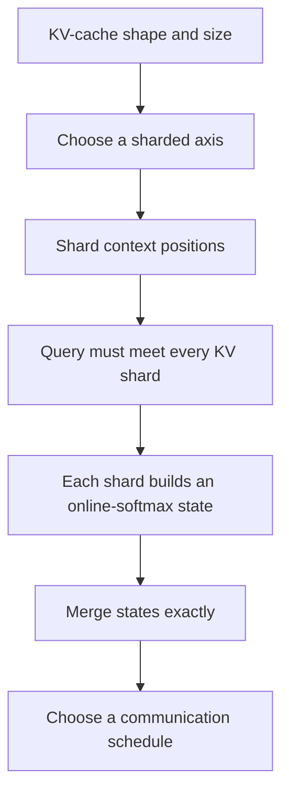

# KV-Cache Sharding for LLM Inference

[← Model parallelism notes](llm-inference-parallelism.md) · [Technique index](inference-techniques.md)

## Goal

Understand how several GPUs can share one request's KV cache while preserving exact attention.

By the end of this lesson, you should be able to:

- calculate KV-cache memory,
- distinguish batch, head, and context sharding,
- explain where KV-head sharding stops scaling,
- distinguish context parallelism from Ring Attention,
- derive the pass-query decode algorithm,
- merge position-sharded attention exactly,
- and map the algorithm onto concrete collectives.

## Dependency map

The key separation throughout the lesson is:

1. **Placement:** where do Q, K, and V live?
2. **Mathematics:** what local result preserves exact attention?
3. **Communication:** how do the required values move?

Do not infer one of these from the others.

### Scenario-labeling convention

Every example should state:

- the phase: prefill or decode,
- the number of requests and new query positions,
- the sharded axes and rank ownership,
- whether queries or outputs are replicated or sharded,
- whether the design is a realistic candidate, a comparison baseline, or only a toy mathematical example,
- and which costs the example includes or omits.

If any of these are missing, do not silently assume them. The conclusion may only hold for a narrower scenario.

---

## 1. KV-cache foundation

During autoregressive generation, the model produces one new token at a time. At decode step $t$, it forms a new query $q_t$, key $k_t$, and value $v_t$.

Earlier keys and values do not change. The KV cache stores them so they do not have to be recomputed at every step. The current query attends to all visible cached positions, including the current position once its K/V is included.

> One query needs information from every visible K/V position.

That fact determines what must communicate when different GPUs own different positions.

### 1.1 Shape and memory

For one layer, write the shape of K or V as

$$
[B,S,H_{kv},d],
$$

where:

- $B$ is the number of requests,
- $S$ is the number of cached positions,
- $H_{kv}$ is the number of KV heads,
- $d$ is the head dimension.

If each element occupies $s$ bytes, K and V together require

$$
M_{\text{layer}}=2BSH_{kv}ds.
$$

For $L$ layers,

$$
M_{\text{cache}}=2LBSH_{kv}ds.
$$

#### Example

For

$$
B=1,\quad S=8192,\quad H_{kv}=8,\quad d=128,\quad s=2,
$$

one layer uses

$$
2\cdot1\cdot8192\cdot8\cdot128\cdot2
=32\,\mathrm{MiB}.
$$

Across $80$ layers, one request uses about $2.5\,\mathrm{GiB}$.

The cache is both:

- a **capacity cost**, because it must remain resident,
- and a **bandwidth cost**, because decode repeatedly reads it.

---

## 2. Which axis are we sharding?

Different cache layouts solve different problems.

| Layout                    | Split axis | What one rank owns                 | Main benefit                     | Main limit or cost             |
| ------------------------- | ---------: | ---------------------------------- | -------------------------------- | ------------------------------ |
| Batch sharding            |        $B$ | Complete cache for some requests   | Scales independent requests      | Cannot split one long request  |
| KV-head sharding          |   $H_{kv}$ | Complete history for some KV heads | Attention remains local per head | Stops at the KV-head count     |
| Position/context sharding |        $S$ | Part of each head's history        | Splits one long request          | Requires distributed attention |
| KV replication            |       None | A copied KV head/history           | Simplifies local attention       | Duplicates memory and reads    |

Systems can combine these axes on a multidimensional device mesh.

### 2.1 Why KV-head sharding eventually stops helping

Attention heads are independent until the output projection. A rank can therefore own complete histories for a subset of heads and compute those heads locally.

But whole-head sharding creates at most $H_{kv}$ distinct cache pieces:

- **MHA:** each query head has its own KV head.
- **GQA:** several query heads share one KV head.
- **MQA:** all query heads share one KV head.

With MQA, $H_{kv}=1$. Head sharding cannot divide that one head's long position history across many ranks. Position sharding can.

---

## 3. Context parallelism is not Ring Attention

Suppose ranks own different $S$-axis shards of one request's cache.

This is best called **context-parallel attention** when those ranks jointly compute attention for the request.

A storage-only distinction matters:

- If ranks process their local position shards and combine an exact result, the computation is context parallel.
- If ranks merely store KV pages and copy them to one GPU before attention, only the storage is distributed. Calling that context parallelism is framework-dependent.

The term **sequence parallelism** is overloaded. In Megatron, it often refers to sequence-sharded non-attention activations inside a tensor-parallel region. Other systems use it for distributed attention. The explicit description is safer:

> K/V is sharded along $S$, and the ranks jointly compute exact attention.

### 3.1 Ring Attention is one schedule

Ring Attention normally keeps query blocks at their owners while K/V blocks circulate around a logical ring. Each query owner updates an online-softmax state as the blocks arrive.

It is one implementation of context parallelism, not the definition. Other exact schedules include:

- gathering K/V before local attention,
- transposing sequence shards into head shards with all-to-all,
- sending queries to stationary K/V owners and reducing partial states,
- tree or hierarchical variants.

A ring-shaped reduction of compact partial states is not automatically **Ring Attention**. The named algorithm centers on blockwise distributed attention with attention operands—especially K/V blocks—circulating around the ring.

---

## 4. Pass-query decode: derive the data movement

This lesson now focuses on one inference design:

- K/V position shards remain stationary,
- the new decode query becomes available at every relevant cache owner,
- each owner computes a local attention state,
- those states are merged exactly.

### 4.1 Why every cache owner needs the query

For one query and one head,

$$
y=\operatorname{softmax}\!\left(\frac{qK^\top}{\sqrt d}\right)V.
$$

Split positions across $P$ ranks:

$$
K=
\begin{bmatrix}
K_0\\K_1\\\vdots\\K_{P-1}
\end{bmatrix},
\qquad
V=
\begin{bmatrix}
V_0\\V_1\\\vdots\\V_{P-1}
\end{bmatrix}.
$$

Then

$$
qK^\top=
\begin{bmatrix}
qK_0^\top & qK_1^\top & \cdots & qK_{P-1}^\top
\end{bmatrix}.
$$

Rank $r$ cannot compute $qK_r^\top$ unless it has $q$. Because this design keeps the large K/V history stationary, the small query must meet every relevant K/V shard.

This is a **layout requirement**, not necessarily a new broadcast:

- if $q$ is already replicated, no query collective is needed;
- if one rank owns $q$, it can broadcast it;
- if ranks own different required query pieces, they can all-gather them;
- a topology-aware system can use a hierarchical distribution.

### 4.2 Why decode favors moving the query

For one request and one new token, the rough element counts are

$$
\text{query}=H_qd,
$$

versus

$$
\text{K/V cache}=2SH_{kv}d.
$$

At long context, $S$ is large. Sending the new query is usually much cheaper than moving the complete cache every decode step.

Once rank $r$ has $q$, it computes local scores

$$
s_r=\frac{qK_r^\top}{\sqrt d}.
$$

The remaining problem is softmax: every position contributes to one global denominator.

### 4.3 Where does the new decode K/V entry go?

**Scenario:** one request, one newly decoded position $t$, $P$ context-parallel ranks, and K/V sharded only by position. Head and batch sharding are omitted here.

The system defines a persistent owner function

$$
r_t=\operatorname{owner}(t).
$$

Only rank $r_t$ stores the new $k_t,v_t$ as the primary persistent cache entry. The other context ranks do not add replicas of that position.

The cache grows by one logical K/V position per layer on every decode step:

$$
S\longrightarrow S+1.
$$

With balanced ownership, each rank receives roughly one out of every $P$ new positions over time. The number of ranks and the replication factor do not grow with the decoded length.

#### The current position must contribute exactly once

At decode position $t$, $q_t$ must attend to positions $0$ through $t$, including its own $k_t,v_t$.

A system can implement this in either order:

1. write $k_t,v_t$ to rank $r_t$, then run distributed attention; or
2. give the current K/V directly to the attention kernel, include it once, and persist it afterward.

These schedules have the same meaning. Exactly one shard must contribute the current position to the global online-softmax merge. If every context rank treated a transient copy as a real cache position, the current token would be counted $P$ times and attention would be wrong.

#### How does the new K/V reach its owner?

That depends on the QKV projection layout:

- If Q/K/V projection outputs are replicated across the context ranks, all ranks may temporarily hold $k_t,v_t$. Only $r_t$ persists them; the others discard the temporary copies.
- If one rank initially owns the new K/V, it sends them to $r_t$ when that is a different rank.
- On a multidimensional context-by-head mesh, each head slice is routed to the rank that owns both position $t$ and that KV-head shard.

A temporary copy created by the preceding operation is not a persistent cache replica.

#### Example ownership policies

The owner function is an implementation choice.

**Token-cyclic example:**

$$
\operatorname{owner}(t)=t\bmod P.
$$

With four ranks, successive positions go to ranks

$$
0,1,2,3,0,1,2,3,\ldots
$$

This balances every few tokens but scatters adjacent positions.

**Paged block-cyclic example:** for cache-page size $G$ positions,

$$
\operatorname{owner}(t)
=
\left\lfloor\frac{t}{G}\right\rfloor\bmod P.
$$

A rank owns a complete page of $G$ adjacent positions; ownership rotates when the page fills. This preserves local blocks while balancing growth over many pages.

A system may instead use contiguous ranges or migrate/rebalance pages. Those choices trade layout simplicity, balance, and movement cost. There is no universal owner function.

#### Replication can still exist for a separate reason

Tensor-parallel GQA/MQA layouts sometimes intentionally replicate a KV head across a fixed set of ranks. In that case, every new position is written once per required replica group. That replication factor comes from the head/tensor layout; it does not increase by one replica on every decode step.

---

## 5. Exact attention over position shards

### 5.1 Why local softmax outputs cannot be summed

Attention is

$$
y=
\frac{\sum_j e^{s_j}v_j}
     {\sum_j e^{s_j}}.
$$

Suppose two one-position shards hold

$$
(s_0,v_0)=(0,0),
\qquad
(s_1,v_1)=(\ln3,8).
$$

The global result is

$$
y=
\frac{e^0\cdot0+e^{\ln3}\cdot8}
     {e^0+e^{\ln3}}
=6.
$$

A one-element local softmax gives each local position weight $1$. The local outputs are therefore $0$ and $8$:

- summing gives $8$,
- averaging gives $4$,
- exact attention gives $6$.

Each local softmax used a different denominator. Once a rank discards that denominator, its normalized output no longer records how much global probability mass its shard deserves.

### 5.2 The state each shard must preserve

For local scores $s_{r,j}$, rank $r$ computes

$$
m_r=\max_j s_{r,j},
$$

$$
\ell_r=\sum_j e^{s_{r,j}-m_r},
$$

$$
n_r=\sum_j e^{s_{r,j}-m_r}v_{r,j}.
$$

The state $(m_r,\ell_r,n_r)$ contains:

- a scalar maximum $m_r$,
- a scalar total weight $\ell_r$,
- a value-sized weighted total $n_r$.

The subtraction of $m_r$ keeps the exponentials numerically safe.

### 5.3 Merge all shards onto one scale

Choose the global maximum

$$
m=\max_r m_r.
$$

Rescale shard $r$ by

$$
c_r=e^{m_r-m}.
$$

Then merge

$$
\ell=\sum_r c_r\ell_r,
$$

$$
n=\sum_r c_rn_r,
$$

and normalize once:

$$
y=\frac{n}{\ell}.
$$

The rescaling is exact because

$$
c_r\ell_r
=e^{m_r-m}\sum_j e^{s_{r,j}-m_r}
=\sum_j e^{s_{r,j}-m}.
$$

The local maximum $m_r$ cancels. The same cancellation holds in $n$.

### 5.4 Why the weighted total comes before normalization

Let

$$
Z=\sum_j e^{s_j}.
$$

Every softmax term has the same scalar denominator:

$$
y
=\sum_j\frac{e^{s_j}}{Z}v_j
=\frac{1}{Z}\sum_j e^{s_j}v_j.
$$

So we may preserve the unnormalized weighted total and divide once after all positions contribute.

The division direction follows from the meanings:

$$
\text{weighted average}
=
\frac{\text{weighted total}}{\text{total weight}}
=
\frac{n}{\ell}.
$$

It is not $\ell/n$. The shape is also a check: $n$ is a value-sized vector and $\ell$ is a scalar, so $n/\ell$ has the required output shape.

### 5.5 This is online softmax

The state $(m,\ell,n)$ is an **online-softmax state**. When a new score block arrives:

1. update the running maximum,
2. rescale the old state if the maximum changed,
3. add the new denominator and weighted-value contributions.

The same algebra appears under different schedules:

- **FlashAttention:** one device processes K/V blocks sequentially.
- **Ring Attention:** remote K/V blocks arrive around a ring.
- **Stationary K/V shards:** ranks process shards in parallel and merge their states.

Online softmax is the mathematics. A ring, tree, or collective is the communication schedule.

### 5.6 The merge is associative

For states $a$ and $b$, let

$$
m=\max(m_a,m_b).
$$

Their merged state is

$$
\ell=e^{m_a-m}\ell_a+e^{m_b-m}\ell_b,
$$

$$
n=e^{m_a-m}n_a+e^{m_b-m}n_b.
$$

The result is another state $(m,\ell,n)$ of the same form. Mathematically, this merge is associative, so states can be combined through a ring, tree, or hierarchy. Floating-point reduction orders may produce small rounding differences.

---

## 6. A toy numerical merge

**Purpose:** demonstrate the softmax-state algebra only. This is not a hardware or performance model.

**Scenario:** one scalar-valued query result, two one-position K/V shards, and exact real-number arithmetic.

Using the earlier one-position shards:

$$
(m_0,\ell_0,n_0)=(0,1,0),
$$

$$
(m_1,\ell_1,n_1)=(\ln3,1,8).
$$

The global maximum is $m=\ln3$. Therefore

$$
c_0=e^{0-\ln3}=\frac13,
\qquad
c_1=1.
$$

Merge the total weight:

$$
\ell=\frac13\cdot1+1\cdot1=\frac43.
$$

Merge the weighted total:

$$
n=\frac13\cdot0+1\cdot8=8.
$$

Normalize:

$$
y=\frac{n}{\ell}
=\frac{8}{4/3}
=6.
$$

This matches attention over the unsplit context.

---

## 7. Mapping pass-query decode onto collectives

### Stage 1: distribute the query

Possible implementations are:

- no-op if the required $q$ layout already exists,
- broadcast from one owner,
- all-gather of query pieces,
- hierarchical distribution across the hardware topology.

“Pass-query” describes what logically moves. It does not prescribe one collective.

### Stage 2: compute local states

Each rank reads only $K_r,V_r$ and computes $(m_r,\ell_r,n_r)$. With balanced context shards, its cache capacity and cache-read traffic fall from roughly $S$ positions to $S/P$.

### Stage 3: reduce the states

There are two main realizations.

#### Custom associative reduction

Use the pairwise softmax-state merge directly in a ring, tree, hierarchy, or custom all-reduce.

#### Standard reductions in two logical phases

If the library only provides ordinary reductions:

1. Find the global maximum:

   $$
   m=\operatorname{all\text{-}reduce}_{\max}(m_r).
   $$

2. Rescale locally:

   $$
   \tilde\ell_r=e^{m_r-m}\ell_r,
   \qquad
   \tilde n_r=e^{m_r-m}n_r.
   $$

3. Sum the rescaled state:

   $$
   (\ell,n)
   =\operatorname{all\text{-}reduce}_{+}(\tilde\ell_r,\tilde n_r).
   $$

4. Compute $y=n/\ell$ locally.

The scalar $\ell$ and vector $n$ can be packed into one sum-reduction buffer. Optimized implementations may fuse or pipeline these logical phases.

### Stage 4: choose the output layout

- **All-reduce:** every participating rank receives the merged result.
- **Reduce to an owner:** only the rank that needs the query output receives it.
- **Sharded result:** different ranks retain different query, head, or output-feature pieces.

An ordinary sum of already normalized local attention outputs remains wrong, regardless of whether the collective is named all-reduce or reduce-scatter.

---

## 8. Compare context-parallel schedules

| Schedule                    | What moves                       | Where attention becomes complete          | Main trade-off                                        |
| --------------------------- | -------------------------------- | ----------------------------------------- | ----------------------------------------------------- |
| Pass-query                  | Query and compact softmax states | After state reduction                     | Decode communication does not grow directly with $S$  |
| K/V all-gather              | Required K/V shards              | Locally after gather                      | Simple kernel, but transiently replicates the cache   |
| Ring/pass-KV                | K/V blocks                       | At each query owner after all blocks pass | Avoids full materialization, but pays multiple rounds |
| Sequence-to-head all-to-all | Q/K/V layout                     | Locally for complete assigned heads       | Limited by head count; GQA/MQA complicate scaling     |

For one decode query, pass-query communicates quantities scaling roughly as

$$
H_qd
\quad\text{and}\quad
H_q(d+2),
$$

rather than moving a cache scaling as

$$
2SH_{kv}d.
$$

The exact bytes depend on head placement, replication, datatype, and output ownership. The important distinction is that pass-query communication does not directly grow with cached length $S$, while moving K/V does.

---

## 9. Prefill and decode are different regimes

| Property | Prefill | Decode |
|---|---|---|
| New queries | Many prompt positions | Usually one new position per request |
| K/V work | Build the persistent cache | Read the history and append one position |
| Attractive schedules | Ring/pass-KV, all-gather, all-to-all, hybrids | Often pass-query plus compact state reduction |
| Main concern | Compute, communication, causal load balance | Cache capacity, HBM reads, per-token latency |

During prefill, query blocks and per-query states are not tiny. Moving K/V or transposing sequence shards into head shards can therefore be competitive.

During decode, the query is small and the persistent history is large. Keeping K/V stationary is often attractive.

Causal prefill also needs load balancing: early query positions see less history than later positions. Striped or zig-zag position assignments can balance this work.

Never choose an algorithm from the label **context parallelism** alone. Use the phase, tensor sizes, head structure, and topology.

---

## 10. Analysis checklist

For any proposed KV-cache layout, ask:

1. **Which axis is split?** Requests, positions, KV heads, or head dimension?
2. **What does one rank retain?** A full history or a position shard?
3. **What is replicated?** Queries, K/V heads, cache positions, or outputs?
4. **What must meet?** Does Q move to K/V, or does K/V move to Q?
5. **What local state is produced?** Scores, normalized outputs, or $(m,\ell,n)$?
6. **How is exact softmax restored?** Gathering or a softmax-aware merge?
7. **Where does the output live?** Replicated, owned by one rank, or sharded?
8. **How does the cost scale?** With $S$, head count, rank count, and topology?

---

## 11. Worked communication comparison

This section compares one useful single-query decode design against two **data-movement baselines**. It does not claim that all three are equally sensible for the same query layout.

1. **Candidate design:** pass-query with stationary K/V and a compact state reduction.
2. **Baseline:** fully all-gather K/V.
3. **Baseline:** circulate the full K/V volume through a ring.

The baselines expose the cost of moving context-sized data. For the pure single-query layout below, they can duplicate attention work. Their useful cases require different query ownership, which Sections 11.4 and 11.5 state explicitly.

The numbers are illustrative, not hardware specifications.

### 11.1 Scenario and configuration

**Phase:** decode.

**Workload:** one request and one new query position at one layer.

**Model shape:**

$$
P=8\text{ ranks},\qquad S=131{,}072,
$$

$$
H_q=32,\qquad H_{kv}=8,\qquad d=128.
$$

This is GQA: each KV head serves four query heads.

**K/V placement:** pure context sharding. Every rank stores $S/P$ positions for all eight KV heads. There is no head or batch sharding in the base scenario.

**Query placement for pass-query:** one rank initially owns the complete query; it is broadcast to all K/V owners.

**Output placement for the latency illustration:** all ranks receive the merged attention output through an all-reduce. If only one owner needs the result, a reduce-to-owner is sufficient and the all-reduce model overstates communication.

**Datatype assumptions:** BF16 Q/K/V, so each element occupies $2$ bytes; FP32 online-softmax state, so each state element occupies $4$ bytes.

**Included costs:** communication payload and an idealized communication-only latency model.

**Omitted costs:** local attention arithmetic, HBM reads except where discussed qualitatively, kernel efficiency, contention, and communication/computation overlap.

### 11.2 Cache size

For one layer and one request,

$$
M_{KV}=2SH_{kv}d\cdot2\text{ bytes}.
$$

Substituting the configuration gives

$$
M_{KV}
=2\cdot131{,}072\cdot8\cdot128\cdot2
=512\,\mathrm{MiB}.
$$

With balanced position sharding, each of eight ranks stores

$$
\frac{512}{8}=64\,\mathrm{MiB}.
$$

This is the first payoff: one layer's cache capacity and local cache read are divided across the context ranks.

### 11.3 Pass-query payloads

The BF16 query contains

$$
H_qd\cdot2
=32\cdot128\cdot2
=8192\text{ bytes}
=8\,\mathrm{KiB}.
$$

For each query head, the FP32 merge state contains:

- one $d$-element numerator $n$,
- one maximum $m$,
- one denominator $\ell$.

The full state therefore contains

$$
H_q(d+2)\cdot4
=32\cdot130\cdot4
=16.25\,\mathrm{KiB}.
$$

The crucial comparison is already visible:

- query: $8\,\mathrm{KiB}$,
- merge state: $16.25\,\mathrm{KiB}$,
- complete K/V cache: $512\,\mathrm{MiB}$.

The query and merge-state sizes do not contain $S$. The cache size grows linearly with $S$.

### 11.4 K/V all-gather payload

#### Scenario A — Section 11.1 decode layout: demonstration baseline only

**Phase:** decode.

**Workload:** one request and one new query position.

**Placement before communication:** eight ranks each own $S/8$ K/V positions for all heads. One complete query exists for the request.

**Operation being measured:** fully all-gather all K/V position shards onto every rank.

**Purpose:** calculate the cost of replicating the position-sharded cache. This is not a recommended algorithm for this query layout.

Each rank already owns $1/8$ of the cache and receives the other $7/8$:

$$
\frac{7}{8}\cdot512\,\mathrm{MiB}
=448\,\mathrm{MiB}.
$$

Afterward, every rank transiently holds the complete $512\,\mathrm{MiB}$ layer cache.

If the complete query is also replicated, every rank has identical inputs:

$$
q,\quad K,\quad V.
$$

Every rank would compute the same output. The attention work is duplicated eight times. For this exact scenario, full K/V all-gather is therefore a deliberately inefficient comparison baseline.

#### Scenario B — sequence-sharded prefill: a useful all-gather case

**Phase:** prefill.

**Workload:** one request with a prompt containing many query positions.

**Placement before communication:** rank $r$ owns a distinct query block $Q_r$ and matching K/V position blocks $K_r,V_r$:

$$
Q_r:[S/8,H_q,d],
$$

$$
K_r,V_r:[S/8,H_{kv},d].
$$

**Operation:** all-gather K/V so every rank obtains the complete prompt context $K,V$, while queries remain partitioned.

**Local computation:** rank $r$ computes attention outputs only for its own query positions:

$$
O_r=\operatorname{Attention}(Q_r,K,V).
$$

The ranks do not duplicate the same outputs because their $Q_r$ blocks contain different positions. The benefit is that each rank can use an ordinary local attention kernel once K/V is gathered.

The costs are:

- every rank receives the other $7/8$ of K/V,
- every rank transiently materializes full K/V,
- communication grows linearly with $S$,
- and a naive full gather may move causally invisible future positions; causal-aware implementations can avoid or overlap some work.

This is the clean use case for K/V all-gather in this lesson: **many distinct local queries need one complete context**.

#### Better choices for Scenario A

For the original one-query decode scenario, use one of these explicitly different layouts:

1. **Pass-query:** broadcast the small query, keep K/V sharded, and merge compact softmax states. All ranks perform distinct work on different positions.
2. **Gather-to-owner:** gather K/V to one query owner and compute attention once. This avoids duplicate compute but moves and materializes the full cache at that owner.
3. **Hybrid layout:** add a separately defined head or batch partition so ranks own distinct query work. This is not analyzed in the current numerical example.

Pass-query is the candidate studied here because it avoids both full-cache movement and duplicate attention.

### 11.5 Ring/pass-KV payload

**Purpose here:** measure the bytes required to circulate all K/V shards. This is a movement baseline for the Section 11.1 single-query scenario, not a recommended execution layout for it.

In a standard ring, each rank's local K/V block visits the other ranks. Each rank sends and receives the equivalent of the other $7/8$ of the full cache:

$$
448\,\mathrm{MiB}
$$

per layer and decode step.

If the same complete decode query is replicated on every rank, every rank can again produce the same attention output after all K/V blocks pass. That duplicates attention work.

Ring/pass-KV becomes useful when ranks have distinct query work, for example:

- different query-position blocks during prefill,
- different query-head subsets,
- or queries from different requests.

In those cases, each query owner consumes arriving K/V blocks and updates its own online-softmax state. Compared with all-gather, it can avoid materializing the complete cache and overlap transfer with attention. It still transports context-sized data.

### 11.6 An idealized communication-only latency model

**Purpose:** compare network scales under the explicit Section 11.1 assumptions. This is not an end-to-end runtime prediction and not a claim that the two K/V-moving baselines perform useful nonduplicated work for the pure single-query layout.

Now attach a simple communication model. Assume:

- effective link bandwidth $\beta=100\,\mathrm{GB/s}$,
- startup per communication round $\alpha=2\,\mu\mathrm{s}$,
- no communication/computation overlap,
- a tree broadcast for Q,
- ring algorithms for all-reduce and all-gather.

These assumptions isolate communication. They do not predict a particular machine.

For eight ranks, a balanced tree broadcast has three rounds. Approximating each round as startup plus one full-query transfer gives

$$
t_{Q\text{-broadcast}}
\approx3\left(\alpha+\frac{8\,\mathrm{KiB}}{\beta}\right)
\approx6.25\,\mu\mathrm{s}.
$$

A ring all-reduce has two phases:

1. reduce-scatter: $P-1$ rounds,
2. all-gather: $P-1$ rounds.

The full local state is $M_{state}=16.25\,\mathrm{KiB}$, but a chunked ring does **not** send that full state in every round. It partitions the state into $P$ independent chunks.

In this scenario, the $32$ query-head states are independent and $P=8$, so one transport chunk contains four heads:

$$
M_{chunk}
=\frac{M_{state}}{P}
=\frac{16.25\,\mathrm{KiB}}{8}
=2.03125\,\mathrm{KiB}.
$$

Each rank sends one chunk in each of the $2(P-1)=14$ rounds. Its total sent bytes are therefore

$$
14\cdot2.03125\,\mathrm{KiB}
=2(P-1)\frac{M_{state}}{P}
=28.4375\,\mathrm{KiB}.
$$

That is where the $P$ in the denominator comes from: **one ring message is one-$P$th of the full state**.

Thus,

$$
t_{\text{state-AR}}
\approx
\underbrace{14\alpha}_{\text{14 startups}}
+
\underbrace{2\frac{P-1}{P}\frac{16.25\,\mathrm{KiB}}{\beta}}_{\text{28.4375 KiB transferred per rank}}
\approx28.29\,\mu\mathrm{s}.
$$

Numerically, $28\,\mu\mathrm{s}$ comes from startup and only about $0.29\,\mu\mathrm{s}$ comes from payload transfer at $100\,\mathrm{GB/s}$.

The rank **starts with** a complete $16.25\,\mathrm{KiB}$ local state. It does not send that complete buffer in each round. If an algorithm sent the full state every round, this ring formula would not apply.

This chunking also assumes the state has enough independent units—in this example, query-head states—to divide across ranks. An implementation with uneven or indivisible dimensions may pad, use uneven chunks, or select another reduction algorithm.

The pass-query communication total is therefore roughly

$$
6.25+28.29
=34.54\,\mu\mathrm{s}.
$$

The small payload does not make the reduction free. Its latency is dominated by the $14$ startup costs.

If the implementation instead uses two ordinary all-reduces—max first, then sum—the extra max reduction adds roughly another $28\,\mu\mathrm{s}$ of startup-dominated latency. The pass-query total becomes about $62.5\,\mu\mathrm{s}$. Fusion matters even though the payload is tiny.

For a ring K/V all-gather,

$$
t_{KV\text{-AG}}
\approx
(P-1)\alpha
+\frac{P-1}{P}\frac{512\,\mathrm{MiB}}{\beta}
\approx4.71\,\mathrm{ms}.
$$

The transfer term dominates. A pass-KV ring moves a similar context-sized volume, although streaming and overlap can change its observed critical-path latency.

### 11.7 What this comparison proves—and what it does not

Under these assumptions:

- pass-query moves tiny tensors but pays collective startup,
- K/V all-gather and pass-KV move hundreds of MiB per layer,
- increasing $S$ widens this communication-volume gap.

But communication time is not total attention time. A full model must also include:

- local reads of each rank's $64\,\mathrm{MiB}$ cache shard,
- score and weighted-value computation,
- collective implementation efficiency,
- contention and hardware topology,
- overlap between communication and computation,
- output-layout conversion for the next operation.

The decision rule is therefore not “pass-query always wins.” It is:

> During decode, pass-query removes $S$ from the network payload, so it is a strong candidate when the context is long and collective startup is cheaper than moving the cache.

During prefill, many queries make the pass-query and state tensors much larger, so the comparison must be rebuilt with prefill shapes.

## 12. How the traffic patterns scale

**Scope:** continue the Section 11 decode shapes and communication formulas. Pass-query remains the candidate for one query with pure context sharding. The K/V all-gather and pass-KV formulas describe how their data movement scales; they require distinct query work to avoid duplicate computation.

The worked example was one point. Now vary the three quantities that matter most:

- cached length $S$,
- context-parallel degree $P$,
- interconnect topology.

Keep the layer and datatype definitions explicit:

$$
M_{KV}=2SH_{kv}d\,s_{kv},
$$

$$
M_Q=H_qd\,s_q,
$$

$$
M_{state}=H_q(d+2)\,s_{acc}.
$$

Here $s_{kv}$, $s_q$, and $s_{acc}$ are bytes per K/V, query, and online-softmax-state element. These formulas are for one request and one new decode position. A batch or several new positions multiplies the corresponding payloads.

### 12.1 Increasing context length $S$

Only $M_{KV}$ contains $S$:

$$
M_{KV}\propto S,
\qquad
M_Q\not\propto S,
\qquad
M_{state}\not\propto S.
$$

Therefore, if $S$ doubles:

- each rank's local K/V shard doubles at fixed $P$,
- local cache-read work doubles,
- K/V all-gather traffic doubles,
- ring/pass-KV traffic doubles,
- pass-query network payload stays unchanged.

Pass-query does **not** make attention independent of $S$. Every cached K/V element must still be read and used somewhere. It removes $S$ from the **network payload**, while local aggregate HBM traffic and attention work still grow with $S$.

This distinction is central:

> Context sharding distributes the $S$-dependent cache reads; pass-query avoids repeating that $S$-dependent data movement over the interconnect.

### 12.2 Increasing context-parallel degree $P$

With balanced position shards, each rank stores and reads

$$
\frac{M_{KV}}{P}.
$$

So increasing $P$ reduces per-rank cache capacity, HBM traffic, and local attention work. But it adds communication participants.

For a ring all-reduce of the compact state,

$$
t_{state}(P)
\approx
2(P-1)\alpha
+2\frac{P-1}{P}\frac{M_{state}}{\beta}.
$$

Because $M_{state}$ is small, the bandwidth term is small and the startup term often dominates. Increasing $P$ then creates a trade-off:

- local K/V work falls roughly as $1/P$,
- ring startup grows roughly as $P$.

Eventually, adding ranks saves less local time than it adds in synchronization. A tree or hierarchical reduction can reduce the number of sequential startup steps, but actual performance depends on topology and collective implementation.

For a ring K/V all-gather,

$$
t_{KV\text{-}AG}(P)
\approx
(P-1)\alpha
+\frac{P-1}{P}\frac{M_{KV}}{\beta}.
$$

As $P$ becomes large,

$$
\frac{P-1}{P}M_{KV}\rightarrow M_{KV}.
$$

So the per-rank network volume approaches one complete cache, not zero. More ranks make each stored shard smaller, but every rank still gathers almost the entire context.

A pass-KV ring has a similar context-sized byte count per rank. Its advantage is execution: a query owner can consume each K/V block as it arrives, avoid full-cache materialization, and potentially overlap transfer with attention. The bytes still scale with $S$.

### 12.3 The pass-query scaling crossover

A simple critical-path model is

$$
t_{passQ}(P)
\approx
\underbrace{\frac{M_{KV}}{P\beta_{HBM}}}_{\text{local cache read}}
+
\underbrace{t_{Q\text{-}distribution}(P)}_{\text{small query}}
+
\underbrace{t_{state\text{-}reduction}(P)}_{\text{small state}}.
$$

This is deliberately a model, not an equality. Kernels also perform arithmetic, and communication may overlap with computation.

The terms move in opposite directions:

- $M_{KV}/(P\beta_{HBM})$ falls with $P$,
- collective startup generally rises with $P$.

The useful context-parallel degree is near the point where another rank no longer saves enough local cache-read/compute time to pay for its added communication and synchronization. It can also be forced higher by memory capacity even when latency stops improving.

This gives two different optimization questions:

1. **Minimum feasible $P$:** how many ranks are required for the cache to fit?
2. **Latency-optimal $P$:** how many ranks minimize critical-path time?

They need not be equal.

### 12.4 Crossing a topology boundary

Suppose $P$ first fits inside one host using NVLink or another fast local fabric, then expands across hosts onto a slower network. At that boundary:

- effective bandwidth $\beta$ may fall,
- startup $\alpha$ may rise,
- synchronization variability may rise,
- and a flat collective may stop matching the physical topology.

The effect differs by schedule:

- **Pass-query:** cross-host messages remain small, so latency and synchronization are usually the main concerns.
- **K/V all-gather or pass-KV:** the large $S$-dependent payload crosses the slow boundary, so bandwidth can dominate sharply.

This is why a hierarchical pass-query design is natural:

1. distribute the query according to node ownership,
2. compute on stationary local K/V shards,
3. merge states within each node,
4. merge one compact state per node across nodes.

The state merge remains exact because the online-softmax merge is associative. Changing the reduction tree changes the schedule, not the mathematical result.

### 12.5 Placement rule

Do not choose $P$ from cache size alone. For each candidate placement, calculate:

1. per-rank cache bytes $M_{KV}/P$,
2. per-rank local cache-read and compute time,
3. query-distribution payload and rounds,
4. state-reduction payload and rounds,
5. whether traffic crosses a slower topology boundary,
6. whether communication can overlap with local attention,
7. and the required output layout for the next operation.

Then compare the full critical path.

## 13. Topology-aware design application

**Phase:** decode.

**Workload:** one request and one new query position.

**Placement:** the K/V cache is position-sharded across eight GPUs in two four-GPU hosts. All eight GPUs are required for cache capacity. There is no batch or head sharding.

**Topology:** links inside each host are fast; the link between hosts is slow.

**Output ownership:** only GPU 0 needs the final attention output.

**Chosen schedule:**

1. distribute $q$ hierarchically to the K/V owners,
2. compute one local $(m_r,\ell_r,n_r)$ state per rank,
3. merge four states within each host,
4. send one compact host state across the slow boundary,
5. merge and normalize on GPU 0.

This schedule is exact because each cached position contributes once and the state merge is associative. It minimizes context-sized cross-host traffic: only the small query and one compact merged state need cross the host boundary.

The learner correctly chose this design over K/V all-gather, cross-host pass-KV, and averaging locally normalized outputs.

## 14. Established understanding

The following checks have been completed:

- Correctly classified pass-query over position-sharded K/V as **context parallelism without Ring Attention**.
- Correctly identified that an already replicated query needs no additional query collective.
- After correcting the ratio direction, correctly merged fresh vector states using

  $$
  y=\frac{\text{weighted total}}{\text{total weight}}=\frac{n}{\ell}.
  $$

- Correctly identified the standard-collective merge order: max-reduce $m_r$, rescale locally, then sum-reduce $\ell_r$ and $n_r$.
- Correctly derived ring state traffic: an $M/P$ chunk in each of $2(P-1)$ rounds, giving $2(P-1)M/P$ bytes sent per rank.
- Correctly distinguished pass-query network scaling from total attention work: doubling $S$ leaves query/state payloads fixed but doubles aggregate K/V reads and exact-attention work.
- Correctly derived the K/V all-gather limit: each rank receives $((P-1)/P)M_{KV}$, which approaches one complete cache as $P$ grows.
- Correctly separated minimum feasible context-parallel degree from latency-optimal degree: memory capacity can force $P$ beyond the unconstrained latency optimum.
- Correctly used associativity of $(m,\ell,n)$ to justify an exact topology-aware hierarchy: merge within hosts, then merge compact host states across hosts.

## Key takeaways

1. Head sharding divides heads; context sharding divides positions within a head's history.
2. Context-parallel computation is defined by ranks jointly computing attention, not merely by distributed KV storage.
3. Ring Attention is one context-parallel communication schedule, not a requirement.
4. In pass-query decode, every K/V owner needs the relevant query, but that may require no new collective if the layout already exists.
5. Locally normalized outputs cannot be summed because softmax has one global denominator.
6. Preserve and merge the online-softmax state $(m,\ell,n)$, then compute $y=n/\ell$ once.
7. Pass-query is attractive during decode because its network traffic need not grow directly with cached context length.
8. Prefill and decode can favor different context-parallel schedules.
9. Each new decode K/V entry has a defined position owner; context sharding does not add a growing number of replicas.
10. Topology-aware pass-query can merge within hosts and send only compact states across slow links.

## Lesson status

Complete. The next topic is the end-to-end serving request lifecycle: preprocessing, admission, batching, prefill, KV allocation, decode scheduling, streaming, cancellation, cleanup, and observability.

## Sources

- [Fast Transformer Decoding: One Write-Head is All You Need](https://arxiv.org/abs/1911.02150) — multi-query attention and decode memory bandwidth.
- [GQA: Training Generalized Multi-Query Transformer Models from Multi-Head Checkpoints](https://aclanthology.org/2023.emnlp-main.298/) — grouped-query attention.
- [FlashAttention](https://arxiv.org/abs/2205.14135) — exact blockwise attention and online-softmax state.
- [NVIDIA NeMo Megatron Bridge: Parallelisms](https://docs.nvidia.com/nemo/megatron-bridge/latest/parallelisms.html) — tensor, sequence, and context-parallel terminology.
- [NVIDIA Megatron Core: Context Parallelism](https://docs.nvidia.com/megatron-core/developer-guide/latest/api-guide/context_parallel.html) — ring, all-gather, all-to-all, and hierarchical context-parallel modes.
- [Ring Attention with Blockwise Transformers for Near-Infinite Context](https://arxiv.org/abs/2310.01889) — ring-based blockwise distributed attention.
- [DeepSpeed-Ulysses](https://arxiv.org/abs/2309.14509) — sequence-to-head all-to-all attention.
- [Context Parallelism for Scalable Million-Token Inference](https://arxiv.org/abs/2411.01783) — inference-specific pass-KV and pass-query designs.
- [The Scaling Book: All About Transformer Inference](https://jax-ml.github.io/scaling-book/inference/) — KV-cache placement and inference cost reasoning.
