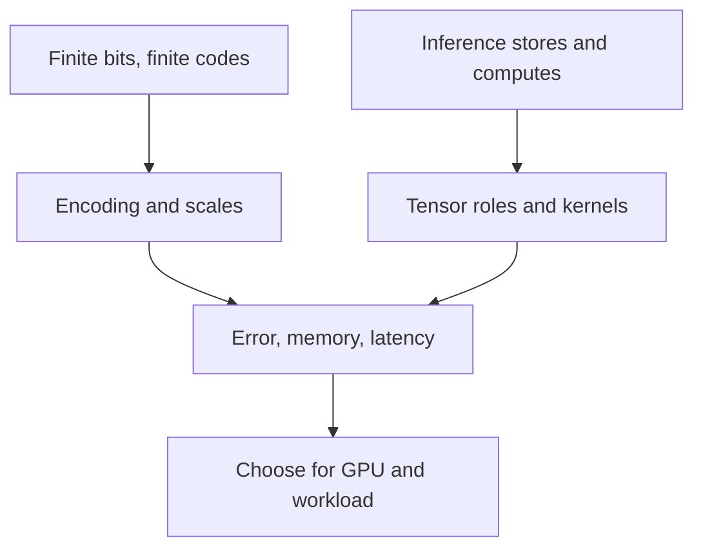

# Numerical data types for LLM inference

## Scope

Datacenter GPU serving: understand the numerical formats used for weights, activations, and KV caches; explain their memory, speed, and quality trade-offs; choose sensible candidates for a particular GPU and workload.

Industry-practice claims will distinguish documented support, public checkpoint examples, and deployment recommendations. Public documentation is not a measurement of industry market share.

## Starting point

Confirmed in the initial checks:

- Weight-storage arithmetic: 8 billion 16-bit weights occupy 16 decimal GB, before runtime memory and overhead.
- W4A16 does not require 4-bit arithmetic: weights can be unpacked/dequantized transiently for wider computation.
- BF16 has wider range but coarser precision near 1 than FP16.
- Separate INT4 scales can isolate outliers and improve reconstruction resolution, at the cost of scale metadata.

New material to explain: NF4's encoding and how it differs from integer quantization and hardware FP4; the wider format landscape and datacenter deployment choices.

## Lesson plan

Approved order:

1. **Decode the formats.** Build from known range/precision and scaling ideas. Compare FP32, BF16, FP16, FP8, INT8, and INT4; then distinguish NF4, MXFP4, and NVFP4. Separate number encodings from quantization algorithms and compute modes.
2. **Locate each format in inference.** Separate weight storage, activation inputs, accumulation, outputs, and KV-cache storage. Follow one mixed-precision operation rather than assigning one dtype to the whole model.
3. **Derive the trade-offs.** Count payload plus metadata and unchanged tensors. Connect fewer bytes to bandwidth savings, and native arithmetic to compute savings. Explain why quality and end-to-end speed still require measurement.
4. **Choose for datacenter serving.** Compare practical candidates on Ampere, Hopper, and Blackwell, with Ada where relevant. Distinguish the reference/baseline, optimized serving candidates, and hardware-specific options; finish with a deployment validation checklist.



Explanations will be added section by section, followed by questions only after the section has been read and clarified.

## 1. Bit width is not the encoding

You already know that fewer bits reduce the weight payload. The missing distinction is **which numbers those bits can represent**. This is why INT4, NF4, and FP4 are not interchangeable.

A $b$-bit code has $2^b$ possible bit patterns. That tells us how many codes exist—not what each code means. An **encoding** supplies that meaning. Some encodings reserve patterns for special values or use two patterns for signed zero, so the number of distinct finite values can be smaller.

For a quantized group, it helps to separate two decisions:

$$
\hat w_i = s_g\,D(c_i).
$$

- $c_i$: the stored code for weight $i$.
- $D$: the decoding rule—the numerical level assigned to that code.
- $s_g$: the scale shared by group $g$.
- $\hat w_i$: the reconstructed weight, which can differ from the original $w_i$.

This equation describes the scaled encodings below. It is not a claim that all quantizers use this exact form; an affine integer scheme can also have a zero-point offset.

**Your earlier outlier example changed $s_g$ and which weights share it. Changing INT4 to NF4 changes $D$ itself.**

### 1.1 Integer quantization: equally spaced levels within a group

An integer code decodes to an integer $q$. With a fixed scale and no zero-point offset:

$$
\hat w=sq.
$$

Adjacent integers differ by $1$, so adjacent reconstructed values differ by $s$. The grid is uniform within that group.

For example, signed INT4 can encode integers from $-8$ through $7$. If $s=0.1$, the reconstruction levels are:

$$
-0.8,\;-0.7,\;\ldots,\;0,\;0.1,\;\ldots,\;0.7.
$$

Rounding $w=0.37$ to this grid gives $q=4$ and $\hat w=0.4$. The reconstruction error is $0.03$. Some symmetric quantizers use only $-7$ through $7$ instead; the defining feature here is equal spacing, not that every possible code must be used.

- **Benefit:** a straightforward grid and a simple reconstruction rule.
- **Drawback:** a large range forces large steps when the number of codes is fixed. An outlier can therefore waste resolution for the other values—exactly the problem you identified in the scale question.

INT8 uses the same basic idea with more codes. It is not inherently floating point merely because its scale is a floating-point number.

### 1.2 Floating point: choose a window, then a position

This explanation adopts the **window + offset** view from [Fabien Sanglard's *Floating Point Visually Explained*](https://fabiensanglard.net/floating_point_visually_explained/), as requested. Start with the picture; derive the formula from it.

We want to cover several magnitudes without using one enormous, equally spaced grid. Split the positive number line into **windows between successive powers of two**:

$$
\ldots,\quad[0.5,1),\quad[1,2),\quad[2,4),\quad[4,8),\quad\ldots
$$

The right endpoint belongs to the next window. For example, $4$ is the first value in $[4,8)$, not the last value in $[2,4)$.

Now give the two bit fields separate jobs:

- **Exponent:** choose which window contains the number.
- **Fraction:** choose one of the available positions inside that window. This is Sanglard's offset.

With $m$ fraction bits, an ordinary complete window has $2^m$ available positions. Divide the window into $2^m$ equal pieces and place a representable value at the **left edge** of each piece.

#### See it with eight positions

Use FP8 E4M3 so there are only three fraction bits and $2^3=8$ positions to look at. The mechanism is the same as FP32, but the gaps are large enough to see.

| Window | Window width | Available positions | Gap |
|---|---:|---:|---:|
| $[1,2)$ | $1$ | $8$ | $1/8=0.125$ |
| $[2,4)$ | $2$ | $8$ | $2/8=0.25$ |
| $[4,8)$ | $4$ | $8$ | $4/8=0.5$ |

In $[4,8)$, the positions are:

$$
4,\;4.5,\;5,\;5.5,\;6,\;6.5,\;7,\;7.5.
$$

To store $6.1$, choose the $[4,8)$ window and then the nearest available position: $6$. This is deliberately an **FP8 example**, not the much finer FP32 approximation in Sanglard's article.

The precision trade-off is now visible: **the number of positions stays the same while the window gets wider, so the gaps get larger.** Moving one window to the right doubles the window width and the gaps.

#### The formula follows from the picture

A window's **width is its right endpoint minus its left endpoint**. For example, $[4,8)$ has width $8-4=4$; $[8,16)$ has width $16-8=8$.

Let the window start at $2^e$. Its right endpoint is $2^{e+1}=2\cdot2^e$: twice the left endpoint. Therefore:

$$
\text{width}=2^{e+1}-2^e=2\cdot2^e-2^e=2^e.
$$

The width equals the left endpoint here because these windows have the special form $[a,2a)$, whose width is $2a-a=a$. This is not true of arbitrary intervals.

Let $f$ be the selected position index, from $0$ through $2^m-1$.

$$
\begin{aligned}
\text{value}
&=\text{left edge}+\text{position index}\times\text{gap}\\
x&=2^e+f\frac{2^e}{2^m}\\
&=\left(1+\frac{f}{2^m}\right)2^e.
\end{aligned}
$$

The sign bit mirrors the value to the negative side when needed. Here $e$ is the **decoded** exponent, not the raw unsigned bits; for normal FP32 values, for example, $e=E-127$.

Two consequences to distinguish:

- **More fraction bits:** more positions inside each window.
- **More exponent bits:** room to encode more windows—not a wider version of the same $[1,2)$ window.

This window explanation describes normal values. Zero, subnormal values, and special encodings need additional rules; formats also have a largest finite value. Shifting windows therefore postpones overflow, not eliminates it.

- **Benefit:** a wide span of magnitudes with useful relative resolution across the normal range.
- **Drawback:** finite windows and finite positions still force rounding and impose range limits.

**External scaling is still useful.** FP8 and FP4 quantization can apply a tensor or group scale on top of this encoding. The exponent chooses a window inside the format; the external scale stretches the whole set of representable levels for that tensor or group.

### 1.3 NF4: choose the levels for a distribution

Suppose most normalized weights are near zero. With only 16 codes, we can put more reconstruction levels where values are concentrated instead of insisting on equal spacing or an exponent/fraction layout.

**NF4, NormalFloat4, uses a fixed nonuniform set of 16 levels designed around a normal distribution**, normalized into $[-1,1]$. Each 4-bit code selects one level from that table; a block scale maps the selected level to a weight magnitude:

$$
\hat w_i=s_g C[c_i].
$$

Here $C$ is the fixed table, also called a **codebook**. NF4's table is not a newly learned set of 16 values for each block; the block scale adapts the magnitudes.

- **Benefit:** allocates its limited levels to suit an approximately normal distribution, rather than spending them uniformly across the range.
- **Drawback:** the chosen level placement is not best for every distribution. Its encoding is also not interchangeable with a GPU's native exponent-and-fraction FP4 format.

NF4 was introduced with QLoRA and is implemented in bitsandbytes. That establishes its purpose and availability—not that it is the default format for high-throughput datacenter serving.

### 1.4 The distinction to retain

| Family | What a code means | Placement of reconstruction levels |
|---|---|---|
| INT4 / INT8 with a fixed group scale | An integer, then scaled | Uniform spacing within the group |
| FP formats | Sign, exponent, and fraction | Spacing changes with magnitude |
| NF4 | An entry in a fixed table, then scaled | Nonuniform levels chosen around a normal distribution |

**Bit width counts codes. Encoding places levels. Scaling positions those levels for a tensor or group.** These are separate choices. That is the foundation for comparing the individual formats next.

Sources for this section: [Sanglard's window-and-offset explanation](https://fabiensanglard.net/floating_point_visually_explained/), [bitsandbytes NF4/FP4 documentation](https://huggingface.co/docs/bitsandbytes/main/en/reference/nn/linear4bit), [vLLM FP8 representations and scaling](https://docs.vllm.ai/en/latest/features/quantization/llm_compressor/fp8/), and [vLLM grouped INT4 example](https://docs.vllm.ai/en/latest/features/quantization/llm_compressor/int4/). The grid and spacing examples are direct arithmetic derivations, not measured model-quality results.

### Section 1 checkpoints

Both answered correctly:

1. **What differs between NF4 blocks?** Each block has a scale; the nonuniform codebook is fixed and shared, not learned separately for each block.
2. **If floating-point spacing is $\Delta$ in $[1,2)$, what is it in $[8,16)$?** $8\Delta$, provided both intervals are in the normal finite range.

**Progress:** checked; ready to use these distinctions to compare concrete formats.

## 2. FP32, BF16, FP16, and FP8

The question is now: **how should we spend the available bits?** You already know the two competing uses: exponent bits for range, fraction bits for resolution. The format names below are particular choices of that split.

### 2.1 Compare windows and positions

Use the window picture from Section 1.2: **exponent bits buy windows; fraction bits buy positions per window**. Every format below also has one sign bit. The fraction count excludes the implicit leading $1$ of a normal value.

| Format | Total bits | Exponent bits | Fraction bits | Positions per ordinary complete window | Gap in $[1,2)$ | Finite range bounds, before scaling |
|---|---:|---:|---:|---:|---:|---:|
| FP32 | $32$ | $8$ | $23$ | $8{,}388{,}608$ | $2^{-23}\approx0.000000119$ | $\approx\pm3.40282\times10^{38}$ |
| BF16 | $16$ | $8$ | $7$ | $128$ | $2^{-7}=0.0078125$ | $\approx\pm3.38953\times10^{38}$ |
| FP16 | $16$ | $5$ | $10$ | $1{,}024$ | $2^{-10}=0.0009765625$ | $\pm65{,}504$ |
| FP8 E4M3FN | $8$ | $4$ | $3$ | $8$ | $2^{-3}=0.125$ | $\pm448$ |
| FP8 E5M2 | $8$ | $5$ | $2$ | $4$ | $2^{-2}=0.25$ | $\pm57{,}344$ |

**Reading the range column:** $\pm M$ means the finite values lie between $-M$ and $+M$, including zero. Only discrete values inside those bounds are representable—not every real number. These bounds describe the largest magnitudes, not the smallest nonzero values or precision near zero. Infinity and NaN, where supported, are separate special encodings. The E4M3 row specifies the common **E4M3FN** variant with maximum magnitude $448$; other FP8 variants can have different bounds.

The $[1,2)$ window has width $1$. Its gap is therefore $1$ divided by the number of positions. No external scaling is included here. These gaps are **not** model-accuracy percentages, and spacing is not the same as rounding error.

The letters in E4M3 mean four exponent bits and three fraction bits; the sign bit makes eight in total. Documentation often calls the fraction field the “mantissa.”

#### 2.1.1 Worked example: round 3.14 to E4M3

**The gap of $0.125$ in the comparison table applies to $[1,2)$, not to every window.** What stays fixed is the number of positions per complete normal window—not their absolute spacing.

With three fraction bits, there are eight positions:

| Window | Width | Positions | Gap |
|---|---:|---:|---:|
| $[1,2)$ | $1$ | $8$ | $1/8=0.125$ |
| $[2,4)$ | $2$ | $8$ | $2/8=0.25$ |

To round $3.14$, without external scaling:

1. **Choose its window:** $3.14$ lies in $[2,4)$.
2. **Divide that window's width by eight:** the gap is $(4-2)/8=0.25$.
3. **Place the eight positions starting at the left edge:**

$$
2,\;2.25,\;2.5,\;2.75,\;3,\;3.25,\;3.5,\;3.75.
$$

4. **Choose the nearest position:** $3.14$ is $0.14$ from $3$ and $0.11$ from $3.25$, so it rounds to **$3.25$**.

The answer $3.125$ comes from carrying the previous window's $0.125$ gap into this window. But $3.125$ is halfway between the available positions $3$ and $3.25$; it is not itself an E4M3 value.

**Always choose the window first, then calculate its gap.** Doubling the window width doubles the absolute gap; it does not add more positions.

### 2.2 FP32: spend bits to reduce numerical error

FP32 combines a wide exponent range with many fraction bits. Its largest finite magnitude is approximately $3.4\times10^{38}$.

- **Benefit:** much finer resolution than the smaller formats. Useful for numerical reference calculations and for selected sensitive calculations, including accumulation where the kernel supports it.
- **Drawback:** four bytes per stored value—twice BF16/FP16 and four times an FP8 payload. Those bytes consume memory capacity and must be moved when the tensor is read.

This explains why using FP32 for an entire large model is an expensive serving choice, while using it for selected internal calculations can still be worthwhile. Storage precision and accumulation precision need not match; we will trace that distinction later.

### 2.3 BF16 versus FP16: same memory, different protection

Both use two bytes per value. Neither saves weight payload memory relative to the other.

**BF16 keeps FP32's eight exponent bits.** Its exponent range is similar to FP32's, although its maximum finite value is slightly smaller. It sacrifices fraction bits to do this.

**FP16 keeps more fraction bits, but only five exponent bits.** Its maximum finite magnitude is $65{,}504$.

You can derive the practical trade-off:

- If the problem is **very large or very small magnitudes**, BF16 gives more room. FP16 may overflow or lose tiny values that BF16 can still represent.
- If both formats cover the relevant normal magnitudes, **FP16 distinguishes nearby values more finely**. Around $1$, its steps are eight times smaller than BF16's.

| Choice | Benefit | Drawback |
|---|---|---|
| BF16 | Wide range without extra scaling solely to fit into FP16's range | Coarser rounding than FP16 in their overlapping normal range |
| FP16 | Finer normal-value resolution at the same memory cost | Narrower range; conversion from a BF16 checkpoint needs numerical validation |

A concrete public example is [Qwen3-32B](https://huggingface.co/Qwen/Qwen3-32B/raw/main/config.json), whose configuration specifies BF16. Keeping the original BF16 weights avoids adding a separate lower-bit weight-quantization step. This example establishes actual use, not an industry-wide deployment share.

**Neither “BF16 is more accurate” nor “FP16 is more accurate” is a sufficient general statement.** FP16 wins on local normal-value resolution; BF16 wins on range. The model's values and computations determine which limitation matters.

### 2.4 FP8: halve the payload again, then manage the error

Going from sixteen bits to eight gives one byte per value instead of two, before scale metadata and any tensors left at higher precision. You now have very few bits to divide between range and resolution.

The two main FP8 encodings make the same trade-off you already understand:

| FP8 encoding | Main advantage | Main cost |
|---|---|---|
| E4M3 | More fraction bits: finer resolution | Less range |
| E5M2 | More exponent bits: wider range | Coarser resolution |

For the common NVIDIA/OCP variants documented by vLLM:

- **E4M3:** largest finite magnitude $448$; supports NaN but not infinity.
- **E5M2:** largest finite magnitude $57{,}344$; supports NaN and infinity.

NaN means “not a number,” a special value used for invalid numerical results. FP8 variants with different special-value rules also exist, so these limits should not be applied indiscriminately to every similarly named dtype.

To see the resolution cost, consider values around $1$:

$$
\begin{aligned}
\text{E4M3:}&\quad 1,\;1.125,\;1.25,\;1.375,\ldots\\
\text{E5M2:}&\quad 1,\;1.25,\;1.5,\;1.75.
\end{aligned}
$$

Rounding $1.1$ to the nearest level gives $1.125$ in E4M3 but $1$ in E5M2. The extra exponent bit did not make E5M2 “better”; it bought range by giving up a fraction bit.

**Why use an external scale if the format already has an exponent?** A tensor need not naturally occupy the format's useful magnitude range. Choose a scale $s$, encode roughly $w/s$, and reconstruct as $s q$. The scale positions the available levels for that tensor or group. It does not create additional code patterns.

- **Benefit:** smaller weight/activation payloads; access to native FP8 matrix arithmetic on supported hardware and kernels.
- **Drawback:** rounding and range limitations, scale selection/storage, possible runtime scaling work, and hardware/backend constraints.

FP8 is a real serving option, not just a theoretical format: [vLLM documents FP8 weight-and-activation execution](https://docs.vllm.ai/en/latest/features/quantization/llm_compressor/fp8/), and [DeepSeek-V3's public configuration](https://huggingface.co/deepseek-ai/DeepSeek-V3/raw/main/config.json) specifies FP8 E4M3 quantization with weight blocks of $128\times128$. Exact quality loss and speedup are not properties of the name “FP8”; they depend on the model and implementation.

### 2.5 Keep the two decisions separate

**Choosing a float format decides its built-in range and spacing. Choosing the quantization scales decides how a tensor uses those levels.** The next comparison—MXFP4 versus NVFP4—will make this especially clear: both use the same tiny floating-point element encoding, but different scaling schemes.

Sources: [Sanglard's window-and-offset explanation](https://fabiensanglard.net/floating_point_visually_explained/), [PyTorch precision documentation](https://docs.pytorch.org/docs/stable/generated/torch.set_float32_matmul_precision.html), [vLLM FP8 definitions and execution paths](https://docs.vllm.ai/en/latest/features/quantization/llm_compressor/fp8/), and the two public model configurations linked above. Bit-spacing calculations and the rounding example are direct derivations.

### Section 2 checkpoints

- **FP16 versus BF16 in $[4,8)$:** answered correctly. Both windows have width $4$; FP16 has more positions.
- **Round $3.14$ to E4M3:** selected $3.125$ rather than $3.25$. The selected answer uses the $[1,2)$ gap in the $[2,4)$ window. Section 2.1.1 now works through the window-specific spacing explicitly.

- **Re-check: round $6.3$ to E4M3:** answered correctly, $6.5$. Chose $[4,8)$, calculated the gap $4/8=0.5$, and selected the nearer available position.

**Progress:** the window-specific spacing issue is repaired and checked.

## 3. Four-bit formats: the encoding and the scales

With only four bits per element, we must choose a very small set of numerical levels. You have already met two choices: **INT4's integer grid** and **NF4's fixed nonuniform codebook**. The third is a tiny floating-point encoding called **E2M1**.

### 3.1 FP4 E2M1: only two positions per normal window

E2M1 uses one sign bit, two exponent bits, and one fraction bit. One fraction bit gives $2^1=2$ positions per complete normal window:

| Normal window | Width | Gap | Representable positive values in this window |
|---|---:|---:|---|
| $[1,2)$ | $1$ | $1/2=0.5$ | $1,\;1.5$ |
| $[2,4)$ | $2$ | $2/2=1$ | $2,\;3$ |
| $[4,8)$ | $4$ | $4/2=2$ | $4,\;6$ |

The full set of nonnegative numerical levels is:

$$
0,\;0.5,\;1,\;1.5,\;2,\;3,\;4,\;6.
$$

There are corresponding negative values. The $0.5$ level is subnormal, outside the normal windows listed above. Positive and negative zero use separate bit patterns, so the 16 patterns give 15 distinct numerical values.

**Before external scaling, the largest finite magnitude is $6$.** This encoding has no infinity or NaN values. It is much coarser than FP8: in $[4,8)$, E4M3 has eight positions, but E2M1 has only two.

That explains why “just cast all the weights to FP4” is not a sufficient quantization recipe. We must also decide how to scale and group them.

### 3.2 MXFP4 versus NVFP4: same element levels, different scaling

Both formats use the E2M1 levels above. What changes is **how many values share a scale and how that scale is encoded**.

| Property | MXFP4 | NVFP4 |
|---|---|---|
| Element encoding | FP4 E2M1 | FP4 E2M1 |
| Values sharing one block scale | $32$ | $16$ |
| Block-scale encoding | 8-bit E8M0 | 8-bit E4M3 |
| Allowed finite positive block scales | Powers of two | Floating-point levels, including non-powers of two |
| Additional tensor-level scale | Not part of the basic scheme described here | One FP32 scale per tensor |

E8M0 uses an exponent without fraction bits. Its finite scales are powers of two; E4M3 has fraction bits and can also represent values such as $1.5$.

For MXFP4, reconstruction is conceptually:

$$
\hat w_i=q_i\,2^{k_g}.
$$

For NVFP4, it is:

$$
\hat w_i=q_i\,s_g\,S.
$$

Here $q_i$ is the **decoded E2M1 level**, not necessarily an integer. The block containing element $i$ is $g$; $s_g$ is its E4M3 scale; $S$ is the tensor's FP32 scale. Implementations can store scales or their reciprocals; these equations describe the reconstruction meaning.

To see what a scale does, hold $S=1$ in a toy NVFP4 example. The E2M1 levels $2,3,4,6$ become $3,4.5,6,9$ under a block scale of $1.5$. The element encoding has not gained more levels; its existing levels have moved.

**Why add the FP32 tensor scale in NVFP4?** E4M3's fractional precision gives more flexible block scales, but its range is narrower than E8M0's. The extra tensor scale adjusts the overall magnitude so that the individual block scales can use E4M3 effectively.

### 3.3 Derive the benefits and drawbacks

You already reasoned that smaller quantization groups can isolate an outlier. NVFP4 applies that idea with groups of $16$ rather than $32$:

- **Smaller groups:** values with very different magnitudes have more opportunities to use different scales.
- **More flexible block scales:** each group's reconstruction levels can be positioned more finely than with a power-of-two scale alone.
- **Cost:** more block scales to store, plus an extra tensor scale and a different kernel/layout requirement.

MXFP4 spends less storage on block scales and uses a simpler power-of-two scaling rule. NVFP4 spends more metadata and scaling machinery to improve the opportunity for an accurate fit. Neither description guarantees a particular model-quality score.

The important contrast is not “NVFP4 has more fraction bits per weight.” **The weight payload is E2M1 in both. NVFP4 changes the shared scaling around those payloads.**

### 3.4 Four-bit payload does not mean four bits of total storage

Assume complete blocks, tightly packed payloads, and no padding or other metadata. Each block scale occupies eight bits, shared by $G$ values:

$$
\text{bits per value}=4+\frac{8}{G}.
$$

Therefore:

- **MXFP4:** $4+8/32=4.25$ bits per value.
- **NVFP4:** $4+8/16=4.5$ bits per value, plus the tensor's FP32 scale.

For one NVFP4 tensor of $N$ values, including that one scale:

$$
\text{average bits per value}=4.5+\frac{32}{N}.
$$

The tensor scale becomes a small per-value cost for a large tensor. The block scales do not disappear: they continue to cost half a bit per value in NVFP4.

Relative to a 16-bit tensor, the large-tensor payload-plus-scale compression ratios are roughly $16/4.25\approx3.76$ for MXFP4 and $16/4.5\approx3.56$ for NVFP4—not exactly $4$. A complete model can have additional padding, unquantized tensors, and runtime memory.

### 3.5 Keep the four names distinct

| Name | What the four-bit element means | Main numerical attraction | Main limitation |
|---|---|---|---|
| INT4 | An integer, used with scaling | Uniform grid with controllable absolute spacing per group | A wide group range forces coarse steps |
| NF4 | An index into a fixed nonuniform codebook | Levels allocated around a normal distribution | That level placement is not best for every distribution |
| MXFP4 | E2M1, with a power-of-two scale per 32 values | Tiny floating-point elements with compact shared scaling | Very few element levels and coarse scale choices |
| NVFP4 | E2M1, with E4M3 block scales and an FP32 tensor scale | Finer grouping and more flexible scale choices | More scale storage and implementation constraints |

These are numerical trade-offs, not a speed ranking. A GPU's ability to **store** any of these encodings does not establish that it can perform native matrix arithmetic in that encoding. That is the next layer of the comparison.

There are concrete public checkpoint examples: [gpt-oss-120b's configuration](https://huggingface.co/openai/gpt-oss-120b/raw/main/config.json) specifies MXFP4 while excluding attention, routing, embeddings, and the output head from conversion; [NVIDIA's Llama-3.3-70B-Instruct-NVFP4 model card](https://huggingface.co/nvidia/Llama-3.3-70B-Instruct-NVFP4/raw/main/README.md) describes FP4 weights and activations for transformer-block linear operators. Neither implies that every tensor in the model uses four bits.

Sources: [NVIDIA's NVFP4 format explanation](https://developer.nvidia.com/blog/introducing-nvfp4-for-efficient-and-accurate-low-precision-inference/), [bitsandbytes NF4 documentation](https://huggingface.co/docs/bitsandbytes/main/en/reference/nn/linear4bit), and the public checkpoints linked above. Storage ratios are derived from the stated block layouts, not measured whole-model memory savings.

### Section 3 checkpoints

Both answered correctly:

1. **MXFP4 to NVFP4:** E2M1 elements stay the same; groups shrink from $32$ to $16$, block scales gain fractional precision, and NVFP4 adds an FP32 tensor scale.
2. **One 256-value NVFP4 tensor:** $128$ payload bytes, $16$ block-scale bytes, and $4$ tensor-scale bytes total **$148$ bytes**, before padding or other metadata.

**Progress:** checked; ready to separate storage formats from computation formats.

## 4. A model does not have one dtype

We know how to encode individual numbers. Now consider what inference does with them: **store tensors, read their values, perform operations, and store new tensors**. These steps do not have to use the same representation.

A **kernel** is a GPU routine implementing an operation. To understand a low-precision deployment, ask what the kernel reads, what formats its arithmetic uses, and what it writes—not just what the model's filename says.

### 4.1 Separate the precision choices

| Object or stage | What it means | What its dtype controls |
|---|---|---|
| Stored weights | The persistent model parameters | Weight payload size and the levels used to reconstruct weights |
| Quantization scales | Metadata shared by tensors, channels, or blocks | How encoded levels map to actual magnitudes |
| Activation operands | Intermediate model values supplied to an operation | The numerical inputs seen by that operation |
| Accumulator | The running partial sum inside a dot product or reduction | Rounding during accumulation |
| Stored output | The tensor written after the operation | Output memory and the values available to the next operation |
| KV cache | Keys and values retained for attention to previous tokens | Persistent attention-state storage and its reconstruction error |

These are **separate choices, not arbitrary combinations**. The selected hardware and kernels must support the combination. Different layers can also use different choices.

### 4.2 Follow an illustrative W4A16 operation

A linear layer computes dot products such as:

$$
y_i=\sum_j w_{ij}x_j.
$$

In **W4A16**, W and A describe four-bit weights and sixteen-bit activations for the relevant quantized operation. They do not fully specify the encoding, accumulator, output, or KV-cache dtype.

Here is one possible implementation, using INT4 weight codes and BF16 activations:

| Step | What happens | Representation |
|---|---|---|
| 1 | Keep the weight matrix compressed in GPU memory | Packed INT4 codes plus scales |
| 2 | Load and reconstruct a small tile of weights as needed | BF16 weight operands |
| 3 | Supply the tile's input activations | BF16 activation operands |
| 4 | Multiply and add the products into partial sums | BF16 operands, FP32 accumulation |
| 5 | Round and write the result | BF16 output tensor |

![[viz-illustrative-w4a16-tiles-1791304153808.png|850]]

This is an **illustrative valid path**, not a promise about every W4A16 implementation. The important separations are:

- **Four-bit weight storage does not require four-bit arithmetic.** Here the multiplication operands are BF16.
- **Transient decoding does not require a persistent BF16 copy of the whole model.** A fused kernel can decode small tiles while it works, retaining compressed weights in GPU memory.
- **FP32 accumulation does not make the stored weights or outputs FP32.** It describes the partial sums inside the operation.

Why use a wider accumulator? A long sum repeatedly combines values of different magnitudes. More positions in the accumulator's floating-point windows can reduce additional rounding during that sum. This does **not** recover information already lost when weights or activations were quantized.

W8A8 similarly describes eight-bit weight and activation precision for the quantized operation. The label alone does not distinguish INT8 from FP8, fully specify the arithmetic pipeline, or determine the precision of every other operation in the model.

### 4.3 KV-cache precision is another decision

A four-bit weight checkpoint does not imply a four-bit KV cache. For example, a supported deployment could use quantized weights while retaining BF16 KV entries, or choose FP8 KV storage separately.

This matters because changing the weight format alone does not shrink a BF16 KV cache. Weight memory and cache memory are different terms in the memory budget.

There are also two separate questions about a quantized cache:

1. **How are K and V stored?** For example, FP8 payloads plus scales.
2. **How does the attention kernel consume them?** It might convert values to a wider format, or compute attention operations using low-precision operands.

[vLLM's KV-cache documentation](https://docs.vllm.ai/en/latest/features/quantization/quantized_kvcache/) gives a concrete backend-dependent example: with its documented Flash Attention 3 FP8-cache path, queries are quantized too and attention operates in the FP8 domain. Do not generalize that behavior to every backend that accepts FP8 cache storage.

### 4.4 Native arithmetic is different from accepting a checkpoint

A compressed encoding is a collection of bits. Software can decode those bits even on hardware that lacks native matrix arithmetic for that encoding. Such a path may still save weight storage, but it is not the same as using that format's native arithmetic throughput.

For the NVIDIA architectures checked in this lesson:

| Architecture | Example GPU | Native BF16 matrix inputs | Native FP8 matrix inputs | Native FP4 matrix inputs |
|---|---|---|---|---|
| Ampere | A100 | Yes | No | No |
| Ada | L40S | Yes | Yes | No |
| Hopper | H100 | Yes | Yes | No |
| Blackwell | B200 | Yes | Yes | Yes |

“Native” here means hardware-accelerated matrix arithmetic with the input format—not that every operation, accumulation stage, or model runs in that format. Exact formats, layouts, and kernels still need software support.

Two examples make the distinction concrete:

- **FP8 checkpoint on Ampere:** vLLM documents a weight-only W8A16 Marlin path on hardware without native FP8 matrix arithmetic. Accepting the checkpoint does not turn an A100 into an FP8-arithmetic GPU.
- **FP4 marked supported on Ada/Hopper:** the checked NVIDIA TensorRT matrix includes an emulation footnote. These entries do not mean native FP4 linear-operation acceleration.

There are therefore **two compatibility checks**: the GPU's native capabilities, then the exact serving runtime/backend, version, model, and quantization scheme. A “Yes” in the hardware table is necessary for the corresponding native path, but is not a guarantee that a particular model can use it.

### 4.5 Read configuration labels at the right level

[DeepSeek-V3's public configuration](https://huggingface.co/deepseek-ai/DeepSeek-V3/raw/main/config.json) contains both of these pieces of metadata:

```json
{
  "torch_dtype": "bfloat16",
  "quantization_config": {
    "quant_method": "fp8",
    "fmt": "e4m3"
  }
}
```

This is an excerpt, not the whole configuration. It demonstrates why reading only `torch_dtype` is insufficient: quantized modules have additional representation instructions. A model-wide default is not a complete inventory of tensor formats.

Some other names describe different layers of the system:

| Name | What it describes—not a whole-model dtype |
|---|---|
| TF32 | A reduced-precision internal multiplication mode for FP32 data on supporting NVIDIA hardware; FP32 tensor storage still uses four bytes per value |
| AWQ / GPTQ | Quantization methods, often used to prepare INT4 weights; not new elementary number encodings |
| W4A16 / W8A8 | Weight/activation bit-width descriptions, not complete storage-and-arithmetic specifications |
| MXFP4 / NVFP4 | Element encodings together with particular block-scaling schemes |

**To characterize an actual deployment, record the weight format and scales, activation operands, accumulator/output formats where relevant, KV-cache format, and selected kernels.** The next step is to use those facts to reason about memory, speed, and practical deployment choices.

Sources: [vLLM FP8 native and weight-only execution paths](https://docs.vllm.ai/en/latest/features/quantization/llm_compressor/fp8/), [vLLM W4A16](https://docs.vllm.ai/en/latest/features/quantization/llm_compressor/int4/), [vLLM KV-cache behavior](https://docs.vllm.ai/en/latest/features/quantization/quantized_kvcache/), [NVIDIA TensorRT precision support and emulation footnotes](https://docs.nvidia.com/deeplearning/tensorrt/latest/getting-started/support-matrix.html#gpu-architecture-and-precision-support), [PyTorch internal FP32 matmul precision](https://docs.pytorch.org/docs/stable/generated/torch.set_float32_matmul_precision.html), and the public DeepSeek configuration. The step-by-step W4A16 path is an explicitly illustrative kernel design, not a benchmark or claim about an uninspected runtime kernel.

**Progress:** Section 4 explanation written; awaiting reading and clarification before checkpoint questions.

## Source register

Primary sources retrieved during this session (2026-10-06). Live `latest` and `main` pages can change; exact runtime support must be checked against the deployed version. The entries below are sources for preparing the lesson, not claims that all covered formats are equally common.

### Explanatory reference

- [Fabien Sanglard: Floating Point Visually Explained](https://fabiensanglard.net/floating_point_visually_explained/) — published 2017-08-29; requested by the learner. Use its window + offset picture as the main floating-point explanation, then derive formulas. It explains FP32; extend the same mechanism to current LLM formats using the format sources below. Use half-open windows to avoid double-counting endpoints, round offset indices explicitly, and preserve finite-range and special-value qualifications.

### Runtime behavior and numerical formats

- [vLLM quantization overview and implementation compatibility](https://docs.vllm.ai/en/latest/features/quantization/)
- [vLLM FP8 W8A8 and weight-only fallback paths](https://docs.vllm.ai/en/latest/features/quantization/llm_compressor/fp8/)
- [vLLM INT4 W4A16 preparation and evaluation](https://docs.vllm.ai/en/latest/features/quantization/llm_compressor/int4/)
- [vLLM quantized KV cache and attention-backend constraints](https://docs.vllm.ai/en/latest/features/quantization/quantized_kvcache/)
- [bitsandbytes NF4 and FP4 layers](https://huggingface.co/docs/bitsandbytes/main/en/reference/nn/linear4bit)
- [PyTorch float32 matmul internal precision controls](https://docs.pytorch.org/docs/stable/generated/torch.set_float32_matmul_precision.html)

### Hardware capabilities and scaled FP4 definitions

- [NVIDIA TensorRT GPU architecture and precision support](https://docs.nvidia.com/deeplearning/tensorrt/latest/getting-started/support-matrix.html#gpu-architecture-and-precision-support) — hardware verification completed; interactive table checked against its 11.3.0 data. Read the emulation footnotes before interpreting a format as natively accelerated. This is not a version-pinned TensorRT-LLM backend inventory.
- [NVIDIA: Introducing NVFP4](https://developer.nvidia.com/blog/introducing-nvfp4-for-efficient-and-accurate-low-precision-inference/) — published 2025-06-24; definitions of E2M1 payloads, MXFP4/NVFP4 block sizes, scale encodings, and storage overhead. Use for format definitions, not as evidence of universal adoption or guaranteed application speedups.

### Public checkpoint examples

- [Qwen3-32B configuration](https://huggingface.co/Qwen/Qwen3-32B/raw/main/config.json)
- [DeepSeek-V3 configuration](https://huggingface.co/deepseek-ai/DeepSeek-V3/raw/main/config.json)
- [gpt-oss-120b configuration](https://huggingface.co/openai/gpt-oss-120b/raw/main/config.json)
- [NVIDIA Llama-3.3-70B-Instruct-NVFP4 model card](https://huggingface.co/nvidia/Llama-3.3-70B-Instruct-NVFP4/raw/main/README.md)
