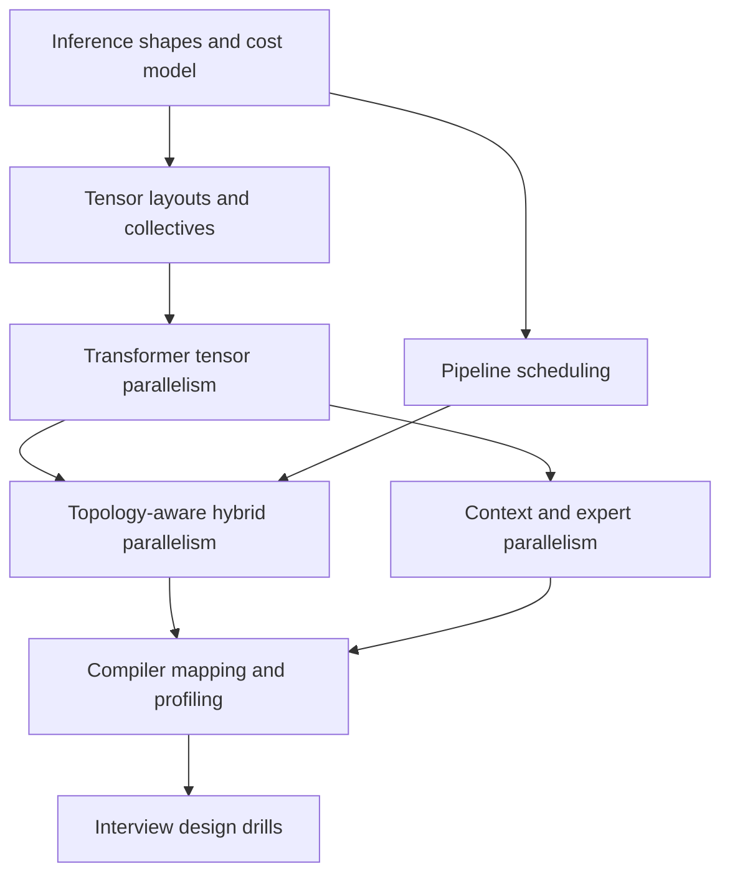
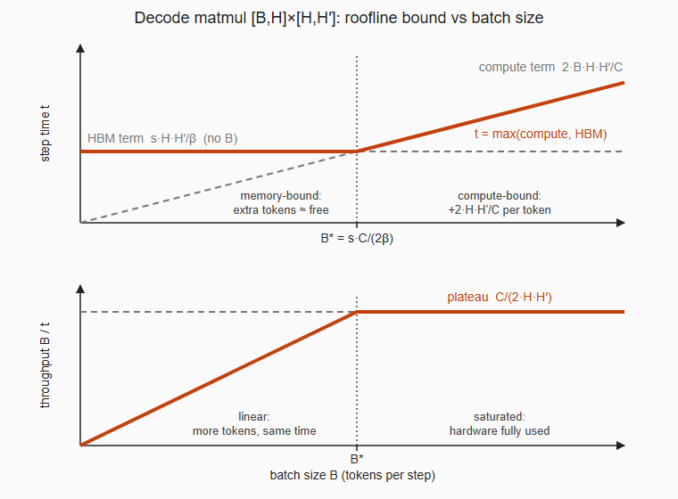
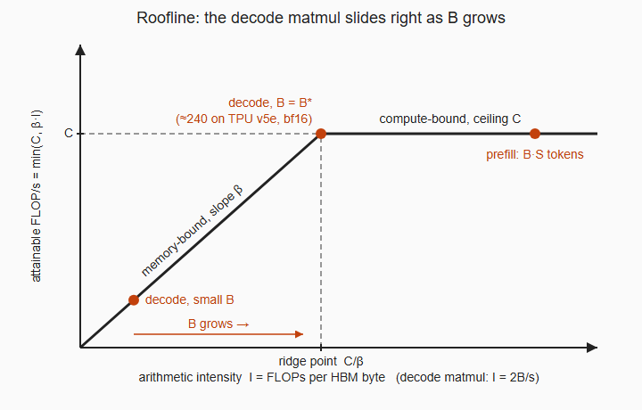
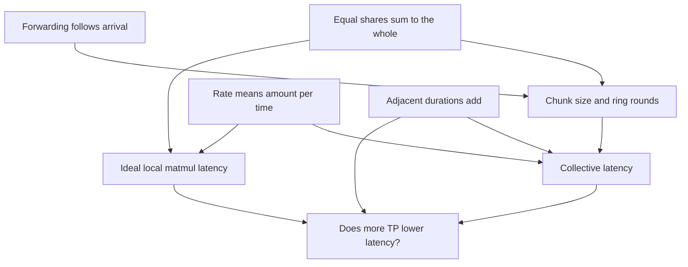

# Model Parallelism for LLM Inference

[← Preparation plan](plan.md) · [Technique index](inference-techniques.md)

## Goal

Prepare for the Google DeepMind **Software Engineer, Model Inference** role. This note covers the distributed-inference part of the broader role plan in [plan.md](plan.md): memory, compute, communication, latency, throughput, and hardware topology.

## Diagnostic probe

### Question 1 — Tensor parallelism

Consider a transformer MLP projection

$$
Y = XW,
$$

where $X \in \mathbb{R}^{B \times H}$ and $W \in \mathbb{R}^{H \times 4H}$. The weight matrix is too large for one accelerator, so two accelerators must share the operation.

Describe one way to shard $W$ across the two accelerators. For your chosen shard direction, state:

1. the shapes of each weight shard and local output,
2. whether the forward pass needs a collective communication operation, and
3. which collective is needed, if any, to produce the full $Y$ on both accelerators.

It is fine to say “I don't know” or to describe your intuition without exact collective names.

#### Learner response

Column parallelism: each weight shard has shape $H \times 2H$, and each local output has shape $B \times 2H$. To obtain the full output tensor on both accelerators, use an all-gather.

#### Feedback

Correct. Splitting $W$ along its output-feature dimension gives

$$
W = [W_1\;W_2], \qquad Y = [XW_1\;XW_2].
$$

Each device computes a distinct slice of the output features, so no reduction is needed. If full $Y$ must be materialized on every device, an all-gather concatenates those slices. In an optimized transformer block, the gather can sometimes be avoided when the following operation can consume the sharded representation directly.

### Question 2 — Row parallelism

Now split the same weight matrix $W \in \mathbb{R}^{H \times 4H}$ along its **input-feature dimension** across two accelerators.

State:

1. the shape of each weight shard,
2. how $X \in \mathbb{R}^{B \times H}$ must be partitioned,
3. the shape and mathematical meaning of each local result, and
4. which collective operation produces a full copy of $Y$ on both accelerators.

Explain why the collective combines values by that operation rather than concatenating them.

#### Learner response

Row parallelism: each weight shard has shape $\frac{H}{2} \times 4H$. Partition $X$ along its feature dimension so each device receives a $B \times \frac{H}{2}$ slice. Each local multiplication produces a $B \times 4H$ partial result. Because each device contracts over only part of the original $H$ dimension, an all-reduce is needed to combine the partial results into the full output on every device.

#### Feedback

Correct. Writing

$$
X = [X_1\;X_2], \qquad
W = \begin{bmatrix}W_1\\W_2\end{bmatrix},
$$

gives

$$
Y = X_1W_1 + X_2W_2.
$$

The local tensors have the same output coordinates and represent additive partial sums, so they must be summed elementwise rather than concatenated. An all-reduce both performs that sum and leaves a full copy on each device.

### Question 3 — Composing tensor-parallel layers

A transformer MLP, ignoring biases, is

$$
Z = \phi(XW_{\mathrm{up}})W_{\mathrm{down}},
$$

with $W_{\mathrm{up}} \in \mathbb{R}^{H \times 4H}$ and $W_{\mathrm{down}} \in \mathbb{R}^{4H \times H}$. Assume two accelerators, elementwise activation $\phi$, replicated input $X$, and replicated final output $Z$.

Choose a column- or row-parallel layout for each matrix so that the intermediate activation stays sharded and only one collective is required across the two linear layers.

Explain:

1. how each matrix is sharded,
2. why $\phi$ can run locally without communication,
3. what each device computes before the collective, and
4. which collective produces replicated $Z$.

#### Learner response

Shard $W_{\mathrm{up}}$ with column parallelism and $W_{\mathrm{down}}$ with row parallelism. Each device computes its column-parallel slice of $XW_{\mathrm{up}}$, applies the elementwise activation locally, and feeds that activation shard to its row-parallel shard of $W_{\mathrm{down}}$. Each device produces a partial output, and an all-reduce produces the final result.

#### Feedback

Correct. The column-parallel first projection creates activation shards aligned with the input-dimension shards of the row-parallel second projection. Since $\phi$ acts independently on each element, it preserves this partition without communication. The second projection produces additive partial sums with shape equal to the final output, so one all-reduce completes the pair. This avoids materializing the full $4H$ intermediate on every device.

### Question 4 — When more tensor parallelism stops helping

Consider autoregressive decoding of one token at a time through a tensor-parallel transformer. Increase the tensor-parallel degree from $p$ to $2p$ while keeping the model, request batch, hardware type, and number of generated tokens fixed. Assume each transformer block ends its attention and MLP sublayers with a collective over activation-sized tensors.

An interviewer asks: **Why might latency stop improving—or even get worse—even though each device now performs roughly less matrix-multiplication work?**

Build a qualitative performance model. Discuss at least:

1. local matrix-multiplication size and accelerator utilization,
2. collective latency and bandwidth costs,
3. the effect of the small decode batch/token dimension, and
4. hardware topology, such as adding devices across a slower interconnect boundary.

Exact formulas are optional; explain which terms shrink, which do not, and where a crossover can arise.

#### Learner response

Decode is typically memory-bandwidth bound because model weights and the KV cache are streamed. Increasing tensor parallelism reduces computation per device, but this may not help when computation is already small relative to memory costs. For an input shaped $B \times S \times D$ and a $D \times 4D$ weight, the learner modeled the work as proportional to $2BS(4D^2)$ FLOPs, with compute time based on peak FLOP/s and memory time based on bytes divided by bandwidth. Doubling tensor-parallel degree approximately halves local compute, while all-reduce adds activation communication, so communication can dominate.

#### Feedback

The main conclusion is correct: tensor parallelism eventually trades diminishing local work for increasing synchronization pressure. Several distinctions make the model interview-ready:

- **HBM traffic and network traffic are separate terms.** Weight and KV-cache reads use device-memory bandwidth; all-reduce uses the accelerator interconnect. A useful lower-bound model is $\max(t_{\mathrm{compute}}, t_{\mathrm{HBM}}) + t_{\mathrm{collective}}$ when the collective is on the critical path and not overlapped.
- For one decode step, dense-layer activation matrices usually have token dimension $B$ rather than $BS$: the new-token input is $B \times D$. Attention still reads a KV cache whose traffic grows with existing context length $S$.
- Tensor parallelism shards weights, so per-device weight traffic also decreases. KV-cache traffic may decrease when KV heads are sharded, though grouped-query or multi-query attention can limit sharding or cause replication.
- The all-reduce tensor is typically activation-sized, approximately $B \times D$ elements per decode step for a hidden-state reduction. Increasing $p$ does not necessarily double this logical payload. Instead, collective time includes bandwidth and startup/topology terms, for example a ring-like approximation

$$
t_{\mathrm{AR}} \approx 2(p-1)\alpha + 2\frac{p-1}{p}\frac{n}{\beta},
$$

where $\alpha$ is per-step latency, $\beta$ is link bandwidth, and $n$ is message bytes. Small decode collectives are often sensitive to latency and synchronization.
- Smaller local GEMMs may achieve lower effective FLOP/s, so halving the FLOP count need not halve compute time. Crossing from a fast intra-node fabric to a slower inter-node network can create a sharp latency jump.

### Question 5 — Hybrid parallelism and topology

An eight-accelerator system consists of two nodes. Each node has four accelerators connected by a fast fabric; communication between nodes is much slower. The model cannot fit within one four-accelerator node.

An engineer proposes tensor parallelism of degree $8$. Another proposes tensor parallelism of degree $4$ within each node and pipeline parallelism of degree $2$ across the two nodes.

Reason about the second design:

1. Why might keeping tensor-parallel collectives inside each node help?
2. What data must cross the node boundary between the two pipeline stages?
3. For a single decoding request or a very small batch, why can pipeline parallelism leave devices idle?
4. How could batching or scheduling improve throughput, and what limitation may remain for the latency of one request?

You do not need exact formulas; focus on the communication frequency, message type, and execution timeline.

#### Learner response

Fast intra-node links make a tensor-parallel group of four preferable to a group spanning both nodes. Tensor parallelism shards compute and weights, potentially leaving more device memory for KV cache and enabling larger batches. Pipeline stages exchange activations across the node boundary, which is less frequent than the per-layer collectives of tensor parallelism. The second stage waits for the first stage on a single request. Multiple microbatches can reduce pipeline bubbles and improve throughput, but an individual request still traverses all stages and pays both computation and communication latency.

#### Feedback

Correct and well framed. Tensor-parallel collectives are frequent—commonly at attention and MLP output boundaries—so topology-aware placement keeps them on the fastest fabric. A pipeline boundary usually sends hidden-state activations using point-to-point communication, though a layout change between stage meshes can require resharding.

The microbatch detail needs one refinement. For $P$ balanced stages and $M$ independent forward microbatches, an idealized pipeline takes approximately $M+P-1$ stage-time slots, giving utilization

$$
\frac{M}{M+P-1}.
$$

Using $P-1$ microbatches reduces the bubble but does not eliminate it; high utilization requires $M$ to be large relative to $P-1$. During autoregressive inference, tokens within one request are sequentially dependent, so serving systems fill the pipeline mainly with work from multiple requests or scheduled microbatches. This improves aggregate throughput, but one token from one request must still traverse every pipeline stage in order.

## Baseline after the probe

### Demonstrated strengths

- Correctly derives column- and row-parallel matrix multiplication, including all-gather versus all-reduce.
- Correctly composes column-parallel and row-parallel layers to keep an MLP intermediate sharded.
- Understands decode's low arithmetic intensity and the role of weight and KV-cache traffic.
- Reasons correctly about topology-aware hybrid tensor and pipeline parallelism.

### Areas to strengthen

- Separate compute time, HBM traffic, and interconnect communication in a quantitative latency model.
- Use decode-step tensor shapes precisely and reason about collective scaling with group size.
- Quantify pipeline bubbles and distinguish throughput gains from single-request latency.
- Extend the same reasoning to attention, long-context parallelism, MoE routing, and multidimensional device meshes.

## Proposed interview curriculum

1. **Inference cost model:** derive  KV-cache memory, arithmetic intensity, TTFT, TPOT, latency, and throughput.
2. **Distributed tensor algebra:** derive collective choice from tensor layouts; estimate all-reduce, all-gather, reduce-scatter, all-to-all, and point-to-point costs.
3. **Transformer tensor parallelism:** map MLP, QKV, attention heads, output projection, embeddings, and vocabulary logits; include MHA, GQA, and MQA constraints.
4. **Pipeline and hybrid parallelism:** model stage balance, bubbles, microbatching, topology-aware TP/PP placement, resharding, and request scheduling.
5. **Long-context parallelism:** distinguish sequence parallelism from context parallelism; reason about ring attention, KV-cache ownership, prefill, and decode.
6. **Expert parallelism:** derive token dispatch and combine all-to-all operations, capacity and load-balance concerns, and interaction with TP and DP.
7. **Compiler and implementation view:** express logical meshes and shardings in JAX/XLA terminology, identify collectives in traces, and discuss overlap and fused collective matmuls.
8. **Interview synthesis:** solve numerical performance estimates and open-ended system-design cases under memory, latency, throughput, and topology constraints.

## Planning sources

- [Efficiently Scaling Transformer Inference](https://arxiv.org/abs/2211.05102) develops an analytical inference model and multidimensional partitioning strategy for TPU v4.
- [Megatron-LM](https://arxiv.org/abs/1909.08053) establishes the transformer tensor-parallel layouts, while [Efficient Large-Scale Language Model Training](https://arxiv.org/abs/2104.04473) treats tensor/pipeline composition and pipeline schedules.
- [JAX manual parallelism with `shard_map`](https://docs.jax.dev/en/latest/notebooks/shard_map.html) connects tensor layouts to explicit collectives, and [JAX collective matrix multiplication](https://docs.jax.dev/en/latest/pallas/gpu/collective_matmul.html) demonstrates communication/computation overlap.
- [Context Parallelism for Scalable Million-Token Inference](https://arxiv.org/abs/2411.01783) covers exact ring-attention variants for long-context prefill and decode.
- [Shortcut-connected Expert Parallelism](https://arxiv.org/abs/2404.05019) provides a concrete inference study of expert-parallel all-to-all overhead and overlap.
- https://app.notion.com/p/mpetrushkov/Plan-3daf10c7b42a80d0a23dd28f77e7ce35?source=copy_link

## Next checkpoint

Confirm or adjust the proposed curriculum. Once agreed, begin with the inference cost model and derive the first quantitative latency model from tensor shapes rather than memorized rules.

## Scope decision

The learner approved the plan and chose to focus this session on **model parallelism only**. CUDA, Triton, profiling, continuous batching, speculative decoding, chunked prefill, disaggregated prefill/decode, quantization, and other inference optimizations are deferred to later sessions.

## Lesson 1 — Tensor parallelism for attention

### Motivation

The MLP pattern worked because the expanded intermediate dimension could stay partitioned between a column-parallel projection and a row-parallel projection. Multi-head attention has an analogous internal dimension: the attention heads. The useful question is whether each head can be computed independently before the output projection mixes heads back into the hidden dimension.

### Multi-head attention layout

Let a token matrix be $X \in \mathbb{R}^{N \times H}$, with $h$ attention heads and head dimension $d = H/h$. For ordinary multi-head attention,

$$
Q=XW_Q, \qquad K=XW_K, \qquad V=XW_V,
$$

where each projection has output dimension $H=hd$.

With tensor-parallel degree $p$ dividing $h$, column-shard the output dimensions of $W_Q$, $W_K$, and $W_V$. Rank $i$ owns $h/p$ complete heads and computes

$$
Q_i=XW_{Q,i}, \qquad K_i=XW_{K,i}, \qquad V_i=XW_{V,i}.
$$

Each local tensor has shape $N \times H/p$. Attention is independent across heads, so rank $i$ can compute its local heads without obtaining the other ranks' heads:

$$
A_i=\operatorname{softmax}\!\left(\frac{Q_iK_i^\top}{\sqrt d}+M\right)V_i.
$$

Here the notation suppresses separate head and sequence axes; $Q_iK_i^\top$ is performed independently for each local head. Every rank must have the sequence positions needed by its heads, but it does not need the other heads. This is **head parallelism**, not sequence partitioning.

The output projection $W_O \in \mathbb{R}^{H \times H}$ mixes information from all heads. Row-shard $W_O$ along the same head-group dimension. Rank $i$ multiplies its local attention output by $W_{O,i} \in \mathbb{R}^{(H/p) \times H}$ and produces an additive partial result:

$$
Z_i=A_iW_{O,i}, \qquad Z=\sum_{i=1}^{p}Z_i.
$$

An all-reduce produces replicated $Z$. Thus the attention block mirrors the MLP:

$$
\text{column-parallel QKV}
\rightarrow \text{local per-head attention}
\rightarrow \text{row-parallel output projection}
\rightarrow \text{all-reduce}.
$$

The deeper principle is that an operation can stay local when it does not couple values across the sharded axis. Elementwise activations preserve MLP feature shards; independent attention heads preserve head shards.

### Check 1 — Grouped-query attention

A model has 64 query heads, 8 key/value heads, head dimension 128, and tensor-parallel degree 16. Each KV head serves a group of 8 query heads.

If query heads are partitioned evenly across all 16 ranks:

1. How many query heads does each rank own?
2. Why can the 8 KV heads not simply be partitioned into 16 distinct, non-overlapping groups?
3. Propose a KV-head placement that lets every rank compute attention for its local query heads.
4. What memory trade-off does your placement introduce?

Reason from which query heads need access to which KV heads; exact framework terminology is optional.

#### Learner response

1. Each rank owns 4 query heads. 2–3. There are fewer KV heads than ranks, so each KV head is replicated on the two ranks that hold its query heads. 4. KV heads are replicated twice.

#### Feedback

Correct on all four parts, with one phrasing slip and two sharpenings.

1. $64/16 = 4$ query heads per rank.
2. A non-overlapping assignment needs at least one KV head per rank, and $8 < 16$. Structurally: each KV head's group of 8 query heads lands on 2 ranks (4 each), so each KV head is needed by exactly 2 ranks.
3. With contiguous assignment, rank $i$ holds query heads $4i,\dots,4i+3$, all in KV group $\lfloor i/2 \rfloor$; ranks $2j$ and $2j+1$ both hold KV head $j$. Slip: each rank holds *half* of one group, not two groups — exactly 1 KV head per rank.
4. Replication factor $p/n_{kv} = 2$. Split this into two costs:
   - **KV weights** $W_K, W_V$ and their projection FLOPs are duplicated. These are small ($H \times n_{kv}d$ each) and replicating them is usually acceptable.
   - **KV cache** is duplicated: each rank stores $1/8$ of the cache instead of $1/16$. This is the cost that matters, because per-device KV-cache *read traffic per decode step* stops shrinking beyond TP $= n_{kv} = 8$, while weight traffic keeps shrinking with $p$. Attention latency plateaus while MLP latency keeps dropping.

   Alternative from *Efficiently Scaling Transformer Inference* and the DeepMind scaling book: shard KV heads up to $n_{kv}$ ways, then shard the remaining factor along the **batch** dimension, i.e. `KV[B/Z, S, K/Y, d]`. Cost: two all-to-alls per attention layer (Q activations into batch sharding, attention output back to head sharding). This trades HBM traffic for interconnect traffic and wins when the KV cache is large.

## Lesson 2 — Decode-step roofline

### Motivation

The probe answer "decode is memory-bound" and the Check 1 conclusion about KV-cache traffic both rest on a quantitative claim. Interviewers push on it: bound by *which* memory, at what batch size does it flip, and what does tensor parallelism do to that boundary? Derive it from one matmul instead of memorizing a number.

### Foundation 1 — Cost of a dense matmul

For $Y = XW$ with $X \in \mathbb{R}^{B \times H}$ and $W \in \mathbb{R}^{H \times H'}$:

- FLOPs $F = 2BHH'$: each of the $BH'$ outputs is a length-$H$ dot product, and a multiply-add counts as 2.
- HBM bytes $M = s\,(HH' + BH + BH')$ with $s$ bytes per element. For $B \ll H, H'$ this is $M \approx sHH'$: the weights dominate.

Scope: dense weights resident in HBM and read once per step.

### Foundation 2 — Roofline bound

A chip with peak compute $C$ FLOP/s and HBM bandwidth $\beta$ bytes/s cannot finish a kernel faster than either resource allows:

$$
t \;\ge\; \max\!\left(\frac{F}{C},\; \frac{M}{\beta}\right).
$$

Equality requires perfect overlap of loads and math, so this is a lower bound. Compute dominates iff $F/M \ge C/\beta$. $F/M$ is the kernel's **arithmetic intensity**; $C/\beta$ is the chip's **ridge point**.

### Derivation — critical batch size

$$
\frac{F}{M} = \frac{2BHH'}{sHH'} = \frac{2B}{s}.
$$

The weight dimensions cancel: each weight element fetched from HBM is used in exactly $B$ multiply-adds, whatever $H$ is. Setting $2B/s = C/\beta$ gives

$$
B^{*} = \frac{s\,C}{2\beta}, \qquad B^{*}_{\text{bf16}} = \frac{C}{\beta}.
$$

TPU v5e: $1.97\times10^{14} / 8.2\times10^{11} \approx 240$ tokens. H100: roughly 280–300. Below $B^*$ the layer takes $\approx sHH'/\beta$ — pure weight streaming, independent of $B$, so extra tokens in the batch are nearly free. Above $B^*$ time grows linearly in $B$.

*Clarification (asked by the learner):* substitute the two costs into the roofline $\max$:

$$
t \approx \max\!\left(\frac{2BHH'}{C},\; \frac{sHH'}{\beta}\right).
$$

The HBM term contains no $B$: the weights are streamed once per step however many tokens use them. The compute term is proportional to $B$. For $B < B^*$ the HBM term is larger, so $t$ is flat at $sHH'/\beta$ — the MXU idles waiting for weights, and extra tokens fill that idle time, so throughput $B/t$ grows linearly. Past $B^*$ the compute term wins, $t \approx 2BHH'/C$, each extra token costs $2HH'/C$ seconds, and throughput saturates at $C/(2HH')$ tokens/s. Time vs. batch is a hockey stick with the kink at $B^*$.

The same fact in the standard roofline form — attainable FLOP/s against arithmetic intensity. Because the decode matmul's intensity is $2B/s$, growing the batch slides its operating point rightward along the roof; prefill, with $B \cdot S$ tokens, sits far out on the ceiling.

*Clarification (asked by the learner): why is the KV-cache read not part of $M$?* Foundation 1 is scoped to one dense linear layer $Y = XW$, and that kernel never touches the KV cache; the cache is read by a different kernel in the same block, attention ($QK^\top$ and $AV$). The two kernels scale differently, so merging them would hide the key fact. Weight bytes are shared by all $B$ tokens, so the linear layer's intensity $2B/s$ grows with batch. KV bytes belong to one sequence each, so attention's intensity does not. Per layer, per KV head, per sequence at decode (one query token, $S$ cached tokens, $G$ query heads per KV head):

$$
\frac{F}{M} = \frac{2GSd + 2GSd}{2\,S\,d\,s} = \frac{2G}{s},
$$

independent of $B$ and $S$: 1 FLOP/byte for bf16 MHA, $G$ FLOP/byte for GQA — far below any ridge point, so decode attention is always memory-bound and batching cannot fix it. Kernels in a block run sequentially (data dependence), so their times add, while compute and memory overlap *within* a kernel, giving the step model

$$
t_{\text{step}} \approx \underbrace{\frac{B \cdot \text{KV}_{\text{seq}}}{\beta}}_{\text{attention, always HBM}} + \underbrace{\max\!\left(\frac{2BP}{C},\; \frac{sP}{\beta}\right)}_{\text{linear layers}},
$$

with $P$ the parameter count and $\text{KV}_{\text{seq}}$ the cache bytes of one sequence. Including the KV term tilts the hockey stick's flat part: below $B^*$ each extra token still costs $\text{KV}_{\text{seq}}/\beta$, which grows with context length $S$. Separating the two terms is what lets you say which lever helps: batching for the weight term, smaller caches (GQA, MQA, quantized KV, sharding) for the attention term.

### Connect

- "Decode is memory-bound" becomes conditional: true when the per-device token batch satisfies $B < B^*$. Prefill pushes $B \times S$ tokens through the same weights, which exceeds $B^*$ for any realistic prompt, so prefill is compute-bound. Same formula, different token count.
- Quantization moves $B^*$: int8 weights with bf16 math halve $s$, so $B^* \approx 120$ on v5e.
- Whole-model lower bound for a memory-bound step: $(\text{parameter bytes} + B \cdot \text{KV bytes per sequence}) / \beta_{\text{total}}$.

### Check 2 — Tensor parallelism and the critical batch

A bf16 decode matmul $[B, H] \times [H, 4H]$ runs on one chip. The layer is then column-sharded over $p$ identical chips. Consider only the matmul kernel (not the collective) and assume $B \ll H$ so activation traffic is negligible.

How does the per-chip critical batch size — the $B$ at which the matmul becomes compute-bound — change? Choose one.

- A. Increases by a factor of $p$, because each chip has fewer FLOPs to perform.
- B. Stays the same, because per-chip FLOPs and per-chip weight bytes both shrink by $p$.
- C. Decreases by a factor of $p$, because each chip reads fewer weight bytes.
- D. Depends on $H$, because arithmetic intensity scales with the weight dimensions.

#### Learner response

B. Derivation: $F = 2B\cdot 4H^2$, $M = 2\cdot 4H^2$ (bf16); compute-bound iff $F/C > M/\beta \iff F/M > C/\beta$, giving $B > C/\beta$ on one device. With TP $= p$: $F_{\text{shard}} = 2BH\cdot 4H/p$, $M_{\text{shard}} = 2H\cdot 4H/p$, ratio $= B$ again, so the threshold $B > C/\beta$ is unchanged.

#### Feedback

Correct. The $1/p$ cancels in $F_{\text{shard}}/M_{\text{shard}}$, so per-chip intensity stays $B$ (bf16) and the threshold stays $C/\beta$. (Minor: "$C/B$" used $B$ for bandwidth as well as batch — keep the symbols distinct on a whiteboard.)

Two consequences to state explicitly in an interview:

1. **TP divides both terms by $p$ and leaves the regime unchanged.** Memory-bound at $p=1$ means memory-bound at $p=64$, and that is fine: TP gives $p\times$ aggregate HBM bandwidth streaming the same weights, so step time falls as $1/p$ until a term that does *not* shrink with $p$ takes over.
2. **Contrast with data parallelism.** DP replicates weights and splits tokens: each replica still reads all $sHH'$ weight bytes for only $B/p$ tokens, so per-replica intensity drops to $2(B/p)/s$. DP neither shortens the weight stream nor improves intensity, which is why decode uses TP rather than DP for latency, and why the critical batch counts tokens per **TP group**, not per chip.

*Clarification (asked by the learner):*

- *Does "regime unchanged" still allow the layer time to drop?* Yes. The regime is *which* argument of the $\max$ wins; the *value* of the $\max$ is divided by $p$. Memory-bound at $p=1$: $t = sHH'/\beta$. At TP $=p$: $t = sHH'/(p\beta)$ — $p\times$ faster, still memory-bound. The regime matters for what helps next: still memory-bound means adding tokens up to $B^*$ is still free and weight quantization still pays off.
- *Per chip or per group?* In pure TP they are the same number, because every chip in the group processes all $B$ tokens; "per TP group" was meant as a warning not to divide $B$ by $p$ by analogy with DP. The precise statement: the roofline counts the tokens served by **one copy of each weight element**. TP: one copy, sharded, serving all $B$ tokens. DP with $r$ replicas: $r$ copies, each serving $B_{\text{total}}/r$. Hybrid TP $\times$ DP: compute-bound iff $B_{\text{total}}/r \ge B^*$ — the scaling book's "per-replica token batch".

## Diagnostic — Collective communication costs

**History:** this diagnostic was paused after the initial three answers and a cancelled question, then resumed below.

The existing goal remains model parallelism for the inference interview. We resumed after Check 2 above, using the demonstrated tensor-layout and roofline reasoning rather than restarting those topics.

### Diagnostic results

1. **Ring all-reduce traffic:** Given an $n$-byte additive partial result on each of $p\geq4$ ranks, asked for total bytes **sent per rank** by a standard ring all-reduce. Selected $(p-1)n$; the correct answer is $2(p-1)n/p$. Feedback explained two phases, each with $p-1$ rounds sending $n/p$ bytes per rank per round. This exposed a gap in the ring traffic count; the precise source was not yet fully established.
2. **Reduce-scatter semantics:** Correctly identified that, with four ranks and equal partitioning, each rank finishes with a different quarter of the elementwise-summed vector, not the full sum or a slice of its own unreduced input.
3. **Ring all-gather schedule:** Correctly identified three rounds, each sending $n/4$ bytes per rank, for four ranks initially holding distinct chunks on a directed ring. These answers followed the first question's feedback, so they demonstrate successful application after that feedback rather than necessarily prior mastery.
4. **Combined latency model:** A question about composing local matmul time $A/p$ with ring startup and bandwidth costs was **cancelled, not answered**. Do not treat it as a wrong answer or evidence of a misconception.

### Resumed diagnostic

- Correctly computed a $40\,\mu\mathrm{s}$ matmul followed by six rounds costing $2+1\,\mu\mathrm{s}$ each: total $58\,\mu\mathrm{s}$. Understood sequential rounds, concurrent ranks, and startup paid per round.
- Selected “I don't know” for the symbolic condition under which doubling TP reduces latency. This was not a guessed wrong answer.
- For the change from four to eight ranks, selected $62\,\mu\mathrm{s}$ instead of $55\,\mu\mathrm{s}$. That choice retained the old chunk transfer time even though the message size halved.
- When matrix shapes and chunking were explicit, correctly identified $BD$ elements in the local row-parallel partial result and $BD/p$ elements in one ring message.

The learner approved a plan to reconstruct the ring schedule, derive communication time, then compare TP degrees numerically before introducing a symbolic cutoff.

## Lesson 3 — Ring all-reduce cost and TP scaling

### Scope

This is an idealized, single-direction chunked ring model: equal chunks, fixed effective per-link bandwidth and startup cost, concurrent ranks with independent link capacity, negligible local reduction cost, and no matmul/collective overlap. The local matmul is assumed to scale ideally as $A/p$. These are modeling assumptions, not universal properties of implementations or hardware.

Here $\beta$ denotes **interconnect bandwidth**, not HBM bandwidth. The full partial-result size $n$ is fixed when varying TP unless explicitly stated otherwise.

### Dependency map

### Tensor size is not message size

For a row-parallel matmul, each rank multiplies $[B,H/p]$ by $[H/p,D]$ and produces a full-shaped additive partial result $[B,D]$. With $s$ bytes per element, its size is $n=sBD$, independent of $p$ at fixed $B,D,s$.

The collective partitions those output coordinates into $p$ equal transport chunks. Their sizes sum to the whole, so one chunk has $n/p$ bytes. This is distinct from sharding the matmul's summation dimension.

**Check:** correctly concluded that doubling both $B$ and $p$ leaves message size unchanged: both the total tensor size and the chunk count double.

### Discovering the two phases

Track one output chunk around four ranks. Rank $0$ sends its contribution to rank $1$, which adds its own contribution. The running sum proceeds to rank $2$, then rank $3$. Rank $3$ has the first complete sum after three rounds; returning to the starting rank is unnecessary for completing the reduction.

Start a different chunk's chain at each rank. The chains advance concurrently, one chunk per rank per round. After $p-1$ rounds, each rank holds one completed chunk: **reduce-scatter**. Circulating those completed chunks for another $p-1$ rounds gives every rank the full result: **all-gather**.

Thus there are $2(p-1)$ rounds, each sending $n/p$ bytes per rank. Total sent bytes per rank are

$$
V_{\mathrm{sent}}=2\frac{p-1}{p}n.
$$

**Checks:** correctly identified rank $3$ after round $3$ as the first holder of the tracked complete sum, and correctly computed $14\,\mathrm{MiB}$ sent per rank for eight ranks with an $8\,\mathrm{MiB}$ partial result on each.

### From messages to elapsed time

Transfer time is bytes divided by transfer rate. Under the chosen startup-plus-transfer model, one round takes

$$
t_{\mathrm{round}}=\alpha+\frac{n}{p\beta}.
$$

Startup is per exchange, not per byte. Smaller chunks reduce transfer time but do not reduce the fixed startup.

Adjacent intervals add, while concurrently executing ranks are not serialized. Therefore

$$
t_{\mathrm{AR}}(p)
=2(p-1)\left(\alpha+\frac{n}{p\beta}\right)
=2(p-1)\alpha+2\left(1-\frac1p\right)\frac{n}{\beta}.
$$

At fixed positive $\alpha,n,\beta$, the startup term grows linearly with $p$, while the transfer term approaches $2n/\beta$. More rounds and smaller messages nearly cancel in the transfer volume, not in the startup count.

**Checks:** correctly computed a $2.25\,\mu\mathrm{s}$ round at sixteen ranks from a four-rank baseline of $2\,\mu\mathrm{s}$ startup plus $1\,\mu\mathrm{s}$ transfer. Correctly identified growing startup time versus a nonzero limiting transfer time.

### Combining local work and communication

Reusing the previously established ideal local matmul model and assuming no overlap:

$$
t(p)=\frac{A}{p}+2(p-1)\alpha+2\left(1-\frac1p\right)\frac{n}{\beta}.
$$

For $A=160\,\mu\mathrm{s}$, $\alpha=2\,\mu\mathrm{s}$, and $n/\beta=4\,\mu\mathrm{s}$:

| TP ranks | Matmul | All-reduce | Total |
|---|---:|---:|---:|
| $4$ | $40\,\mu\mathrm{s}$ | $18\,\mu\mathrm{s}$ | $58\,\mu\mathrm{s}$ |
| $8$ | $20\,\mu\mathrm{s}$ | $35\,\mu\mathrm{s}$ | $55\,\mu\mathrm{s}$ |
| $16$ | $10\,\mu\mathrm{s}$ | $67.5\,\mu\mathrm{s}$ | $77.5\,\mu\mathrm{s}$ |

From four to eight ranks, local work saves $20\,\mu\mathrm{s}$ but communication adds $17\,\mu\mathrm{s}$: a small win. From eight to sixteen, local work saves $10\,\mu\mathrm{s}$ but communication adds $32.5\,\mu\mathrm{s}$: a loss.

**Check:** correctly predicted the $77.5\,\mu\mathrm{s}$ total at sixteen ranks.

### The cutoff: concrete meaning checked; compact notation not yet fluent

The useful decision rule is **saved matmul time must exceed added communication time**. Equivalently, subtract the added transfer cost from the matmul saving; the remaining time must cover the extra startups.

For four to eight ranks in the example:

- Matmul saving: $20\,\mu\mathrm{s}$.
- Added transfer time: $1\,\mu\mathrm{s}$, leaving $19\,\mu\mathrm{s}$ of saving.
- Added rounds: eight.
- At $2\,\mu\mathrm{s}$ per startup, extra startups cost $16\,\mu\mathrm{s}$ and the net win is $3\,\mu\mathrm{s}$.
- At $3\,\mu\mathrm{s}$ per startup, extra startups cost $24\,\mu\mathrm{s}$ and the net loss is $5\,\mu\mathrm{s}$.
- Break-even startup is the remaining budget shared across the extra rounds: $19/8=2.375\,\mu\mathrm{s}$ per startup.

**Presentation issue:** the learner selected a symbolic threshold with denominator $2p^2$ instead of $4p^2$, then selected “I don't know” for the immediate numerical cutoff follow-up. When asked what got in the way, they said: **“The formulas you gave me confused me.”** Do not infer an arithmetic inability or a calculus misconception from these responses. The explanation had become too notation-heavy.

**Repair and transfer check:** after removing the formula pile and explaining the time budget in plain language, the learner correctly solved a fresh example: $24\,\mu\mathrm{s}$ saved, $4\,\mu\mathrm{s}$ extra transfer, five extra startups. Break-even is $4\,\mu\mathrm{s}$ per startup.

For reference only, the compact symbolic translation for doubling $p$ is

$$
\frac{A}{2p}>2p\alpha+\frac{n}{p\beta},
$$

or $A>4p^2\alpha+2n/\beta$. When $A>2n/\beta$, this is $\alpha<(A-2n/\beta)/(4p^2)$. **Update:** the slow symbolic translation was subsequently completed and checked below. Continue to introduce one expression at a time, tied to a physical quantity; avoid presenting several new formulas together.

### Slow symbolic translation — completed and checked

The learner explicitly chose to translate the concrete reasoning back into symbols slowly. Keeping the original numerical example visible, naming each quantity before using it, and replacing one label at a time worked.

The following steps were checked with correct answers:

1. **Per-round versus total startup:** if one startup costs $\alpha$, eight extra startups cost $8\alpha$.
2. **Encoding the budget:** with $19\,\mu\mathrm{s}$ remaining, strict improvement requires $8\alpha<19\,\mu\mathrm{s}$.
3. **Total budget to per-startup budget:** on a fresh example with twelve extra startups and $30\,\mu\mathrm{s}$ available, correctly obtained $\alpha<2.5\,\mu\mathrm{s}$.
4. **Extra rounds:** $p$ refers to the rank count before upgrading. Adding $p$ ranks adds $p$ rounds in each of the two phases, hence $2p$ extra startups. Correctly counted twelve extra startups for six to twelve ranks, rather than the old or new total round count.
5. **Matmul saving:** $A$ is the unsharded matmul time; doubling TP saves half the current local time, $A/(2p)$. Correctly computed a $30\,\mu\mathrm{s}$ saving for $A=300\,\mu\mathrm{s}$ and current $p=5$.
6. **Added transfer volume:** each phase sends all but one chunk's worth of the full tensor. Doubling TP halves the omitted chunk, adding half an old chunk per phase, or one old chunk across both phases. Correctly computed $2\,\mathrm{MiB}$ more per rank for an $8\,\mathrm{MiB}$ partial result when TP grows from four to eight.
7. **Added transfer time:** dividing that extra $n/p$ bytes by link rate gives $n/(p\beta)$. Correctly identified this as the increase in transfer time, not the old or new total and not startup time.
8. **Assembling the unsimplified cutoff:** successfully applied the annotated budget expression to fresh parameters $A=400\,\mu\mathrm{s}$, $p=4$, and $n/\beta=8\,\mu\mathrm{s}$: saving $50$, extra transfer $2$, remaining budget $48$, eight extra startups, so $\alpha<6\,\mu\mathrm{s}$.
9. **Common denominator:** correctly supplied $2n/\beta$ as the numerator when rewriting extra transfer time with denominator $2p$. Changing notation must not change the physical cost.
10. **The previously missed factor:** correctly simplified the final denominator $(2p)(2p)$ to $4p^2$, preserving both divisions and the subtraction of transfer cost.

The readable symbolic form is

$$
\alpha<
\frac{\underbrace{A/(2p)}_{\text{matmul saving}}-\underbrace{n/(p\beta)}_{\text{extra transfer time}}}
{\underbrace{2p}_{\text{extra startups}}}.
$$

The compact denominator has two distinct origins: one $2p$ belongs to the remaining-time budget after using a common denominator; another $2p$ shares that budget among the extra startups. The learner correctly selected the compact cutoff $\alpha<(A-2n/\beta)/(4p^2)$ after reconstructing these pieces. This was a guided reconstruction plus fresh numerical application, not a cold recall test of the whole formula.

### Reference check

No researcher-subagent tool was available in this session; references were checked directly.

- [Scaling Book: Sharded Matrices and How to Multiply Them](https://jax-ml.github.io/scaling-book/sharding/) — contracting-dimension partial sums, collective semantics, chunked rings, and latency/bandwidth distinctions.
- [NCCL ring implementation](https://github.com/NVIDIA/nccl/blob/master/src/device/all_reduce.h) — reduce/forward and gather/forward structure. The simple model above is not a claim that all NCCL implementations use one unmodified schedule or a universal startup formula.

## Checkpoint after Lesson 3

**Established:** full partial versus message chunk; ring phase/round counts; per-rank sent traffic; fixed startup versus shrinking transfer time; numerical TP latency comparisons; the concrete savings-versus-added-cost budget rule; and its slow symbolic translation, including a fresh cutoff calculation and the previously missed $4p^2$ denominator.

**Teaching preference to preserve:** the learner explicitly said the formula pile was confusing. One expression at a time, tied to a named physical quantity, worked. Use the readable budget form before compact algebra. Do not restart the already-demonstrated tensor algebra and ring counting without a reason.

**Scope reminder:** all cutoff conclusions use the agreed idealized ring model. Different collective algorithms, topology, effective local matmul rates, and overlap require revisiting the cost terms.

**Latest completed activity:** the learner chose and completed an interview-style application of the current model, recorded below.

### Interview-style application — choosing a TP degree

The task was to minimize latency of a representative row-parallel matmul plus ring all-reduce. There were two eight-GPU nodes. All configurations fit in memory and served the same batch; TP $4$ and $8$ stayed within one node, while TP $16$ crossed nodes. Local matmul times already included compute and HBM access. There was no overlap with the collective.

These were **hypothetical measurements**, not hardware specifications or actual benchmark results. The full-buffer transfer column was $n/\beta$, not the time to send one ring chunk.

| TP | Local matmul | Startup per round | Full-buffer transfer time | Derived collective time | Total |
|---|---:|---:|---:|---:|---:|
| $4$ | $80\,\mu\mathrm{s}$ | $2\,\mu\mathrm{s}$ | $4\,\mu\mathrm{s}$ | $18\,\mu\mathrm{s}$ | $98\,\mu\mathrm{s}$ |
| $8$ | $48\,\mu\mathrm{s}$ | $2\,\mu\mathrm{s}$ | $4\,\mu\mathrm{s}$ | $35\,\mu\mathrm{s}$ | $83\,\mu\mathrm{s}$ |
| $16$ | $30\,\mu\mathrm{s}$ | $3\,\mu\mathrm{s}$ | $8\,\mu\mathrm{s}$ | $105\,\mu\mathrm{s}$ | $135\,\mu\mathrm{s}$ |

**Decision check:** correctly selected TP $8$. Moving from eight to sixteen ranks saves only $18\,\mu\mathrm{s}$ locally but adds $70\,\mu\mathrm{s}$ of communication.

**Assumption check:** asked which assumptions of the earlier compact doubling cutoff fail for the eight-to-sixteen upgrade. Correctly selected ideal local scaling and fixed per-round startup, but omitted fixed bandwidth. All three fail:

- Ideal local halving would give $24\,\mu\mathrm{s}$, not the provided $30\,\mu\mathrm{s}$.
- Startup increases from $2$ to $3\,\mu\mathrm{s}$.
- The payload is fixed, while $n/\beta$ doubles, so the modeled effective link bandwidth halves.

Fixed payload and no overlap still hold. Therefore, use the costs of each configuration rather than reusing the compact cutoff with one unchanged parameter set.

**Bandwidth clarification and repair check:** distinguish transfer-only time from total collective time, which also includes startup. With fixed bytes, twice the transfer-only time means half the effective bandwidth. On a fresh question, the learner correctly concluded that doubling the payload while holding transfer-only time fixed implies doubling effective bandwidth. The omitted bandwidth assumption was not accompanied by a free-text explanation, so do not infer a specific underlying misconception beyond what the checks establish.

**Next study direction:** the learner selected attention and KV-cache sharding, covering both placement and distributed computation, with placement first. Continue in [Lesson 4 — KV-cache sharding](kv-cache-sharding.md).

## Related topics

- [Lesson 4 — KV-cache sharding](kv-cache-sharding.md)
