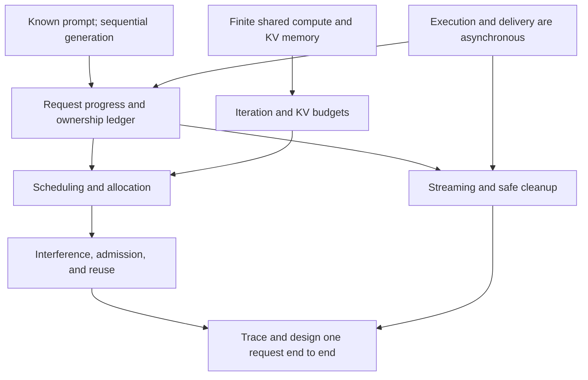

# Production LLM Serving: One Request End to End

[← Preparation plan](plan.md) · [← KV-cache sharding](kv-cache-sharding.md) · [Technique index](inference-techniques.md)

## Goal

Given a request and a competing workload, be able to explain:

- its current state and resource ownership,
- why it can or cannot run next,
- what one iteration changes,
- and when output and resources become complete.

## Baseline

- Warm decoder-only model with full causal attention.
- One generated sequence per request.
- Ordinary autoregressive decoding.
- One serving replica, possibly spanning several GPU ranks.
- Text input and streamed text output.
- No speculative decoding or beam search.

## Terminology rule

- **Token position:** a particular logical index in one sequence, such as position $10{,}000$.
- **Number of input tokens:** how many tokens the model processes in the current iteration.

We will not use “token positions” as a synonym for token count.

## Dependency map

## Lesson sequence

1. Request progress and ownership.
2. Iteration scheduling.
3. KV capacity and admission.
4. Prefill/decode interference.
5. Prefix reuse and preemption.
6. Streaming, deadlines, cancellation, and cleanup.
7. Observability and an end-to-end scheduling exercise.

---

## 1. Request progress and ownership

### Node 1 — Sampling a token does not create its K/V

A scheduler must distinguish:

- **known tokens:** token IDs already fixed for this request;
- **valid KV positions:** tokens already processed through the model.

K/V is produced by model projection layers. Selecting a token ID from logits does not run those layers.

For a seven-token prompt:

| Completed operation | Known tokens | Valid KV positions |
|---|---:|---:|
| Request arrives | $7$ | $0$ |
| Prefill; sample $y_1$ | $8$ | $7$ |
| Process $y_1$; sample $y_2$ | $9$ | $8$ |
| Process $y_2$; sample $y_3$ | $10$ | $9$ |

The rule is:

> Sampling advances the known-token frontier. Model execution advances the valid-KV frontier.

If $y_3$ terminates generation, it need not be processed: no later prediction needs its K/V.

This gives precise meanings to the two phases:

- **Prefill:** process many already-known prompt tokens.
- **Decode:** process the latest sampled token to produce logits for the next one.

#### Checkpoint

The learner correctly identified that after prefill of seven prompt tokens, processing $y_1$, and sampling $y_2$, there are nine known tokens but eight valid KV positions.

### Node 2 — A request persists across GPU iterations

Definitions:

- **Request:** one service attempt, including input, policy, outputs, and terminal result.
- **Sequence:** one independent autoregressive continuation—the thing that progresses token by token. Its **sequence state** is the data describing its current progress: token history, valid KV, and decoding state. Under our baseline, one request has exactly one sequence. A sequence is **not** a batch.
- **Iteration:** one scheduled model invocation.
- **Iteration batch:** the work selected from several sequences for that invocation.

One sequence advances across many iterations. One iteration batch can advance several sequences. A live sequence can receive no work in an iteration and still retain its state.

The minimum persistent ledger is:

| State | Required contents |
|---|---|
| Identity | Request/attempt ID, model configuration, arrival time, deadline |
| Progress | Prompt/generated IDs, known-token frontier, valid-KV frontier |
| Model state | KV references and their logical positions |
| Decoding | Sampling, RNG/constraint, and stop state |
| Output | Generated and delivered offsets |
| Lifecycle | Waiting, selected, in flight, terminal reason, cleanup status |

These events are not equivalent:

1. API acceptance.
2. Scheduler selection.
3. GPU launch.
4. GPU completion and committed progress.
5. Token generation.
6. Client delivery.
7. Safe resource reclamation.

For example, generation can finish while bytes remain buffered for the client. A GPU launch can return while the GPU still reads the request's KV.

The ledger must therefore answer three questions independently:

- What work is committed?
- What work is in flight?
- What resources does the request still own?

#### Checkpoint

The learner correctly identified that a live request omitted from one iteration retains its progress, KV ownership, and decoding state for a later iteration.

## 2. Iteration scheduling

### Node 3 — Eligibility comes before policy

Before ranking requests, the scheduler determines each request's **legal next work**.

A position is eligible only if:

1. its input token is known;
2. its causal predecessors are valid or will be produced earlier in the same valid model invocation;
3. the position is not already committed;
4. the same work is not already in flight;
5. the request is not terminal, cancelled, or expired.

For ordinary decode with $c_i$ valid KV positions, the next input belongs at logical position $c_i$. Position $c_i+1$ is not known yet.

Keep these terms separate:

- **Eligible:** legal to advance next.
- **Selected:** included in the current iteration plan.
- **In flight:** launched but not yet committed.

Example at one scheduling boundary:

| Request | State | Candidate work |
|---|---|---|
| $A$ | $a_1$ sampled; KV valid through prompt | Process $a_1$ |
| $B$ | Prompt known; no work in flight | Process an allowed prompt chunk |
| $C$ | Next decode already in flight | None |

$A$ and $B$ are eligible candidates. $C$ remains live but cannot launch the same decode again.

After an iteration, ledgers change. The scheduler can then remove terminal work, admit newly eligible work, and build a different batch. This is **continuous batching**:

> Batch membership is reconsidered at iteration boundaries rather than fixed for each request's full lifetime.

Continuous batching creates scheduling opportunities. It does not guarantee that all eligible work fits, that latency is low, or that allocation succeeds. Those are budget and policy questions.

#### Checkpoint

The learner correctly established that:

- in-flight work is not eligible for duplicate scheduling;
- eligibility, selection, and launch are separate states;
- continuous batching can remove $A$, retain $B$, and add $C$ at the next iteration boundary.

### Node 4 — One iteration needs several budgets

A request-count limit does not bound iteration work.

Example:

- $32$ decode requests usually contribute $32$ input tokens.
- $32$ unchunked prompts of length $512$ contribute $16{,}384$ input tokens.

Both plans contain $32$ requests, but their execution sizes differ by $512\times$.

Track these quantities separately:

| Quantity | Meaning |
|---|---|
| Retained requests | Requests still held by the service |
| KV-resident sequences | Sequences currently retaining model state |
| Selected sequences | Sequences included in this iteration batch |
| Number of input tokens | Tokens the whole iteration batch will process now |
| Required new KV blocks | Physical cache growth needed before execution |
| Estimated execution cost | Predicted time/resource demand for this exact mix |

#### Concrete batch example

At one iteration boundary:

- Sequence $A$ is decoding and contributes one input token.
- Sequence $B$ is prefilling and contributes $64$ input tokens.
- Sequence $C$ remains waiting and contributes nothing.

The iteration batch therefore contains:

- $2$ selected sequences: $A$ and $B$;
- $65$ input tokens: $1+64$.

The **input-token budget** limits the total across the iteration batch:

$$
\sum_i u_i.
$$

It is not a per-sequence limit. A separate policy may cap one sequence's prefill chunk size.

It also does not count the old KV context. If $A$ has $10{,}000$ valid KV positions and contributes one decode token, then $u_A=1$, even though attention reads the existing $10{,}000$-position history.

A basic iteration plan can require all of these constraints:

$$
N_{\text{selected}} \le N_{\max},
$$

$$
\sum_i u_i \le T_{\max},
$$

$$
\sum_i \Delta a_i \le A_{\text{free}},
$$

where:

- $N_{\text{selected}}$ is the number of sequences in this iteration batch;
- $N_{\max}$ is the maximum sequences allowed in one iteration batch—effectively the maximum request batch size under our one-sequence-per-request baseline;
- $u_i$ is the number of input tokens from sequence $i$ processed in this iteration;
- $T_{\max}$ is the maximum number of input tokens across the batch (`max_num_batched_tokens` in vLLM);
- $\Delta a_i$ is the number of new physical KV blocks needed;
- $A_{\text{free}}$ is the allocatable block count.

These constraints answer different questions:

- The sequence limit bounds batch metadata and supported execution shapes.
- The input-token limit bounds the amount of new model input.
- The block limit enforces KV feasibility.

The input-token budget is still only a proxy for time. Two iterations with $256$ input tokens can differ:

- a prefill chunk performs causal attention among its input tokens;
- $256$ one-token decodes can each read a long existing KV history;
- kernel shapes and communication can differ.

Therefore, a production scheduler may add a phase- and context-aware cost estimate. But even an approximate token budget is stronger than request count alone.

The decision order is now:

1. derive eligible work from request ledgers;
2. choose work under sequence, token, and cost limits;
3. verify and acquire the required KV capacity;
4. launch only the resulting feasible plan.

The next node will make step 3 precise: selection and KV allocation must agree before execution writes any new K/V.

#### Checkpoint

The learner correctly established that:

- four selected sequences can contribute $63$ input tokens;
- a batch can satisfy $T_{\max}$ while violating $N_{\max}$;
- equal sequence and input-token counts can have different costs because long-context decode reads more existing KV.

## 3. KV capacity and admission

### Node 5 — Selection must reserve writable KV capacity

A selected input token creates one new K/V position. The iteration must have storage for that write before execution begins.

Assume:

- fixed-size KV blocks of $G$ token positions;
- private, on-demand allocation;
- no prefix sharing or lookahead reservation yet;
- sequence $i$ has $c_i$ valid KV positions.

Its current block count is

$$
a_i=\left\lceil\frac{c_i}{G}\right\rceil.
$$

If the iteration schedules $u_i$ input tokens for it, the additional blocks required are

$$
\Delta a_i=
\left\lceil\frac{c_i+u_i}{G}\right\rceil-a_i.
$$

#### Example with $G=4$

| Sequence | Valid KV $c_i$ | Input tokens $u_i$ | Current blocks | Blocks after | $\Delta a_i$ |
|---|---:|---:|---:|---:|---:|
| $A$ | $7$ | $1$ | $2$ | $2$ | $0$ |
| $B$ | $8$ | $1$ | $2$ | $3$ | $1$ |
| $C$ | $0$ | $6$ | $0$ | $2$ | $2$ |

The proposed batch needs three new blocks:

$$
\Delta a_A+\Delta a_B+\Delta a_C=0+1+2=3.
$$

If only two blocks are allocatable, the batch is infeasible even if it satisfies $N_{\max}$ and $T_{\max}$.

The scheduler must then revise the plan—for example, defer $B$ or reduce $C$'s prefill chunk. Launching first and hoping memory becomes available later is not correct.

#### Scheduling and allocation transaction

The logical order is:

1. choose candidate work under sequence and input-token limits;
2. calculate its required KV growth;
3. reserve blocks and construct the logical-to-physical block mapping;
4. launch workers with that mapping;
5. commit valid-KV progress after successful execution.

“Transaction” here means the schedule and allocation must agree. It does not require a database transaction or one particular lock design.

Keep these quantities distinct:

- **valid KV:** model state already computed;
- **allocated capacity:** physical slots owned by the sequence;
- **in-flight writes:** allocated slots whose K/V is not committed yet.

For sequence $B$ above, reserving a third block makes capacity available, but its ninth KV position becomes valid only after execution completes.

This is the first direct scheduler/cache coupling:

> A request may be eligible and fit the compute budget, yet remain unselected because its next KV write cannot be allocated.

#### Checkpoint

The learner correctly established that:

- growing from $15$ to $17$ KV positions with $G=8$ needs one additional block;
- reserving capacity does not make an in-flight KV position valid;
- a plan that passes sequence and input-token limits must still be revised if its KV growth cannot be allocated.

### Node 6 — KV capacity comes from a finite block pool

For an unsharded full-attention cache, one token position occupies

$$
\kappa=2LH_{kv}ds
$$

bytes across all layers. Use the actual local layout for per-rank capacity: head sharding, context sharding, or replication changes local bytes.

With block size $G$, one physical block occupies

$$
M_{\text{block}}=G\kappa.
$$

If the serving system dedicates $M_{\text{pool}}$ bytes to KV, the idealized block count is

$$
A_{\text{total}}=
\left\lfloor
\frac{M_{\text{pool}}}{M_{\text{block}}}
\right\rfloor.
$$

#### Numerical example

For

$$
L=80,\quad H_{kv}=8,\quad d=128,\quad s=2\text{ bytes},
$$

one token position uses

$$
\kappa
=2\cdot80\cdot8\cdot128\cdot2
=320\,\mathrm{KiB}.
$$

With $G=16$ positions per block:

$$
M_{\text{block}}=16\cdot320\,\mathrm{KiB}=5\,\mathrm{MiB}.
$$

A $20\,\mathrm{GiB}$ KV pool therefore contains
 
$$
A_{\text{total}}=(20\,\mathrm{GiB})/(5\,\mathrm{MiB})=4096
$$

blocks under this simplified accounting.

#### The KV pool is not all HBM

Device memory must also hold:

- model weights;
- peak activations and execution workspaces;
- communication and graph buffers;
- allocator metadata and operational headroom.

So the scheduler uses the configured KV pool, not total device capacity. Increasing the maximum execution shape can enlarge workspaces and reduce the memory available for KV.

#### What paging fixes

A sequence's logical blocks may map to noncontiguous physical blocks. Growth therefore needs any free block, not a larger contiguous region.

Paging reduces external fragmentation, but it leaves tail waste. With on-demand private allocation:

$$
0\le a_iG-c_i<G.
$$

A sequence can waste fewer than $G$ positions in its final allocated block. Smaller blocks reduce this waste but increase block-table metadata and mapping granularity.

The next admission decision uses these block counts. Current fit is not enough: active sequences continue consuming blocks as they generate.

#### Checkpoint

The learner correctly established that:

- a $12\,\mathrm{GiB}$ pool with $3\,\mathrm{MiB}$ blocks holds $4096$ blocks;
- $33$ valid positions in blocks of $16$ leave $15$ unused tail positions;
- increasing execution workspace can shrink the KV pool because both share finite HBM.

### Node 7 — Current fit is not a completion guarantee

API acceptance, queue admission, and KV residency are separate decisions:

- **API acceptance:** the request passed frontend validation and overload checks.
- **Queue admission:** the service retains it as waiting work.
- **KV residency:** the serving replica gives its sequence physical KV capacity.

A request can be accepted and queued without being KV-resident.

#### Failure from incremental growth

Suppose the KV pool has four blocks.

- Sequence $A$ owns two full blocks.
- Sequence $B$ owns two full blocks.
- No block is free.
- Both sequences need one more block for their next decode token.

Both requests fitted when they became resident. Neither can now advance.

Stopping new admissions does not fix this state: the already-resident sequences require more capacity. The system must have an explicit recovery mechanism, such as preemption with re-computation, offload, or terminating work according to its contract.

#### Three admission strategies

| Strategy | Capacity rule | Main cost |
|---|---|---|
| Conservative reservation | Reserve enough blocks for a completion bound | Lower utilization when outputs finish early |
| Incremental allocation | Allocate blocks only as sequences grow | Later growth can require preemption or failure recovery |
| Predicted reservation plus headroom | Reserve an estimated amount and keep safety capacity | Prediction errors still need recovery |

A conservative upper bound can use prompt length plus the allowed maximum output length. This may reserve slightly more than exact execution needs because a final terminating token need not have its K/V computed, but it is simple and safe.

Incremental allocation admits more concurrent work. It is safe only when the system defines what happens if future growth does not fit.

#### Two different admission questions

1. **Can this request ever fit by itself?**
   
   Reject or change requests whose required context cannot fit even without competitors.

2. **Can this set of residents progress safely together?**
   
   Account for their current blocks, expected growth, and the chosen recovery policy.

Passing the first check does not imply the second.

#### Scheduler/cache feedback loop

The coupling is:

$$
\text{KV capacity}
\rightarrow
\text{resident sequences}
\rightarrow
\text{batching choices}
\rightarrow
\text{iteration time}
\rightarrow
\text{residence time}
\rightarrow
\text{KV pressure}.
$$

For example, pausing a slow request saves iteration work but does not free its KV. It can remain resident longer and increase memory pressure.

Admission policy must therefore state both:

- when a request may become resident;
- what recovery action is allowed if its later growth cannot be allocated.

#### Checkpoint

The learner correctly established that:

- rejecting new work cannot fix residents that already lack growth capacity;
- a no-KV-preemption contract requires conservative completion reservation;
- a request can be accepted and queued without being KV-resident.

## 4. Prefill/decode interference

### Node 8 — Continuous batching does not bound iteration time

Suppose an iteration contains:

- $32$ decode sequences, contributing $32$ input tokens;
- one new prompt containing $4096$ input tokens.

Continuous batching permits this mixed batch. It does not make the iteration short. All $32$ decode sequences wait for the mixed iteration to finish before their next outputs become available.

#### Why input-token count is approximate

For a prefill chunk of $u$ input tokens following $c$ valid KV positions, the number of causal query-key pairs is

$$
cu+\frac{u(u+1)}{2}.
$$

- $cu$ accounts for each new token attending to the old context.
- $u(u+1)/2$ accounts for causal attention among the new tokens.

Thus the cost of $u$ input tokens depends on $c$, phase, kernels, and hardware. The input-token budget controls batch size, but does not predict runtime exactly.

#### Chunked prefill

Instead of scheduling all $4096$ prompt tokens at once, cap this request's prefill contribution at $256$ tokens per iteration.

The prompt then needs $16$ chunks:

$$
4096/256=16.
$$

A scheduler can place ongoing decode tokens beside each chunk. This creates a scheduling boundary every $256$ prefill tokens instead of after all $4096$.

Chunking changes execution granularity, not model semantics:

- each chunk attends to all valid preceding context;
- the final prompt KV is still required;
- the first sampled output is available only after the final prompt chunk.

#### Chunk-size trade-off

| Smaller chunks | Larger chunks |
|---|---|
| More chances to run decode | Fewer scheduling boundaries |
| Usually smaller decode disruptions | Better kernel size and fewer launches |
| More launch/scheduling overhead | Larger gaps between generated tokens |
| Can increase prompt TTFT | Can finish one prompt sooner |

There is also a memory effect: a partially prefetched request retains KV but has not produced its first output. Admitting too many partial prefills can fill the KV pool with unfinished prompts.

A practical policy often:

1. reserves capacity for ongoing decode work;
2. uses the remaining input-token budget for one or more prefill chunks;
3. profiles chunk size rather than treating one value as universal.

The scheduler is balancing at least two latency objectives:

- **TTFT:** how long a new request waits for its first generated token;
- **inter-token latency (ITL):** each gap between consecutive generated tokens of an active sequence.

For model-token timestamps $t_1,\ldots,t_n$:

$$
ITL_j=t_j-t_{j-1},\qquad j=2,\ldots,n.
$$

**TPOT** is their per-request average:

$$
TPOT=\frac{t_n-t_1}{n-1},\qquad n>1.
$$

A client-visible inter-output gap is different: one streamed event can contain zero, one, or several tokens because of buffering and transport. We will define that separately in the observability section.

Improving TTFT can regress ITL, and vice versa.

#### Checkpoint

The learner correctly established that:

- continuous batching can still produce a large ITL gap when an iteration contains a long prefill;
- a chunk with $c=100$ and $u=4$ computes $410$ causal query-key pairs;
- smaller chunks create more decode opportunities but add overhead and can increase TTFT.

## 5. Prefix reuse and preemption

### Node 9 — A cached KV block can be reclaimable without being empty

Prefix caching reuses computed model state for requests with an equivalent prefix. It is more specific than matching text.

A safe cache identity includes the inputs that can change the cached K/V, such as:

- prefix token IDs and their preceding context;
- logical positions and positional semantics;
- model weights/version and active adapter;
- compatible KV representation;
- relevant multimodal inputs;
- the allowed tenant/security namespace.

Sampling temperature does not change prefix K/V. It acts on logits after the forward pass, so two requests with different temperatures can share immutable prefix blocks and then use private continuation blocks.

#### Three physical block states

| Block state | Meaning | Reclaimable now? |
|---|---|---|
| Pinned | Referenced by a live request or in-flight operation | No |
| Cached, unreferenced | Contains reusable KV but has no active owner | Yes, under eviction policy |
| Free | Contains no cache entry the system intends to preserve | Yes |

“Cached” and “allocated by the memory pool” do not imply “owned by a live request.”

#### Shared-prefix example

Requests $A$ and $B$ share two immutable prefix blocks, $P_0$ and $P_1$.

1. While both requests use them, each block has two active references.
2. If $A$ finishes, its references are removed; $B$ still pins the blocks.
3. If $B$ finishes, the active reference count reaches zero.
4. The blocks may remain cached for reuse, but the eviction policy can now reclaim them.

Private continuation blocks follow their own ownership lifecycle. Finishing $A$ can release $A$'s continuation without affecting $B$.

If a shared block must be modified, the system needs copy-on-write or an equivalent isolation mechanism. A simple design shares only immutable full prefix blocks and allocates private continuation blocks.

#### What a cache hit saves

A prefix hit can save:

- recomputing the matched prefix;
- physically duplicating shared prefix KV.

It does not automatically remove:

- later decode attention over that prefix;
- the need to pin its physical blocks while in use;
- private capacity for new continuation tokens;
- all boundary computation needed to obtain next-token logits.

K/V stores attention state, not a cached next-token distribution. Exact boundary handling is implementation-specific.

Prefix-cache admission must therefore count shared physical blocks and new private growth—not sum every request's logical prefix length as if all blocks were duplicated.

#### Checkpoint

The learner correctly established that:

- a shared prefix remains pinned while any active request still references it;
- sampling temperature does not prevent immutable prefix-KV sharing;
- a block can be cached, unreferenced, and reclaimable without being empty.

### Node 10 — Evicting cached state and preempting active state are different

**Preemption** suspends a request before it has finished so that another request can use a constrained resource. The suspended request remains live and may resume later.

In this lesson, **active-KV preemption** means stopping future scheduling for a sequence and reclaiming KV that it still needs. Resuming then requires running prefill again or reloading an offloaded KV copy.

Merely leaving a request out of one iteration is not active-KV preemption if it keeps its KV. Cancellation is also different: cancellation makes the request terminal rather than intending to resume it.

Two memory-pressure actions have different correctness costs.

#### Cache eviction

Evicting an unreferenced cached prefix:

- frees reclaimable physical blocks;
- loses a future optimization;
- does not interrupt an active request.

A later matching request simply prefills the prefix again.

#### Active-state preemption

Freeing KV required by an active sequence removes state needed for its next decode. The request can resume only through an explicit recovery path.

| Recovery path | Preserved elsewhere | Resume cost |
|---|---|---|
| Prefill again | Committed token history and decoding/output state | Run prefill over the committed tokens to rebuild KV |
| Swap/offload | KV representation in host memory or another tier | Transfer KV back before execution |

To resume without an offloaded KV copy, run **prefill again** over the committed token history. This rebuilds the missing KV.

This prefill must not:

- resample the committed tokens;
- emit them to the client again;
- advance RNG or constraint state as if they were new outputs.

After prefill rebuilds KV through the committed frontier, ordinary decode continues.

#### Example

Sequence $A$ owns ten active KV blocks. Memory pressure preempts it by recomputation:

1. stop selecting new work for $A$;
2. wait until existing accesses are safe to release;
3. retain $A$'s committed token history, sampling state, and output offsets;
4. free its KV blocks;
5. later allocate capacity and run prefill over the committed token history;
6. resume generation without replaying delivered output.

Step 2 will be derived precisely in the cancellation section; an asynchronous kernel may still be using the blocks.

#### Thrashing

Preemption can increase apparent GPU activity while reducing useful output.

If a request is repeatedly evicted and recomputed, the system spends input-token budget rebuilding old state. Track at least:

- preemption count;
- recomputed input tokens;
- swapped bytes and transfer time;
- useful generated tokens.

High utilization is not sufficient evidence of good service if much of the work is recovery.

A practical reclamation order normally prefers unreferenced cached blocks before active-state preemption, because cache eviction loses only potential reuse while active preemption adds mandatory recovery work.

#### Checkpoint

The learner correctly established that:

- skipping iterations while retaining KV is a pause, not active-KV preemption;
- preemption without an offloaded copy requires prefill over committed tokens before decode resumes;
- evicting unreferenced cached state normally costs less than preempting active state.

## 6. Streaming, deadlines, cancellation, and cleanup

### Node 11 — Cancellation does not make in-flight KV immediately reusable

GPU launches are asynchronous. The CPU can observe cancellation while a previously launched kernel still reads or writes the request's KV blocks.

Reusing those blocks immediately can create a use-after-free race:

1. kernel $K_A$ for request $A$ is launched;
2. the CPU receives cancellation for $A$;
3. the allocator assigns $A$'s blocks to request $B$;
4. $K_A$ continues accessing the same addresses and corrupts or reads $B$'s state.

Cancellation must separate two actions:

- **stop future scheduling now;**
- **reclaim resources only after previous accesses are complete.**

#### Action by request state

| State when cancellation is observed | Safe action |
|---|---|
| Waiting; no resources or work in flight | Remove it from the queue and release owned host state |
| Selected but not launched | Remove it from the plan and release reservations |
| GPU work in flight | Suppress future work; mark affected resources pending-free |
| Shared prefix blocks | Drop only this request's references |

For in-flight work, reclamation waits for an ordering mechanism such as a CUDA event, stream ordering, a completion callback, or an equivalent deferred-free queue. A global device synchronization is not inherently required.

#### Completion can race cancellation

One request attempt needs one authoritative terminal outcome. Cancellation and normal completion may arrive concurrently.

The implementation must ensure:

- no new useful work is scheduled after the terminal decision;
- a late completion cannot publish stale output as a new continuation;
- committed progress is not advanced twice;
- private resources are eventually reclaimed;
- shared resources remain until their other references end.

A useful cleanup state is **terminal, pending reclamation**: the request will not resume, but some resources cannot be reused yet.

#### Repair — terminal outcome and memory reuse are separate decisions

Suppose cancellation races the final model completion.

The implementation uses one atomic/serialized terminal transition:

| Transition that commits first | Request outcome | Memory action |
|---|---|---|
| Normal completion | Publish the completed result; later cancellation is a no-op | Reclaim only when all accesses and references permit it |
| Cancellation | Suppress any late model output; do not schedule more work | Reclaim only when all accesses and references permit it |

There is no universal rule that cancellation always wins. It may arrive after normal completion already became authoritative.

Even when cancellation wins, it does **not** imply immediate reuse. Terminal state answers whether the request may publish more progress. Stream/event completion and reference ownership answer whether its memory may be reused.

So the implementation needs two independent checks:

1. **Which terminal outcome won?**
2. **Are the resources safe to reclaim?**

Conflating them creates either duplicate/stale output or use-after-free memory access.

#### Distinction from preemption

- **Cancellation:** the request becomes terminal and will not resume.
- **Preemption:** the request remains live and must restore KV before resuming.

Both may need deferred reclamation when GPU work is already in flight.

#### Checkpoint

The learner correctly established that:

- cancellation stops future scheduling but defers reuse of in-flight KV;
- cancelling one user releases only that user's references to shared blocks;
- one terminal outcome must win a completion/cancellation race;
- terminal outcome and safe memory reuse are independent decisions.

### Node 12 — Network backpressure does not automatically stop generation

Model generation and client delivery are separate progress streams.

Track at least:

- generated output offset $g$;
- delivered output offset $d$;
- buffered output $g-d$.

If the model generates $100$ tokens/s while the client consumes $20$ tokens/s, the undelivered token backlog grows at roughly

$$
100-20=80\text{ tokens/s}.
$$

The exact memory cost is measured in buffered bytes, because tokens, text characters, and protocol events are not one-to-one.

Transport flow control can block the network writer. It does not stop the GPU scheduler unless the serving system explicitly propagates that state back to scheduling.

#### Slow-consumer policies

| Policy | Compute effect | Memory/residency effect |
|---|---|---|
| Continue generating | No immediate compute reduction | Output buffer grows |
| Coalesce output events | Reduces event overhead | Buffered bytes can still grow |
| Pause the sequence | Stops its new model work | KV remains resident longer |
| Preempt the sequence | Frees active KV | Later prefill or reload is required |
| Cancel after a limit | Stops future useful work | Terminal cleanup still follows safety rules |

A queue containing only one coalesced output object is not necessarily bounded: that object can keep accumulating text. Use an explicit byte/event/time limit.

#### Isolation requirement

One slow network writer must not block the shared model scheduler or every other stream.

A common separation is:

1. model execution produces per-request output;
2. a bounded per-request queue stores pending output;
3. an independent writer obeys transport flow control;
4. scheduler policy reacts when that queue crosses a threshold.

The policy must define what “reacts” means: pause, preempt, or cancel.

#### Completion boundaries

These events can occur at different times:

1. last model token generated;
2. last text chunk formed;
3. last chunk accepted by the transport;
4. last byte observed by the client;
5. terminal protocol event observed.

Therefore, “request completed” is incomplete unless the metric or API contract names its boundary.

#### Checkpoint

The learner correctly established that:

- producer minus consumer rate gives backlog growth;
- pausing a slow consumer retains its active KV;
- model completion can precede client-visible delivery completion.

### Node 13 — Preserve one deadline across the whole request path

A deadline is an absolute latest completion time, not a fresh timeout for every component.

If the original deadline is $D$ and a component begins work at time $t$, its remaining budget is

$$
\max(0,D-t).
$$

Resetting a $30$-second timeout at the frontend, scheduler, model worker, and transport could let one request run far longer than the client's original $30$-second limit.

#### Different latency contracts

| Contract | Boundary |
|---|---|
| Overall deadline | Request start to declared terminal delivery event |
| TTFT objective | Request start to first generated or delivered content, as declared |
| ITL objective | Gap between consecutive generated model tokens |
| Slow-consumer timeout | Time output remains blocked or undrained |

These contracts trigger different actions. Missing a TTFT target does not automatically mean the overall deadline has expired.

#### Where to check expiration

Check remaining time:

- before expensive preprocessing;
- while waiting in scheduler queues;
- before selecting more model work;
- before retrying, prefetching, or rebuilding KV;
- while output delivery is blocked.

If an expired request has work in flight, expiration becomes a cancellation signal: stop future work, then follow deferred-reclamation rules.

#### Overload and bounded queues

A queue cannot grow without bound. Under overload, longer queueing:

- consumes host memory;
- makes more requests miss deadlines before execution;
- hides that admitted demand exceeds capacity.

Request count or QPS alone is a weak load measure. One request may contain a short prompt and output; another may retain a long KV context for minutes.

Overload control should use relevant work and resource signals, such as:

- queued input tokens and oldest queue age;
- resident KV blocks and expected growth;
- recent iteration time;
- missed TTFT/ITL/deadline rates.

When the system cannot meet its contract, reject or shed work deliberately instead of accepting an unbounded queue.

A request can therefore end before model execution with an overload rejection or queue-deadline expiry. That is a valid terminal outcome and should be measured separately from model failure.

#### Checkpoint

The learner correctly established that:

- an absolute deadline at $50$ with current time $38$ leaves $12$ seconds;
- missing TTFT does not itself imply that the overall deadline expired;
- equal request rates can create different compute, queueing, and KV pressure.

## 7. Observability and end-to-end diagnosis

### Node 14 — Define metrics from timestamps, not names

Metric names vary across tools. Record the event boundary first.

For one request, define:

| Symbol | Event |
|---|---|
| $t_0$ | Server receives the request |
| $t_q$ | Scheduler enqueues it |
| $t_x$ | Its first model execution begins |
| $t_1$ | Its first model token is generated |
| $t_j$ | Its $j$th model token is generated |
| $t_n$ | Its last model token is generated |
| $t_d$ | Its final content is observed by the client |

Then:

$$
TTFT_{server}=t_1-t_0,
$$

$$
T_{queue}=t_x-t_q,
$$

$$
ITL_j=t_j-t_{j-1},\qquad j=2,\ldots,n,
$$

$$
TPOT=\frac{t_n-t_1}{n-1},\qquad n>1,
$$

$$
E2E_{delivery}=t_d-t_0.
$$

TPOT is undefined for fewer than two generated tokens. A tool may omit those requests or record a sentinel such as zero; the report must state which.

#### Numerical example

Suppose:

$$
t_0=0,\quad t_1=0.8,\quad t_2=0.9,\quad t_3=1.3,\quad t_d=1.5
$$

seconds.

Then:

- server TTFT is $0.8$ s;
- ITLs are $0.1$ s and $0.4$ s;
- TPOT is $(1.3-0.8)/2=0.25$ s;
- delivery E2E latency is $1.5$ s.

The $0.25$-second TPOT hides the individual $0.4$-second stall. Report tail ITL as well as average TPOT.

#### Client and server metrics differ

Client TTFT starts at client submission and ends at the first content-bearing client event. It includes network and transport effects that server TTFT may exclude.

A first byte or protocol event can contain no model text. Therefore, time-to-first-byte and time-to-first-content are different metrics.

#### Count populations explicitly

Keep separate rates for:

- offered requests;
- accepted requests;
- rejected requests;
- successful completions;
- failures;
- cancellations;
- generated tokens;
- delivered tokens.

**Goodput** is successful work that meets a declared latency and quality contract per unit time. Throughput without SLO compliance can increase while user-visible service gets worse.

#### Checkpoint

The learner correctly established that:
- token times $1.0,1.2,1.8$ give ITLs $0.2,0.6$ and TPOT $0.4$ seconds;
- TPOT is undefined for a one-token output unless a tool defines a sentinel;
- time-to-first-byte can precede time-to-first-content.

### Node 15 — User latency needs internal resource signals

A latency metric identifies a symptom. Internal signals locate its owner.

| User-visible symptom | Internal signals to inspect |
|---|---|
| High TTFT | Tokenization time, queue age, prefix hit, prefill chunks, first scheduling time |
| ITL spikes | Iteration duration, prefill/decode mix, context lengths, preemption, GPU/communication time |
| Client gaps but stable model ITL | Buffered bytes, writer blocked time, transport and network delay |
| High throughput but low goodput | Tail latency, rejection, cancellation, failure, and SLO-miss rates |
| KV allocation failures | Pinned, pending-free, cached-reclaimable, and free block counts |

Record model iterations as shared events. Attach request IDs and the selected input-token counts to an iteration trace. Do not charge the complete shared iteration time independently to every included request and then sum it as resource usage.

#### Counters, gauges, and distributions

Use the right signal type:

- **Counter:** cumulative events, such as generated tokens, preemptions, allocation failures, and rejected requests.
- **Gauge:** current state, such as queue length, resident sequences, free blocks, and buffered bytes.
- **Histogram/distribution:** variable durations and sizes, such as TTFT, ITL, iteration time, prompt length, and context length.

Averages alone hide tails. For example, one $2$-second ITL stall can be hidden by many $50$-millisecond gaps.

#### Clarification — counter versus gauge

Ask which question the metric answers:

- **Counter:** “How many have happened since this counter started?”
- **Gauge:** “How many are there right now?”

Example, with no process restart or counter reset:

| Event | Cumulative preemptions — counter | Free KV blocks — gauge |
|---|---:|---:|
| Initial observation | $12$ | $20$ |
| One request is preempted; four blocks become safely reusable | $13$ | $24$ |
| Another request allocates six blocks | $13$ | $18$ |

Allocating blocks does not undo the earlier preemption. The counter stays at $13$; the gauge falls to $18$.

A counter is not appropriate merely because the value is a count: **free blocks are a count, but they measure current state, so they need a gauge.** A counter increases or resets; it does not decrease as part of normal event accounting.

#### Separate useful work from recovery work

Track token populations separately:

- new prompt input tokens;
- ordinary decode input tokens;
- input tokens repeated by preemption recovery prefill;
- prefix tokens reused without execution;
- generated output tokens;
- delivered output tokens.

Then a highly utilized GPU cannot hide repeated recovery prefill behind a single total-token counter.

#### KV accounting invariant

At a measurement instant, every physical block should belong to one explicit category. A useful accounting identity is

$$
A_{\text{total}}
=
A_{\text{pinned}}
+A_{\text{pending-free}}
+A_{\text{cached-reclaimable}}
+A_{\text{free}}.
$$

If the categories do not sum to the pool, the telemetry or allocator ownership model is incomplete.

Use request IDs in traces and logs, not as metric-label values: per-request metric labels create unbounded cardinality.

#### Checkpoint

- Correctly located client stalls with steady model ITL and growing buffered output in the writer/transport path.
- Initially swapped counter and gauge; after the clarification, correctly kept cumulative preemptions at $13$ while allocation reduced the free-block gauge from $24$ to $18$. This demonstrates application after feedback, not an unassisted initial answer.
- Correctly chose recovery-prefill input tokens/s to detect work spent rebuilding discarded KV rather than advancing generation.

### Node 16 — The load generator can hide overload

You now have metrics to diagnose the server. But the experiment also needs to specify **when new requests arrive**.

#### Fixed concurrency: closed-loop load

Keep ten requests outstanding. Each time one finishes, send a replacement.

With no think time, steady state, and no failures:

| Average request duration | Outstanding requests | Approximate request rate |
|---|---:|---:|
| $1$ s | $10$ | $10$ requests/s |
| $2$ s | $10$ | $5$ requests/s |

When the server slows down, the generator sends fewer replacements. The experiment has reduced offered load automatically.

This measures service at a chosen concurrency. It does **not** by itself show what happens if real arrivals continue at ten requests/s during the slowdown.

#### Fixed arrival rate: open-loop load

Schedule a new request every $100$ ms, independently of previous completions. That targets ten requests/s.

If the server sustains only five completions/s, the difference must appear somewhere: growing outstanding work, rejections, cancellations, or expiry. It cannot disappear merely because execution is slow.

Use server-side queue limits and explicit overload rejection. Open-loop testing does not mean accepting unlimited work.

Check that the generator actually maintains the intended arrival schedule. Record intended and actual send times; a blocked generator can quietly turn a rate test into a lower-load test.

#### Clarification — fixed arrivals do not mean fixed outstanding requests

**Outstanding requests** are requests already sent but not yet completed or otherwise terminated. They include waiting requests, not just the current GPU batch or KV-resident sequences.

Suppose $20$ requests are outstanding initially. Every second, ten arrive and six finish. There are no other departures:

| Interval | Outstanding at start | Arrivals | Completions | Outstanding at end |
|---|---:|---:|---:|---:|
| First second | $20$ | $10$ | $6$ | $24$ |
| Second second | $24$ | $10$ | $6$ | $28$ |

Each second leaves four additional unfinished requests:

$$
\text{outstanding at end}
=
\text{outstanding at start}+10-6.
$$

The distinction is what the generator holds fixed:

- **Closed loop:** hold the outstanding count fixed; send a replacement after a departure.
- **Open loop:** hold the arrival schedule fixed; send regardless of previous completions.

A constant outstanding count would require departures to match arrivals. In this example, it could be maintained only by reducing arrivals or adding other departures such as rejections or expiry. Neither occurs under the stated assumptions.

#### Compare policies under the same workload

To compare two chunk sizes or admission policies, hold these fixed:

- model, hardware, software version, and relevant configuration;
- prompt/output-length mix, generation limits, and sampling settings;
- arrival schedule or concurrency;
- prefix-cache condition: cold, warm, or a declared reuse distribution;
- measurement boundaries and latency/quality objectives.

Warm model execution separately from prefix-cache state. A warmed executor can still have a cold prefix cache. Repeating identical prompts can warm that cache and make a later run faster without any policy improvement.

Report offered and actual send rates, successful completions, rejections/failures, TTFT/ITL tails, and goodput. Do not compare only the requests that happened to finish quickly; account for outstanding work when the measurement window ends.

The next exercise will combine request progress, batch limits, KV ownership, and latency in one small serving trace.

#### Checkpoint

- Correctly derived that fixed concurrency of $12$ with average duration increasing from $1$ s to $3$ s reduces request rate from $12$ to $4$ requests/s.
- Initially selected constant outstanding work for unequal open-loop arrival/completion rates. After the clarification, correctly solved a fresh example: $15$ outstanding plus $16$ arrivals minus $10$ completions gives $21$. This is successful application after feedback.
- Correctly identified that changing both chunk size and prefix-cache warmth prevents attributing lower TTFT to chunk size alone.

## 8. Integrated serving trace

### Node 17 — Trace the batch, KV blocks, and outputs together

This worked example combines scheduling, chunked prefill, cancellation, and latency. **Timings are hypothetical, not benchmark results.**

#### Configuration

- Six KV blocks, each holding four token positions.
- At most two sequences and five input tokens per iteration.
- Schedule ready decodes first; use spare capacity for prefill.
- Maximum prefill chunk: four input tokens.
- Private, on-demand KV allocation; no sharing, prefix caching, or preemption.
- Each iteration takes exactly $10$ ms in this toy trace. All outputs are sampled at its end; no overlapping iterations.
- Output processing/delivery is instantaneous for this example. No request finishes naturally during the trace.

#### Initial state at $t=0$

| Request | State                                            | Valid KV positions | Owned blocks |
| ------- | ------------------------------------------------ | -----------------: | -----------: |
| $A$     | Ready to decode its latest sampled token         |                $7$ |          $2$ |
| $B$     | Six-token prompt just received and tokenized     |                $0$ |          $0$ |
| $C$     | Ready to decode; previous token sampled at $t=0$ |                $8$ |          $2$ |

Two blocks are free. Cancellation for $A$ will arrive at $t=4$ ms.

#### Iteration 1: $0$–$10$ ms

Select $A$ and $C$: two sequences and two input tokens.

- $A$ needs no new block: its next KV entry fits in its second block.
- $C$ needs one new block: growing from eight to nine entries crosses a block boundary.
- Reserve that block before launch. One free block remains.
- $B$ waits because both sequence slots are used, even though three input-token slots remain.

At $t=4$, cancellation makes $A$ terminal. Its two blocks are **pending-free**, not reusable: the launched work still accesses them. The iteration keeps running for $C$; membership does not change mid-launch.

At $t=10$, suppress $A$'s output and safely release its two blocks. $C$ now has nine valid KV entries, three blocks, and a newly sampled token awaiting its next decode. Three blocks are free.

#### Iterations 2 and 3

| Interval | Selected inputs | Input tokens | New blocks reserved | Valid KV after completion | Free blocks after completion |
|---|---|---:|---|---|---:|
| $10$–$20$ ms | $C$: one decode; $B$: four prompt tokens | $5$ | One for $B$ | $C=10$, $B=4$ | $2$ |
| $20$–$30$ ms | $C$: one decode; $B$: two remaining prompt tokens | $3$ | One for $B$ | $C=11$, $B=6$ | $1$ |

$B$ produces no continuation token after its first chunk. At $t=30$, the final chunk supplies logits for $B$'s first output token.

#### Read the metrics from the trace

- $B$ first runs at $10$ ms: initial queue time is $10$ ms.
- $B$ first generates at $30$ ms: server TTFT is $30$ ms.
- $C$ generates at $0,10,20,30$ ms: its observed ITLs are all $10$ ms.
- $A$ is cancelled at $4$ ms and its private KV is reusable at $10$ ms: KV cleanup delay is $6$ ms.

At $t=30$, five blocks are owned and one is free. $B$ knows seven token IDs but has only six valid KV entries: sampling its first output did not create that output token's K/V.

The fixed $10$-ms durations let us check state transitions. They do **not** demonstrate that chunking leaves real decode latency unchanged; that requires measured iteration times.

#### Clarification — chunk limit versus remaining batch budget

**Variant:** increase only the maximum sequences per batch from two to three. The original trace above remains unchanged.

After selecting one decode input each for $A$ and $C$:

| Limit | Capacity left for $B$ |
|---|---:|
| Sequence slots | One slot, so $B$ may enter |
| Batch input-token budget | $5-1-1=3$ input tokens |
| Maximum prefill chunk | At most $4$ input tokens |
| KV capacity after reserving $C$'s growth | One free block, holding $4$ tokens |
| Unprocessed prompt | $6$ tokens |

The chunk size must satisfy every limit. Here the remaining **batch input-token budget** limits $B$ to three tokens.

A four-token chunk would give

$$
1\text{ from }A+1\text{ from }C+4\text{ from }B=6>5.
$$

A maximum prefill chunk is a ceiling, not a guaranteed allocation. Similarly, room in a KV block does not grant more input-token budget.

#### Checkpoint

- Correctly kept $A$'s two cancelled-but-in-flight blocks unavailable, leaving only one immediately allocatable block.
- In the three-sequence variant, selected four prompt tokens for $B$ instead of three. The learner clarified that they had remembered the input-token budget as six rather than five. Four would be correct under that remembered budget; treat this as a parameter mix-up, not evidence of misunderstanding the constraints.
- With the limits displayed in a compact table, correctly scheduled four prefill tokens alongside three one-token decodes under a seven-input-token batch budget and six-token chunk cap.
- Correctly derived TTFT of $40$ ms from receipt at $0$ ms and prompt chunks at $10$–$20$ and $30$–$40$ ms, including queueing and inter-chunk waiting. Also correctly retained six valid KV entries after sampling the first output from a six-token prompt.

## Study status

Nodes 1–17 and the worked-trace checkpoint are complete. The lesson establishes conceptual reasoning about scheduling, KV ownership, cancellation, delivery, metrics, and load-test controls.

No service, scheduler simulator, or real GPU benchmark has been implemented in this topic. The trace uses hypothetical timings; measured profiling and optimization evidence remain next-stage work.

**Teaching convention:** display numeric limits together in a compact table for scheduling questions. Keep input tokens per batch, sequences per batch, chunk size, and KV blocks explicitly separate.

## Sources

- [Efficient Memory Management for Large Language Model Serving with PagedAttention](https://arxiv.org/pdf/2309.06180) — autoregressive generation and KV-cache progression.
- [TensorRT-LLM: In-flight batching and paged-attention scheduling](https://nvidia.github.io/TensorRT-LLM/features/paged-attention-ifb-scheduler.html) — concrete prefill/decode scheduling walkthrough.
- [Orca: A Distributed Serving System for Transformer-Based Generative Models](https://www.usenix.org/system/files/osdi22-yu.pdf) — iteration-level scheduling for autoregressive generation.
- [Sarathi-Serve](https://www.usenix.org/system/files/osdi24-agrawal.pdf) — prefill/decode interference and chunked-prefill scheduling.
- [vLLM V1 prefix caching](https://docs.vllm.ai/en/latest/design/v1/prefix_caching/) — cache identity, full-block reuse, and block lifecycle.
- [gRPC cancellation](https://grpc.io/docs/guides/cancellation/) — cooperative cancellation semantics.
- [vLLM asynchronous abort path](https://github.com/vllm-project/vllm/blob/main/vllm/v1/engine/async_llm.py) — concrete request-abort propagation.
- [gRPC flow control](https://grpc.io/docs/guides/flow-control/) — transport backpressure semantics.
- [gRPC deadlines](https://grpc.io/docs/guides/deadlines/) — absolute deadline propagation.
- [Google SRE: Handling Overload](https://sre.google/sre-book/handling-overload/) — bounded queues and resource-aware load shedding.
- [OpenTelemetry GenAI metrics](https://github.com/open-telemetry/semantic-conventions-genai/blob/main/docs/gen-ai/gen-ai-metrics.md) — current metric conventions and TPOT definition.
- [Prometheus histograms and summaries](https://prometheus.io/docs/practices/histograms/) — latency distributions and percentile aggregation.
- [NVIDIA Perf Analyzer load modes](https://github.com/triton-inference-server/perf_analyzer/blob/main/docs/inference_load_modes.md) — concurrency-driven versus request-rate-driven load.
- [vLLM benchmark guidance](https://github.com/vllm-project/vllm/blob/main/docs/benchmarking/cli.md) — benchmark controls, metric definitions, and prefix-cache warming hazards.
