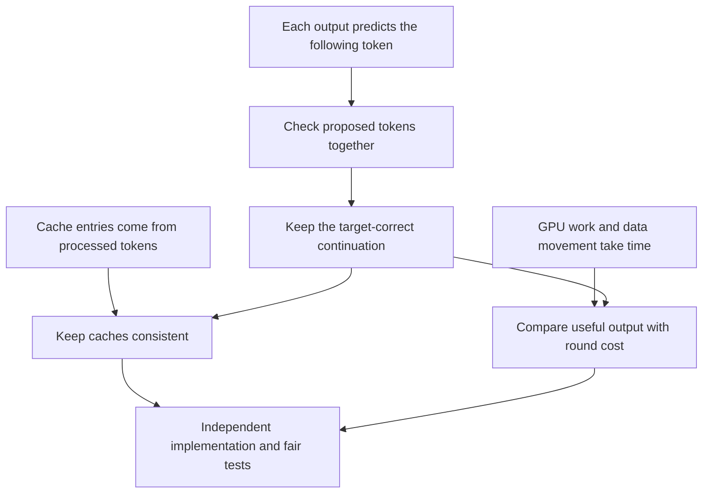

# Speculative decoding

## Goal

Understand how speculative decoding works, why it can be faster, and when its extra work outweighs the benefit. Use that understanding to independently add it to the learner’s study inference engine and measure the results.

**The learner will write the implementation. The assistant will not change the engine or implement speculative decoding.**

Engine location: `D:\Code\nano-vllm\nanovllm\experiments` (available here as `/mnt/d/Code/nano-vllm/nanovllm/experiments`). Engine references describe the read-only [[#Local engine inspection snapshot|working-tree inspection below]], not a permanent property of future versions.

## Primary source

The learner requested [Modular’s handbook chapter on speculative decoding](https://handbook.modular.com/inference-optimization/speculative-decoding/) as the main lesson material. The researcher read the chapter and inspected its main mechanism diagram. The lesson follows that chapter, with supplemental verification from the original papers where needed.

## Lesson status

Sections 1, 2, 3.1–3.4, and 4.1–4.4 each passed all three checkpoint questions. Section 4.5 was started but not completed. The learner then stopped the detailed checkpoint sequence and requested a concise practical summary of benefits, drawbacks, and when to use speculative decoding. Follow that scope; do not resume the previous quiz sequence without a request. At the learner’s request, the practical summary was subsequently checked against the handbook, original papers, and current official engine documentation; the qualifications and evidence are recorded below. The learner then chose a mechanisms-and-trade-offs overview of drafting approaches. Section 5 presents that researched comparison, continuing the proposer overview in the approved plan, without restarting prerequisite or cache checkpoints.

Examples use greedy decoding to match the inspected engine. Random sampling is a separate branch, not an assumed implementation requirement.

**2026-10-06 review:** rechecked the primary papers, pinned EAGLE/vLLM code, and local engine observations. Revised explanations and source precision without changing checkpoint status or extending the lesson scope.

**Reading routes:** [[#Practical decision summary|When it helps]] · [[#1. How one forward pass checks several proposed tokens|Mechanism]] · [[#3. Keeping the caches correct|Cache state]] · [[#4. Understanding the performance|Performance]] · [[#Side-by-side comparison|Compare drafters]].

## Practical decision summary

Speculative decoding trades extra cheap prediction work for fewer sequential calls to the expensive target. It helps only when a complete speculative round is cheaper than ordinary decoding of the output that round actually commits.

### Main benefits

- **Faster generation:** several output tokens can be committed after one target verification pass. This can reduce completion latency and improve output throughput.
- **Keep the target’s choices:** strict greedy verification produces the same tokens given the same target decisions and tie-breaking. For random sampling, the exact acceptance-and-correction algorithm preserves the target’s probability distribution, not necessarily the same text for the same seed. Floating-point differences between execution paths can affect either guarantee in practice. Relaxed acceptance and methods that change the target weights require separate qualification.
- **Use otherwise spare arithmetic capacity:** multi-position verification can reuse weights across positions instead of reading them in several separate target calls. This helps particularly when ordinary decoding is limited by moving weights from memory.

### Main drawbacks

- **Extra work can make it slower.** Drafting, verification of rejected tokens, and bookkeeping all cost time. High agreement alone does not guarantee a win if the draft is expensive.
- **Memory overhead can reduce serving capacity.** A separate draft adds weights and its own KV cache; verification also needs speculative target state and working buffers. Prompt lookup does not require another neural model, and auxiliary heads avoid a separate full language model, but neither makes verification free.
- **Implementation becomes more complex.** Multi-position outputs, rollback, stopping, scheduling, and any draft cache need coordinated handling.
- **The benefit depends on the workload.** Model pair, task, decoding settings, context length, proposal length, and concurrency can change the result. A speedup for one request does not imply a speedup for a busy server.
- **Streaming can become bursty.** Several tokens become available together after verification; lower average time per output token does not guarantee shorter individual gaps. Separately, [Chen et al. §6.3](https://arxiv.org/html/2302.01318v1#S6.SS3) report increased **full-sequence generation latency variance** with longer drafts, which matters for tail latency.

### When it is worth trying

The strongest candidate is a relatively expensive target, a much cheaper proposer that frequently agrees with it, low-to-moderate request concurrency, spare memory, and enough generated output for decode time to matter. Long generations can make decode improvements more valuable, but long output alone does not guarantee a speedup.

### When to avoid it or give it lower priority

- The draft costs nearly as much as the target, or agreement is poor.
- At large ordinary batch sizes, extra speculative compute erases the gain in representative measurements. High concurrency by itself is not a reason to reject speculation; see the counterexample below.
- Memory is tight and the draft reduces useful serving capacity.
- Startup or prompt processing dominates the request. Standard speculative decoding accelerates output generation, not the initial prompt pass.
- A representative benchmark shows no net improvement over the existing optimized baseline.

### High concurrency is not an automatic “no”

Ordinary batching already shares weight reads and uses more compute, so it can make speculation less attractive. But current vLLM documentation lists potential high-QPS gains for several methods.

A concrete counterexample is EAGLE-3 §4.3/Table 3: **$1.38$-fold throughput at batch size $64$**, using Llama-3.1-8B-Instruct, one H100, SGLang v0.4.4, MT-Bench, and a target-specific EAGLE-3 drafter with a linear chain of length three. This establishes that a large-batch benefit is possible. It does not establish a universal saturated-server gain or predict results for a conventional separate-model draft in this engine.

### What if ordinary decoding is compute-bound?

For conventional draft-then-verify on the same GPU, **if ordinary decoding already uses compute efficiently and verification does not improve that efficiency, expect worse throughput**.

Fewer target calls do not mean less target arithmetic. Verification still evaluates the target at every supplied position. With perfect acceptance, it performs roughly the same useful target arithmetic per output token as ordinary decoding, plus drafting and coordination. With rejections, it also performs target arithmetic for discarded positions.

In bandwidth-limited decoding, extra positions can exploit otherwise unused arithmetic capacity while sharing weight reads. In efficiently compute-saturated decoding, that spare capacity is unavailable: extra arithmetic adds time.

This is a conditional cost argument, not a theorem that every implementation described as “compute-bound” must lose. Changes in matrix shapes can change achieved compute efficiency, and execution overheads or different resource placement can alter the comparison. The usual benefit from amortizing weight reads alone does not overcome a saturated arithmetic bottleneck.

**High concurrency is not proof of compute saturation.** The EAGLE-3 batch-size-$64$ result above does not establish that its baseline had exhausted arithmetic capacity; it is not a counterexample to the conditional argument here. The original paper’s favorable wall-time model explicitly assumes enough spare compute for parallel verification ([Leviathan et al., §3.3](https://arxiv.org/html/2211.17192v2#S3.SS3)).

Practical rule: bandwidth-bound decode is a promising candidate; already-efficient, compute-saturated decode is generally a poor candidate for conventional speculation.

### What this means for the study engine

The default target is a relatively small 1B model. That can leave less time to save, but parameter count alone does not decide the outcome: actual draft latency, verification cost, overhead, and agreement do. No beneficial compatible draft or hardware bottleneck has been established here.

Compare with the engine’s existing optimized baseline, including ordinary decode’s CUDA graphs. Eager speculative verification versus graph-enabled ordinary decoding is a material implementation difference, not a reason to promise either outcome.

**Decision rule:** if a round produces three useful tokens, compare its entire duration with three ordinary target steps—not with one step, and not just with its verification stage. Measure at the request concurrency you intend to serve.

### Research sources and qualifications

The practical advice was checked against these sources:

- [Modular handbook](https://handbook.modular.com/inference-optimization/speculative-decoding/): requested starting point; taxonomy and practical concerns.
- [Leviathan et al., §§2–3](https://arxiv.org/html/2211.17192v2): distribution preservation, draft cost, spare-compute assumptions, and the distinction between model size and measured latency ratio.
- [Chen et al., §§4 and 6](https://arxiv.org/html/2302.01318v1): hardware conditions, numerical divergence, workload differences, and latency variance.
- [vLLM, method selection and lossless guarantees](https://docs.vllm.ai/en/latest/features/speculative_decoding/): current workload-dependent guidance, including potential high-QPS gains.
- [EAGLE-3, §4.3/Table 3](https://arxiv.org/html/2503.01840#S4.SS3): the scoped large-batch counterexample above.
- [TensorRT-LLM, performance improvements and method descriptions](https://nvidia.github.io/TensorRT-LLM/advanced/speculative-decoding.html): optimized-baseline comparisons and methods without a separate full draft model.
- [MAX, tuning](https://max.modular.com/serve/speculative-decoding/), and [SGLang, OOM troubleshooting](https://docs.sglang.ai/advanced_features/speculative_decoding.html#oom-troubleshooting): draft/target KV and verification-buffer memory costs.

**Do not copy the handbook’s broad claims unqualified.** Not all LLM inference is memory-bound; sampling-distribution preservation is not exact sampled-text equality; high agreement alone does not guarantee a speedup. Its linked BentoML article describes 8B experiments, not the handbook’s claimed 70B/H100 experiments, so those 70B figures remain unsubstantiated and are excluded from this advice. Synthetic acceptance results do not by themselves demonstrate real draft-model costs.

## Approved lesson plan

Start from the learner’s confirmed knowledge of causal outputs, KV caches, and GPU bandwidth. Use the handbook’s weather example to connect those ideas rather than repeat the background material.

1. **The mechanism.** Follow the proposed continuation through one target forward pass. Show exactly which input position supplies each prediction.
2. **Keeping the right output.** Explain the first-disagreement cutoff, the target’s replacement, and the extra token available when all proposals agree. Establish why strict greedy verification preserves the target’s choices.
3. **Keeping the caches correct.** Track committed text separately from processed tokens. Work through no acceptance, partial acceptance, and full acceptance, including the draft model’s different cache progress. Connect logical rollback to paged storage and stopping rules.
4. **Evaluating performance.** Count useful output tokens per round and compare them with the time spent proposing, verifying, and handling the result. Build correctness checks and fair benchmarks for the learner’s independent work.

Briefly compare ways to propose tokens after the core mechanism is understood. Treat random-sampling correction, tree methods, and adaptive proposal length as optional extensions rather than prerequisites.

### Source qualifications to explain when relevant

The handbook’s expected-length formula counts committed output, including the target correction or bonus; [[#4.3 Derive the average number of tokens per round|§4.3 derives it with explicit assumptions]]. Workload limits, output guarantees, and the unverified 70B/H100 attribution are consolidated in [[#Research sources and qualifications|the practical summary’s source qualifications]].

### Supplemental references

- [Leviathan et al., Fast Inference from Transformers via Speculative Decoding](https://proceedings.mlr.press/v202/leviathan23a/leviathan23a.pdf): Algorithm 1 and Sections 2–3 for verification and performance accounting.
- [Chen et al., Accelerating Large Language Model Decoding with Speculative Sampling](https://arxiv.org/pdf/2302.01318): Algorithm 2 and discussion of numerical behavior.

No implementation code will be supplied or applied as part of this plan.

## 1. How one forward pass checks several proposed tokens

Ordinary decoding asks the model to choose one new token per forward pass. We want to reduce the number of those calls. But we still want that model to determine the answer.

Call that model the **target model**. A **draft model** is another model that suggests a continuation. Its suggestions are temporary guesses, not output we have agreed to keep. For this example, the draft is a smaller model. Later we will consider other ways to produce guesses.

We will use **greedy decoding**: choosing the token with the highest score. This matches your engine’s current behavior.

### Start with the handbook’s example

The text we have already committed to is:

> The weather is quite

The draft proposes:

> nice today outside

Treat each displayed word as one token for this example. This illustrates the mechanism; it is not a claim about how your tokenizer splits these words.

How can the target check all three guesses without generating them one at a time?

**Supply the guesses as input.** The target does not have to choose a token before processing it when we have already supplied that token.

### The target’s input and output are shifted by one token

Use the cache convention you already know: the newest selected token has not yet been processed. Here, the target’s cache ends at **is**, and **quite** is the selected token waiting to be processed.

The target receives these four new input tokens in one forward pass:

> quite nice today outside

It also reads the cached prefix, **The weather is**. We keep the output at every new input position.

Each output predicts the token **after** its input position:

| Input position | Context available at this position | Target’s highest-scoring next token | Draft token being checked |
|---|---|---|---|
| quite | The weather is quite | nice | nice |
| nice | The weather is quite nice | today | today |
| today | The weather is quite nice today | for | outside |
| outside | The weather is quite nice today outside | Not specified in this example | There is no fourth draft token. |

These are four output positions from **one target forward pass**, not four separate calls. The target choices shown are illustrative, following the handbook’s example; we have not run your model to obtain them.

Notice the alignment: the output at **today** checks the proposed token **outside**. The output at **outside** predicts whatever comes afterward. Checking a token against the output at its own position would compare the wrong things.

### Why later guesses do not leak into earlier predictions

The causal mask prevents each position from attending to later positions.

The output at **quite** therefore sees **The weather is quite**, even though **nice today outside** is present in the same input tensor. The output at **today** cannot see **outside**. It can predict **for** without being told that **outside** is the next supplied token.

That is the connection to what you already know about causal outputs: the same forward pass evaluates several different prefixes, each ending at a different position.

### Why this does not make ordinary generation parallel

When the target generates from scratch, the next input token is unknown until the preceding prediction has been used to choose it. That creates a wait between token choices.

The draft removes that wait from the **target’s evaluation of this particular proposed continuation**. All the proposed input tokens already exist, so the target can process their positions together within each layer. The layers still run in order, and this pass still does more work than processing one input token.

**The opportunity is to evaluate several guesses in one target call. Whether that saves time depends on how many guesses are useful and how much the whole process costs.**

### Connection to your engine

In `nanovllm/experiments/llama.py`, `LlamaModel.forward` returns the hidden states for all supplied positions. During prefill, `LlamaForCausalLM.forward` then keeps only the final position for each sequence. That is why your current runner normally returns only one choice per sequence. The verification table above requires predictions from the earlier positions too.

This is a read-only observation about the current code. No engine code has been changed.

We have now obtained the target’s checks. The next section will decide which tokens to keep and explain why that rule preserves the target’s greedy output.

**Sources:** [Modular, “How does speculative decoding work,” including Figure 1](https://handbook.modular.com/inference-optimization/speculative-decoding/#how-does-speculative-decoding-work); [Leviathan et al., Section 2.3 and Algorithm 1](https://proceedings.mlr.press/v202/leviathan23a/leviathan23a.pdf). The explicit cached-prefix layout connects that mechanism to your engine’s existing pending-token convention.

### Section 1 checkpoint

All three questions were answered correctly:

1. **Which output checks “outside” in the weather example?** The output at “today,” since it predicts the following token.
2. **Why can verification process several draft tokens together?** The proposed input tokens already exist; the target does not need to generate them first.
3. **If “She opened” is cached, “the” is committed but uncached, and the draft proposes “red door,” what new input is needed?** “The red door.” The pending committed token must be processed before its output can check the first proposal.

## 2. Which tokens we keep

The verification pass gives us several target predictions. We now need to turn them into one continuation that agrees with ordinary target-only generation.

We are still using greedy decoding. A draft token matches when its token ID equals the target’s highest-scoring choice at that position. Similar meaning is not enough.

For now, assume no end-of-sequence token or output-length limit interrupts the round. We will handle stopping when we work through the full state changes.

### Keep matches until the first disagreement

Return to the handbook’s example:

- Committed text: **The weather is quite**
- Draft: **nice today outside**

Read the verification results from left to right:

| Draft token | Target choice at the preceding position | Decision |
|---|---|---|
| nice | nice | Keep “nice.” |
| today | today | Keep “today.” |
| outside | for | Discard “outside” and use “for.” |

The new committed text is:

> The weather is quite nice today for

The target’s replacement, **for**, is already available. It came from the output at **today**. We do not need another target forward pass just to select that replacement.

### Why the first disagreement ends the usable draft

Consider a different draft:

> nice tomorrow outside

Suppose the same verification pass produces these comparisons:

| Draft token being checked | Context used for that check | Target choice |
|---|---|---|
| nice | The weather is quite | nice |
| tomorrow | The weather is quite nice | today |
| outside | The weather is quite nice tomorrow | outside |

The first token matches. The second does not. The third appears to match again.

Can we keep that third token? **No.** Its check used a context containing **tomorrow**. But the continuation we are keeping contains **today**. That third check does not tell us what the target would choose after the corrected context.

We therefore keep **nice**, add the replacement **today**, and discard the remaining draft. The committed text becomes:

> The weather is quite nice today

The word **outside** might happen to be the target’s next choice after this text. We have not established that. It needs a prediction based on the corrected context.

This follows directly from the causal-context rule you already know: a next-token prediction belongs to the particular preceding text used to compute it.

### If every proposal matches, use the final output too

Suppose the draft is **nice today outside**, and this time all three tokens agree with the target. The target also produced an output at **outside**. That output predicts the next token after the full accepted continuation.

If its highest-scoring choice is a period, we can commit:

> The weather is quite nice today outside.

This period is often called the **bonus token**. It is an ordinary target prediction, not another draft guess. It is available because the target processed the last proposed token too.

This is a hypothetical all-matching variant, not the outcome shown in the handbook’s original figure.

### If the first proposal fails, we still get one token

Suppose the target chooses **windy** after **The weather is quite**, but the draft begins with **nice**.

We discard the entire draft and commit **windy**. No draft tokens survived, but the target still supplied one valid next token.

These cases give one counting rule: **a round adds the accepted draft tokens, followed by one target token.** That final token is either a replacement at the first disagreement or the bonus after full agreement. Stopping rules can shorten this output.

### Why this preserves greedy generation

Start with text that already agrees with target-only generation.

1. The first accepted token matches the target’s choice for that text.
2. The next accepted token is checked after that same text plus the already-correct token. Its preceding context is therefore correct too.
3. This reasoning continues until a disagreement. At that point, the replacement is the target’s choice after the correct accepted prefix.
4. If there is no disagreement, the bonus is also predicted after a correct prefix.

Every token we keep is therefore a target choice made with the right preceding context. We changed how the predictions were computed, not which greedy choices were allowed into the answer.

This argument assumes the same target scores and tie-breaking. Different GPU execution paths can introduce small numerical differences; later correctness tests must distinguish those from alignment or cache bugs. It is not a guarantee that every kernel configuration produces bit-identical scores.

**Sources:** [Modular, Figure 1 and mechanism explanation](https://handbook.modular.com/inference-optimization/speculative-decoding/#how-does-speculative-decoding-work); [Leviathan et al., Algorithm 1](https://proceedings.mlr.press/v202/leviathan23a/leviathan23a.pdf); [Chen et al., Algorithm 2 and numerical discussion](https://arxiv.org/pdf/2302.01318). The later-match and all-matching examples are illustrative extensions of the handbook example.

### Section 2 checkpoint

All three questions were answered correctly:

1. **If “nice” matches, “tomorrow” is replaced by “today,” and a later “outside” appears to match, what do we commit?** “Nice today.” The later check used the rejected context.
2. **How many tokens can three fully accepted proposals produce?** Four: three accepted draft tokens plus the target’s bonus, provided stopping rules allow them.
3. **What happens if the first proposal is “nice” but the target chooses “windy”?** Discard the draft and commit “windy” from the existing verification output. Another target pass is not needed to choose it.

## 3. Keeping the caches correct

### 3.1 How the target cache changes

We know which text to keep. Now the next forward pass must use a cache that agrees with that text. Verification has already processed the rejected guesses, so its cache can contain entries we must not reuse.

We will track only the **target cache** first. The draft model has its own cache, which we will handle separately. Assume generation continues after this round, without hitting an end-of-sequence token or output limit.

#### Follow one partial-acceptance round

Start with the same example. The committed text is **The weather is quite**. The cache contains **The weather is**. The last committed token, **quite**, has been selected but not yet processed.

The draft proposes **nice today outside**. The target processes **quite nice today outside**, using the earlier cached prefix.

That forward pass computes and stores keys and values for all four supplied tokens. It does not wait for the acceptance decision before creating those entries.

| Stage | Committed text | Target cache contents |
|---|---|---|
| Before verification | The weather is quite | The weather is |
| After the forward pass, before deciding what to keep | The weather is quite | The weather is quite nice today outside |
| After accepting “nice today” and replacing “outside” with “for” | The weather is quite nice today for | Keep only the entries through “today.” |

The final cache prefix is:

> The weather is quite nice today

The token waiting to be processed next is:

> for

#### Why “today” stays, but “outside” does not

The entries for **quite**, **nice**, and **today** were computed using the same preceding text that we are keeping. Those entries are usable. The causal mask prevented **outside** from affecting them.

The entry for **outside** belongs to a different token than the committed replacement, **for**. We cannot relabel that entry. When we process **for**, the model must compute its keys and values from the token **for** and the correct preceding context.

Notice that selecting **for** did not process it. The prediction came from the output at **today**. This is the same distinction you already know from ordinary decoding: selecting a token does not put that token in the cache.

#### Check the other two outcomes

Keep the same starting text and the same three draft tokens. The target choices below describe different hypothetical outcomes.

| Outcome | Text added to the committed history | Last token in the reusable target cache | Committed token still waiting to be processed |
|---|---|---|---|
| No draft tokens match; the target chooses “windy.” | windy | quite | windy |
| “Nice today” match; the target replaces “outside” with “for.” | nice today for | today | for |
| All three match; the target adds a period. | nice today outside. | outside | The period. |

Even when no proposal matches, **quite** stays cached: it was already part of the committed text, and verification has now processed it.

When all proposals match, the target keeps every entry that verification created. The bonus period is still uncached, because the target predicted it after processing **outside**; it did not receive the period as input.

#### The rule behind all three cases

At the end of a continuing round, the target can reuse the cache for:

1. All the text that was committed before this round, including the token that was previously uncached.
2. The draft tokens accepted in this round.

The new replacement or bonus token remains uncached. **The reusable target cache ends one token before the new committed history ends.** This restores your engine’s ordinary decoding convention.

Shortening the usable cache after rejecting proposals is called **cache rollback**. Here, “shortening” means identifying the valid prefix. It does not yet specify whether GPU memory is cleared or blocks are returned to the allocator. We will separate those storage decisions from logical validity when we reach paged caches.

**Connection to the earlier sections:** Section 1 tells us which tokens the forward pass actually processed. Section 2 tells us which continuation survived. The reusable cache is the processed prefix that agrees with that continuation.

**Sources:** The draft–verify sequence comes from [Modular’s mechanism explanation](https://handbook.modular.com/inference-optimization/speculative-decoding/#how-does-speculative-decoding-work). This cache trace is derived from the verified causal-cache and pending-token rules, using the write-before-attention behavior in your engine’s `nanovllm/experiments/llama.py` and its bookkeeping in `scheduler.py`. The handbook does not supply this engine-specific cache trace.

#### Section 3.1 checkpoint

All three questions were answered correctly:

1. **After accepting “nice today” and replacing “outside” with “for,” where does the reusable target cache end?** At “today.” The replacement “for” still needs to be processed.
2. **If every draft token fails, do we also discard the previously pending committed token’s cache entry?** No. Verification processed “quite,” so the reusable cache now includes it even though it previously ended at “is.”
3. **Starting with $100$ committed and $99$ cached tokens, what happens after accepting four drafts and adding a bonus?** There are $105$ committed tokens and $104$ reusable target-cache entries. The bonus remains uncached.

### 3.2 Why the draft cache can be behind

The target and draft share the committed token history, but each model computes its own keys and values. Their caches are separate. Equal token histories do not imply equal cached lengths, because the models can have processed different portions of that history.

We need to track this difference before starting the next round. Otherwise, the draft might generate its next proposal without having processed all the text that was committed.

Use a separate autoregressive draft model that proposes one token per forward pass. Start with both caches ending at **is**, with **quite** committed but uncached. As before, assume generation continues without reaching a stopping limit.

#### Count what each draft call actually processes

The draft proposes **nice today outside** in three calls:

| Draft call | New input token | Newly selected proposal | Draft cache now ends at |
|---|---|---|---|
| First | quite | nice | quite |
| Second | nice | today | nice |
| Third | today | outside | today |

After the third call, **outside** has been selected but not processed by the draft. There is no draft-cache entry for it yet.

The target then processes **quite nice today outside** in one verification pass. Before rollback, the target cache ends at **outside**, while the draft cache ends at **today**.

The difference is not caused by rejection. It exists before we decide which proposals to keep. The draft stopped when it selected its last proposal; the target consumed that proposal to check the whole continuation and predict a possible bonus.

#### Rejection lets both caches return to the same prefix

If the target accepts **nice today** and replaces **outside** with **for**:

- The target discards its entry for **outside**.
- The draft already ends at **today**, so it has no entry for **outside** to discard.
- Both reusable caches now end at **today**.
- The replacement **for** is pending in both models.

If the first proposal fails instead, both models keep their entries only through **quite**. The target’s replacement is pending in both models.

More generally, when a proposal is rejected, the draft has already processed all the proposals before it. Both caches can therefore retain the original committed text plus the accepted draft prefix. Neither retains the rejected continuation.

#### Full acceptance needs extra attention

Suppose every proposal is accepted, and the target chooses a period as the bonus. The committed text becomes:

> The weather is quite nice today outside.

But the cache states differ:

| Model | Reusable cache ends at | Committed tokens not yet processed by this model |
|---|---|---|
| Target | outside | The period. |
| Draft | today | “Outside” and the period. |

We must not set the draft’s cached length equal to the target’s. That would claim the draft had computed an entry for **outside** when it had not.

One valid way to bring the draft up to date is to give it **outside** in another forward pass. Its cache then ends at **outside**, just like the target’s. Ignore the draft’s next-token choice from this catch-up pass: the target has already chosen the period for that position. The period remains the next input waiting to be processed by both models.

Another valid schedule is to defer that work. When drafting resumes, process **outside** and the period together, and use the output at the period to choose the next proposal. The draft must still process both tokens in their correct positions; it cannot skip straight to the period.

These schedules do the catch-up work at different times. Either way, that work belongs in the performance measurement.

#### The connection to ordinary decoding

The same rule explains both models: **a selected token has no cache entry until that model processes it.**

The target processed the last proposal during verification. The draft only selected it. That is why full acceptance can leave the draft two tokens behind the committed history: the last accepted proposal and the target’s bonus are both waiting to be processed.

This is a property of the particular draft schedule traced above. A different implementation may process extra tokens earlier. Track the actual inputs consumed by each model rather than copying one model’s cached length into the other.

**Sources:** The mechanism follows [Modular’s draft-model explanation](https://handbook.modular.com/inference-optimization/speculative-decoding/#how-does-speculative-decoding-work) and [Leviathan et al., Algorithm 1](https://proceedings.mlr.press/v202/leviathan23a/leviathan23a.pdf). The two-cache trace is derived from the explicitly stated forward-pass schedule, not supplied by the handbook. Separate assistant-cache handling is also visible in [Transformers’ candidate generator](https://github.com/huggingface/transformers/blob/main/src/transformers/generation/candidate_generator.py).

#### Section 3.2 checkpoint

All three questions were answered correctly:

1. **After three draft passes select “nice,” “today,” and “outside,” where does the draft cache end?** At “today.” The third pass selected “outside” but did not process it.
2. **After full acceptance and a period bonus, what must a draft cache ending at “today” process to catch up and propose another token?** “Outside” followed by the period. The output at the period can select the next proposal.
3. **If “nice” is accepted but “today” is replaced by “evening,” where do both reusable caches end after rollback?** At “nice,” with “evening” pending in both models.

### 3.3 Rollback in a paged cache

We have identified the reusable prefix. Now we need the cache’s storage and metadata to respect that boundary.

Two quantities must remain separate:

- **Valid cached length:** how many prefix tokens have reusable keys and values.
- **Allocated capacity:** how many token slots the sequence has reserved in GPU memory.

Rejecting a proposal reduces the valid prefix. It does not automatically erase bytes or return memory to the allocator.

#### A rejected token can share a block with valid tokens

The inspected engine’s configured default block size is $256$ token slots; use that size for this example. Positions start at zero, so the first logical block holds positions $0$ through $255$, and the second holds positions $256$ through $511$.

Consider an illustrative verification pass that used two physical blocks, with block IDs `7` and `12`. Its block table is `[7, 12]`.

After rejection, suppose the reusable target prefix contains $255$ tokens. A replacement has been committed at position $255$, but it has not been processed yet. The state is:

| Storage | What remains after rejection |
|---|---|
| Block `7`, slots $0$ through $254$ | Valid keys and values for the retained prefix. |
| Block `7`, slot $255$ | An old entry for a rejected draft token. The replacement will need this slot. |
| Block `12` | No retained prefix entries. Any draft entries here are stale. |

We cannot free block `7`: most of it still contains valid state. The valid prefix can end partway through a block.

#### Stale bytes are not the same as valid cache entries

The rejected entry in slot $255$ does not normally need to be zeroed. It must be excluded from the usable prefix until the replacement’s keys and values overwrite it.

For rollback to be correct:

1. The next attention operation must use the corrected prefix lengths, positions, and block mappings.
2. Rejected entries must not contribute to attention.
3. Before a stale slot is treated as valid again, the correct token’s keys and values must be written there.

This connects directly to the target-cache rule: the reusable prefix contains $255$ tokens, not $256$. Committing the replacement changes the token history; processing it later creates the new entry at position $255$.

Zeroing the old bytes would not fix an incorrect valid length or an incorrect write address.

#### Your current write-address rule makes the block table important

In `model_runner.py`, `_prepare_decode` uses `seq.block_table[-1]` when choosing the physical block for the next write.

In this example, the pending replacement belongs in block `7`, at slot $255$. If the active block table remains `[7, 12]`, that expression chooses block `12` instead. The write goes to the wrong block even if the valid cached length was reduced correctly.

Under the current addressing convention, the active table for this state should therefore be `[7]`. The unnecessary trailing block must not remain the block that the decode path mistakes for the write destination.

This does not mean every design must immediately free all spare capacity. A design can keep spare blocks separately as reservations, or locate the write block from the token’s logical position. What matters is that reserved capacity does not silently change the active mapping used for reads and writes.

#### Reclaim blocks without discarding the prefix

Block `12` can be returned to the allocator once no owner or in-flight operation still needs it. Block `7` remains allocated. Its stale final slot can be reused for the replacement.

The block manager currently supports whole-sequence deallocation, but has no dedicated operation for rolling back only a suffix. That distinction matters: releasing the entire sequence would also throw away the retained prefix.

If blocks are tracked for prefix reuse, their token metadata and hashes must describe retained content, not rejected proposals. A correct valid length is not permission to advertise stale block contents as a reusable prefix.

The draft and target need these decisions applied to their own caches. Their physical block IDs and valid lengths need not match.

**The rule to carry forward:** rollback must restore both the correct token prefix and the storage mappings that make that prefix usable. Changing only the token list, only the cached length, or only the allocated blocks is not sufficient by itself.

**Sources:** This is an engine-facing supplement to [Modular’s speculative-decoding mechanism](https://handbook.modular.com/inference-optimization/speculative-decoding/#how-does-speculative-decoding-work). The local observations were checked in `nanovllm/experiments/model_runner.py`, `_prepare_decode`; `block_manager.py`, `allocate` and `deallocate`; and `config.py`, `block_size`. The block IDs and rollback scenario are illustrative. No engine code was changed.

#### Section 3.3 checkpoint

All three questions were answered correctly:

1. **How can we reuse a block with valid entries in slots $0$ through $254$ and a rejected entry in slot $255$?** Retain the block and overwrite the stale slot when processing the replacement. Recomputing the valid prefix is unnecessary.
2. **If the active table remains `[7, 12]`, which block does `seq.block_table[-1]` select?** Block `12`, even if the pending token actually belongs in block `7`. Updating the valid length alone does not fix the mapping.
3. **What makes stale bytes harmless?** Correct metadata excludes them from the usable prefix, and correct keys and values overwrite their slots before those slots become valid again. Removing token IDs or zeroing bytes alone is insufficient.

### 3.4 Stopping inside a round

So far, each round has kept an accepted draft prefix followed by one target replacement or bonus. That rule assumed generation would continue.

A real request also has stopping rules. We must apply the same rules as ordinary target-only decoding, at the same token positions. Otherwise, matching the target’s predictions would still produce the wrong output length.

Here, `EOS` means an **end-of-sequence token**. Assume EOS stopping is enabled. Some workloads deliberately disable it, as your engine allows through `ignore_eos`.

#### A draft EOS is still only a guess

Suppose the draft proposes:

> nice EOS

The target accepts **nice** but chooses **today** instead of `EOS`.

We commit **nice today** and continue. The draft’s `EOS` does not stop the request, because it was rejected. The draft can stop proposing when it encounters `EOS`, but that is different from declaring the target’s output finished.

This follows the same authority rule as ordinary words: draft tokens become part of the output only when verification permits them.

#### A committed EOS ends the request immediately

There are three ways EOS can enter the committed output:

| How EOS appears | Example | Result |
|---|---|---|
| The target accepts a draft EOS. | The draft is “nice EOS,” and both tokens match. | Commit “nice EOS” and stop. Do not add a bonus. |
| The target supplies EOS as a replacement. | The draft starts “nice today,” but the target chooses EOS after “nice.” | Commit “nice EOS” and stop. Discard the remaining draft. |
| The target supplies EOS as the bonus. | All draft tokens match, and the final target output chooses EOS. | Commit the accepted draft and EOS, then stop. |

Any predictions after the committed EOS are irrelevant to this request. Their availability does not authorize extra output.

The examples above describe token history. Whether a decoded text string displays EOS is a separate tokenizer/output-format choice. Correctness comparisons must use the same EOS handling on both paths.

#### The output limit can also cut a round short

Suppose the request has room for only two more output tokens. Verification could otherwise commit:

> nice today outside.

Commit only **nice today**, then finish the request. Do not append **outside** or the period just because their predictions are available.

Apply the remaining output budget to committed tokens, not to target calls or draft rounds. One speculative round can consume several output slots.

This also changes performance counters: this round added two output tokens, not four. Work spent producing the unused suffix still counts toward elapsed time.

#### Finished requests do not need cache catch-up

The one-token-behind target-cache rule describes an active request that will run another round. It is not a requirement to perform extra work after a request has finished.

For example, an accepted draft EOS may already have been processed during target verification. There is no need to reshape that finished request’s cache merely to leave EOS uncached. Likewise, there is no need to run the draft through missing committed tokens if the request will never generate again.

For an ordinary completed request, its cache can be released once no in-flight operation or other owner needs it. Your engine’s whole-sequence deallocation is relevant here, unlike partial rollback for an active request.

The distinction is:

- **Continuing request:** restore a correct prefix and account for every committed token that each model still needs to process.
- **Finished request:** keep the final output, stop scheduling generation, and release unneeded state safely.

Apply these decisions separately to each request in a batch. One request reaching EOS must not stop another request whose output is still unfinished.

**Connection to the previous sections:** verification establishes which tokens agree with the target. Stopping rules determine how much of that valid continuation belongs to the request. Cache handling must follow the resulting request state, rather than assuming every round ends with more generation to do.

**Sources:** This section extends [Modular’s mechanism explanation](https://handbook.modular.com/inference-optimization/speculative-decoding/#how-does-speculative-decoding-work) with the stopping rules needed for target-only equivalence. The local engine already checks EOS and output limits in `nanovllm/experiments/scheduler.py`, `postprocess`; speculative rounds must preserve those token-level decisions when several tokens become available together. The examples are illustrative, not measured model outputs.

#### Section 3.4 checkpoint

All three questions were answered correctly:

1. **If the draft proposes “nice EOS” but the target replaces EOS with “today,” does the request stop?** No. Commit “nice today” and continue, provided no other limit has been reached.
2. **If “nice EOS” is fully accepted, should we also add the available bonus?** No. Commit through EOS and stop.
3. **If only two output slots remain but verification could supply three accepted drafts plus a bonus, how many output tokens count?** Two. The unused predictions cost time but are not committed output.

## 4. Understanding the performance

### 4.1 Count the output each round actually produces

Speculative decoding tries to obtain more useful output from each target call. Before comparing times, we need to count that useful output correctly.

Consider four rounds for one request. Each round proposes three tokens. None of these rounds reaches EOS or the output limit.

| Round | Draft tokens proposed | Draft tokens accepted | Target replacement or bonus | New committed output tokens |
|---|---:|---:|---:|---:|
| First | $3$ | $0$ | $1$ | $1$ |
| Second | $3$ | $2$ | $1$ | $3$ |
| Third | $3$ | $3$ | $1$ | $4$ |
| Fourth | $3$ | $1$ | $1$ | $2$ |
| **Total** | **$12$** | **$6$** | **$4$** | **$10$** |

Every round contributes one target replacement or bonus, in addition to its accepted drafts. That is why six accepted draft tokens produce ten committed output tokens here.

#### Three different summaries of the same run

**Average committed tokens per round:**

$$
\frac{\text{total new committed tokens}}{\text{number of rounds}}
=\frac{10}{4}=2.5.
$$

This tells us how much output each verification call produced on average in this single-request example.

**Average accepted draft tokens per round:**

$$
\frac{\text{accepted draft tokens}}{\text{number of rounds}}
=\frac{6}{4}=1.5.
$$

This leaves out the target’s replacement or bonus.

**Fraction of proposals that became accepted draft tokens:**

$$
\frac{\text{accepted draft tokens}}{\text{proposed draft tokens}}
=\frac{6}{12}=50\%.
$$

All three numbers are correct. They answer different questions. A metric named “acceptance rate” is ambiguous unless its numerator and denominator are stated. In particular, this last fraction counts all proposals in its denominator, including proposals discarded after an earlier disagreement. It is not automatically the conditional acceptance probability used in a theoretical model.

#### Work performed is another count

Under our pending-token convention, each target verification pass consumes four new input tokens: the previously pending committed token and the three proposals.

Across these four rounds, the target therefore processes $16$ query-token positions. The request gains only $10$ output tokens. The old pending tokens were already committed, and some proposals failed.

Count query-token positions when describing computation. Count newly committed output tokens when describing output throughput. Neither count can replace the other.

#### Apply stopping before counting useful output

If a round could produce four tokens but the request has room for only two, count two output tokens. The same principle applies when an accepted EOS stops a round before the bonus.

The direct measurement is the number of tokens actually appended to each request’s committed output. It does not require assuming a fixed proposal length or a fixed acceptance probability.

For a batch, sum that number across the requests. A target call serving several requests is not the same counting unit as a round for one request; state which unit your metric uses.

#### A terminology correction in the handbook

In “Key metrics,” the handbook gives a formula for an average length and describes it in terms of tokens accepted per round. That formula includes the target’s replacement or bonus. It therefore counts **committed tokens per round**, not accepted draft tokens alone, under its assumptions and before stopping truncates a round.

The zero-acceptance case makes the distinction visible: no drafts survive, but a continuing round still produces one target token. We will derive the formula after introducing the cost comparison.

#### Connection to your current counters

In `llm_engine.py`, `_step` currently reports `len(scheduled)` as the decode token count. Ordinary decode processes one input token per scheduled sequence, so that count fits the current path. A speculative round can commit several tokens for each scheduled sequence; that counter alone would not measure its useful output.

The final completion total is a different path: `generate` adds the lengths of completed outputs. It already counts actual completion tokens. Do not confuse that final total with the per-step decode counter.

**The performance question is still open.** Producing $2.5$ tokens per verification call does not prove a $2.5$-fold speedup. We must also account for the draft work, verification time, and overhead. That is the next section.

**Sources:** [Modular, “Key metrics”](https://handbook.modular.com/inference-optimization/speculative-decoding/#key-metrics); [Leviathan et al., Section 3.1](https://proceedings.mlr.press/v202/leviathan23a/leviathan23a.pdf), which counts generated tokens including the additional target token. Local counter behavior was checked in `nanovllm/experiments/llm_engine.py`, `_step` and `generate`. The four-round data are illustrative.

#### Section 4.1 checkpoint

All three questions were answered correctly:

1. **Four rounds accept six draft tokens and each add one target token. What is the average committed output per round?** $2.5$ tokens: $(6+4)/4$.
2. **A decode interval processes $400$ verification input positions but commits $250$ new output tokens. Which count belongs in output tokens per second?** $250$. Verification work and useful output are different counts.
3. **Does $2.5$ committed tokens per target call prove a speedup?** No. We also need the complete round cost and a comparable ordinary-decoding baseline.

### 4.2 Compare the whole round with ordinary decoding

Producing several tokens in one target call saves time only if the whole speculative round is cheaper than ordinary decoding of that output.

For this first cost model, make two separate simplifications:

1. **Only one request is being served.** There are no other requests competing for the GPU or sharing its batches.
2. **The stages run in sequence.** Drafting finishes, then target verification runs, then result handling runs. Their times do not overlap.

Here, **request concurrency** means having multiple unfinished requests in progress at the same time. The engine may batch their work together or alternate between them. It does not mean multiple draft tokens within one request.

Request concurrency and overlapping execution stages are different ideas. [[#4.4 Why multiple requests change the comparison|§4.4 considers multiple requests]]; this section establishes which work belongs in the timing.

#### Count every part of the round

| Part | Work to include |
|---|---|
| Drafting | Produce the proposals and do any draft-cache catch-up needed by the chosen schedule. |
| Target verification | Process the input positions and compute the required next-token scores, including the output projection. |
| Other round work | Decide what to keep, update histories and cache metadata, and perform remaining scheduling or synchronization work. |

Use non-overlapping time intervals when adding these costs. If a CPU wait overlaps GPU execution, counting both as separate elapsed costs would count the same time twice. If stages overlap, measure the actual round duration rather than adding their overlapping durations.

#### A worked comparison

Suppose ordinary target decoding takes $10$ milliseconds per new output token. Consider these illustrative speculative-round costs:

| Part | Time |
|---|---:|
| Drafting, including any catch-up | $4$ milliseconds |
| Target verification | $12$ milliseconds |
| Other round work | $4$ milliseconds |
| **Total** | **$20$ milliseconds** |

Use the previous example’s average of $2.5$ committed tokens per round. At those rates, four speculative rounds produce $10$ output tokens in $80$ milliseconds. Ordinary decoding produces the same number in $100$ milliseconds.

The speedup is the ordinary time divided by the speculative time:

$$
\text{speedup}=\frac{100}{80}=1.25.
$$

This is a $1.25$-fold speedup, not a $2.5$-fold speedup. The target-call count improved more than the total elapsed time did.

These numbers are invented to show the accounting. They are not measurements of your engine.

#### The general comparison

Define three quantities:

- $n$ is the average number of new committed tokens per speculative round.
- $t$ is ordinary target-decoding time per output token.
- $r$ is the average duration of a complete speculative round.

Ordinary decoding needs about $nt$ time to produce one round’s worth of output. Speculative decoding needs $r$. Therefore:

$$
\text{speedup}\approx\frac{nt}{r}.
$$

The **speedup condition** is:

$$
r<nt.
$$

In words: **a speculative round must cost less time than ordinary decoding of the tokens it produces.** Break-even is $r=nt$. A speedup above $1$ means faster; below $1$ means slower.

For our example, the ordinary cost of a round’s output is $2.5\times10=25$ milliseconds. A $20$-millisecond round wins. A $25$-millisecond round breaks even. A $30$-millisecond round loses, even with exactly the same acceptance behavior.

This is a decode-stage estimate. Startup, prompt processing, changing context lengths, and serving contention can affect an end-to-end comparison.

#### Why verification can cost less than several ordinary steps

You already know that a small decode workload can wait on moving weights from GPU memory rather than on arithmetic.

Processing several supplied positions together lets a matrix operation use the same weights for multiple positions. If ordinary decoding leaves arithmetic capacity available, that reuse can make a multi-position pass much cheaper than several separate one-token passes.

But it is not free. The additional positions require arithmetic, activations, cache writes, and next-token score computation. A verification pass is not guaranteed to take the same time as one-token decoding.

That is why our example allowed verification to take $12$ milliseconds while ordinary decoding took $10$ milliseconds per token. Whether those costs are close in your engine must be measured.

#### Why more agreement is not enough by itself

A larger draft might produce more accepted tokens and still be slower overall. It raises the useful-output count $n$, but it can also raise the round time $r$.

Likewise, increasing the proposal length can increase both useful output and wasted work. The comparison must include both changes. The next section will explain how acceptance affects the useful-output count.

**Sources:** [Modular, “Why speculative decoding” and “Tips for using speculative decoding”](https://handbook.modular.com/inference-optimization/speculative-decoding/); [Leviathan et al., Section 3.3](https://proceedings.mlr.press/v202/leviathan23a/leviathan23a.pdf). The measured-cost comparison here is more general than the paper’s simplified model, which assumes a verification pass costs the same as one ordinary target step. Neither assumption has been established for your current workload.

#### Section 4.2 checkpoint

All three questions were answered correctly:

1. **Ordinary decoding takes $10$ milliseconds per token. A round produces three tokens with costs of $5$, $12$, and $3$ milliseconds. What is the speedup?** $30/20=1.5$ times.
2. **Which is faster: three output tokens in $20$ milliseconds, or four in $30$ milliseconds?** Three in $20$ milliseconds. The time per token is about $6.67$ rather than $7.5$ milliseconds.
3. **Why can a multi-position verification pass be cheaper than several separate target calls in a weight-bandwidth-limited workload?** Its matrix operations can reuse weights across positions. The target still computes its own layers and KV entries.

Clarification resolved before the checkpoint: “concurrency” meant multiple requests in progress. That is separate from overlapping execution stages.

### 4.3 Derive the average number of tokens per round

The cost comparison needs the average committed output per round, which we called $n$. We can measure it directly. We can also estimate it from how often draft prefixes survive.

This estimate helps answer a practical question: how much extra output might one more proposed token buy us?

#### Start with rounds, not a formula

Suppose each round proposes three tokens. There is no EOS or output-limit truncation.

Make one explicit assumption: **whenever we reach a proposal’s comparison, it has an $80\%$ chance of matching.** This means $80\%$ of first proposals match; among rounds where the first matched, $80\%$ of second proposals match; and so on.

Consider $1000$ rounds. The following counts are expected counts, not a claim that a real run must produce these exact numbers.

| Event | Expected number of rounds | Contribution to the total committed-token count |
|---|---:|---:|
| A round runs. Every round supplies one target replacement or bonus. | $1000$ | $1000$ |
| The first proposal matches. | $1000\times0.8=800$ | $800$ |
| The first two proposals both match. | $800\times0.8=640$ | $640$ |
| All three proposals match. | $640\times0.8=512$ | $512$ |

Each accepted proposal adds one token to the round’s output, on top of its one target token. A fully matching round therefore contributes to every row of this table: one target token plus three accepted drafts.

The expected total is:

$$
1000+800+640+512=2952.
$$

Divide by the number of rounds:

$$
n=\frac{2952}{1000}=2.952.
$$

These matching frequencies can describe many contexts in a greedy run. We are not switching the decoder to random token sampling.

#### Why the probabilities multiply

The second proposal helps only if the first proposal also survives. Of the $800$ rounds that reach the second comparison, about $640$ pass it.

That is why the second accepted draft contributes $0.8\times0.8=0.64$ tokens per round on average, not $0.8$. The third contributes $0.8^3=0.512$.

This is the same first-disagreement rule from Section 2, now expressed as a count across rounds.

#### Generalize the count

Let $K$ be the fixed number of proposals per round. Let $\alpha$, pronounced “alpha,” be the probability of matching the next proposal **given that all earlier proposals matched**. For this model, assume that conditional probability is the same at every position.

A round always contributes one target token. It contributes its first accepted draft with probability $\alpha$, its second with probability $\alpha^2$, and so on. Therefore:

$$
n=1+\alpha+\alpha^2+\cdots+\alpha^K.
$$

To write this sum more compactly, multiply it by $\alpha$. That shifts every power one place:

$$
\alpha n=\alpha+\alpha^2+\cdots+\alpha^{K+1}.
$$

Subtract the second equation from the first. The shared middle terms cancel:

$$
(1-\alpha)n=1-\alpha^{K+1}.
$$

For $\alpha<1$:

$$
n=\frac{1-\alpha^{K+1}}{1-\alpha}.
$$

This is the handbook’s formula, with $K$ for its proposal count $\gamma$ and $n$ for its average length $\tau$. The quantity includes the target replacement or bonus.

If $\alpha=1$, use the original sum: every proposal matches, so $n=K+1$. If $\alpha=0$, no proposal matches, so $n=1$.

#### Do not substitute the wrong “acceptance rate”

In the example, the expected accepted-draft count is:

$$
800+640+512=1952.
$$

We proposed $3000$ tokens. The fraction of all proposals that became accepted draft tokens is therefore about:

$$
\frac{1952}{3000}\approx65.1\%.
$$

But the model’s $\alpha$ was $80\%$. There is no contradiction. The $3000$ includes later proposals discarded because an earlier proposal failed. Those later proposals never reached a usable comparison.

**The conditional chance of passing a comparison and the fraction of all proposals retained are different quantities.** Do not insert an accepted-drafts-divided-by-proposals counter into this formula as though it were automatically $\alpha$.

Real agreement can vary by position and context. If the constant-conditional-probability model does not fit, measure the fraction of rounds where each whole prefix survives instead of assuming those fractions are powers of one number. Or use the direct committed-tokens-per-round measurement from Section 4.1.

#### Why longer drafts have diminishing returns in this model

At $\alpha=0.8$, three proposals give $n=2.952$. A fourth adds only:

$$
\alpha^4=0.4096
$$

expected output tokens per round. Its benefit requires all four proposals to match. Meanwhile, producing and verifying it adds work.

This connects to Section 4.2: increasing proposal length changes both useful output $n$ and round time $r$. The best length is not necessarily the longest one.

**Sources:** [Modular, “Key metrics”](https://handbook.modular.com/inference-optimization/speculative-decoding/#key-metrics); [Leviathan et al., Section 3.1 and Equation 1](https://proceedings.mlr.press/v202/leviathan23a/leviathan23a.pdf). The paper derives this form under an independent, identically distributed acceptance-probability approximation. Here the assumption is stated directly in terms of constant conditional prefix survival. Neither assumption follows merely from observing one aggregate acceptance counter.

#### Section 4.3 checkpoint

All three questions were answered correctly:

1. **With an $80\%$ conditional matching chance, how many of $1000$ rounds accept the first two proposals?** About $640$: $1000\times0.8\times0.8$.
2. **Which measurement estimates the conditional matching chance at position two?** Rounds accepting both proposals divided by rounds accepting the first, not divided by all rounds or all proposed tokens.
3. **At $\alpha=0.5$, what does increasing the proposal length from three to four add?** $0.5^4=0.0625$ expected output tokens per round. All four proposals must survive for that extra contribution.

### 4.4 Why multiple requests change the comparison

So far, we have focused on one request. But an engine can also obtain more work per forward pass by batching different requests.

This matters because speculative decoding must be compared with the ordinary decoding that the engine could actually run at the same workload—not only with an isolated one-request baseline.

#### Separate concurrent requests from a particular batch

Here, **request concurrency** counts unfinished requests in progress. Some may be waiting for a turn. **Requests in a batch** means the requests whose work is included in a particular forward pass.

For example, an engine might have $16$ unfinished requests but process only $8$ in its next pass. Request concurrency does not require all $16$ to execute simultaneously.

Also distinguish requests from token positions. One request can supply several verification positions in the same pass.

#### Two ways to supply more positions to the target

Assume eight requests are all ready to decode, and the engine processes all eight together. Each has one pending committed token.

| Mode | Target input per request | Total new target input positions |
|---|---|---:|
| Ordinary batched decoding | One pending token. | $8$ |
| Speculative decoding with three proposals per request | One pending token plus three proposals. | $32$ |

Ordinary batching already gives a matrix operation several positions that use the same model weights. These positions come from different requests.

Speculation adds more positions within each request. The two methods can be combined; they are not alternatives that exclude each other.

#### Why the single-request benefit can shrink

With one request, ordinary decoding may leave much of the GPU’s arithmetic capacity unused while it reads weights. Adding verification positions can make use of that capacity.

With more requests in an ordinary batch, the engine may already be using more of that capacity and sharing weight reads across more positions. The speculative batch then adds work on top of an already busier target pass.

That extra work can still be worthwhile, but it has less room to be nearly free. Verification time, draft time, and contention must be measured again at the higher concurrency.

Higher concurrency does not have to reduce draft agreement for the speedup to shrink. The cost can change even if the average accepted-prefix length stays the same.

#### An illustrative comparison at eight requests

Suppose each speculative round still commits an average of $2.5$ tokens per request. Eight requests therefore produce an average of $20$ tokens per speculative batch round.

Consider these invented timings, with no request finishing during the measured interval:

| Mode | New committed tokens per batch iteration | Complete iteration time | Aggregate output rate |
|---|---:|---:|---:|
| Ordinary decoding | $8$ | $10$ milliseconds | $800$ tokens per second |
| Speculative decoding | $20$ on average | $30$ milliseconds | About $667$ tokens per second |

The speculative iteration produces more tokens, but its time grows even more. Aggregate throughput falls.

The earlier one-request example showed a speedup. This example shows a slowdown at a different workload. Neither predicts your engine’s result; together they show why a measurement at one concurrency does not establish performance at another.

#### Memory capacity matters too

A separate draft model requires its own weights and KV cache. That memory is unavailable for other uses, including additional target-cache capacity.

Even if speculation improves the latency of a single request, the extra memory can reduce how many requests or how much context the engine can hold at once. Compare both execution time and memory usage.

Do not turn this into a rule that speculation always loses at high concurrency. Hardware, model sizes, context lengths, proposal cost, and scheduling all affect the result.

#### What to vary in the experiment

Measure ordinary and speculative decoding at the same request concurrency. Then repeat at several concurrency levels. Keep the target model and workload comparable at each level.

Report at least two distinct outcomes:

- **Aggregate throughput:** how many new output tokens all requests produce per second.
- **Request latency:** how long individual requests or their outputs take to arrive.

A system-level throughput number does not by itself describe an individual user’s wait. Use [[#4.2 Compare the whole round with ordinary decoding|§4.2’s full-round accounting]] and [[#What this means for the study engine|the practical comparison rule]]; a detailed benchmark implementation remains the learner’s work.

**Sources:** [Modular, “How performance varies under different workloads”](https://handbook.modular.com/inference-optimization/speculative-decoding/#how-performance-varies-under-different-workloads); [vLLM’s speculative-decoding documentation](https://docs.vllm.ai/en/latest/features/speculative_decoding/), which describes the memory-bound, medium-to-low-query-rate use case; [SGLang, adaptive speculative decoding](https://docs.sglang.io/docs/advanced_features/adaptive_speculative_decoding), which discusses proposal cost at different batch sizes. The handbook’s particular 70B/H100 benchmark provenance was not verified, so its figures are not used here as measured evidence. All numeric timings in this section are illustrative.

#### Section 4.4 checkpoint

All three questions were answered correctly:

1. **Five requests each supply one pending token and two drafts. How many target input positions are processed?** $15$, not five requests or ten proposals.
2. **Why can the advantage shrink with larger ordinary batches even when agreement is unchanged?** Ordinary batching can already reuse weights across positions and use more arithmetic capacity.
3. **Which has higher aggregate throughput: eight tokens in $10$ milliseconds or twenty in $30$ milliseconds?** The first: $800$ versus about $667$ tokens per second.

### 4.5 Establish correctness before measuring speed

Speculative decoding does extra work on text that may be discarded. An implementation can appear fast because it accidentally keeps wrong tokens, skips needed cache work, or stops early. Timing cannot distinguish those bugs from a genuine improvement.

For this greedy implementation, use ordinary target-only decoding as the reference. Keep the target weights, tokenizer, token-selection rules, prompts, and stopping rules the same. Compare token IDs, not only the displayed text.

#### Test each acceptance outcome deliberately

Do not rely only on natural prompts to happen to exercise every branch. Use controlled proposals to test the outcomes you need.

| Case                                                     | What must be true                                                                                                          |
| -------------------------------------------------------- | -------------------------------------------------------------------------------------------------------------------------- |
| The first proposal fails.                                | No draft tokens are committed. The target replacement is committed. The previously pending committed token remains cached. |
| A later proposal fails.                                  | Only the matching draft prefix and the target replacement are committed. The rejected suffix is not reused as valid cache. |
| A later token appears to match after an earlier failure. | That later match is discarded; its context was wrong.                                                                      |
| Every proposal matches.                                  | The bonus is handled correctly, and the draft’s missing cache entries are accounted for before further drafting.           |

For a proposal length of three, test rejection at the first, second, and third positions, plus full acceptance. They leave different valid lengths.

A successful first round is not enough. Continue for several rounds after a rejection, using the caches that rollback actually left behind.

#### Why a rollback bug can appear only in the next round

A round leaves two things behind: committed output tokens and cached state for future computation. Correct output tokens do not prove that the cached state is correct.

Follow the order in our weather example:

1. **Verification computes the predictions.** The target accepts **nice today** and predicts **for** instead of **outside**.
2. **The engine commits “nice today for.”** These choices came from the verification outputs already computed.
3. **The engine rolls back the cache.** It should retain entries through **today**, with **for** pending. Suppose a bug instead leaves the rejected **outside** entry marked as valid context.
4. **The next round uses that cache.** If attention reads the rejected entry, it uses information that does not belong to the committed text. A later prediction can now differ from the reference.

The first round’s output can therefore be right even though the state left for the next round is wrong. Rollback does not retroactively change predictions that verification already computed.

Restarting the request or rebuilding its cache from the committed text would remove this faulty state. That might produce correct output, but it would not test whether rollback itself worked. Continue from the actual post-rollback cache and compare subsequent output with ordinary decoding.

Old bytes alone are not the bug. Discarded entries may remain in memory safely if attention cannot read them and they are overwritten before reuse. A bad visible length or block mapping can make them unsafe.

#### Test output alignment separately from acceptance

For a supplied continuation, compare each verification position’s target prediction with an ordinary target prediction using that same prefix.

For example, the verification output at **today** must correspond to ordinary target prediction after **The weather is quite nice today**. It must not correspond to the output after **outside**, or to the prediction after the original prompt alone.

This isolates the prerequisite from Section 1: verification must supply the right prediction before the acceptance logic can make the right decision.

#### Test the storage boundaries

With the inspected engine’s configured default of $256$ tokens per GPU-cache block, exercise cases where:

- Verification stays within the current block.
- Verification crosses into a new block, but rollback returns to the old block.
- The valid prefix ends exactly at a block boundary.
- The next pending token belongs in the last slot of an existing block.
- Several requests have different accepted lengths in the same iteration.

Check both valid lengths and block mappings. In particular, the next write must target the block containing the pending token’s position—not a spare suffix block left in the active table.

Repeat rejection-heavy runs and check that blocks are reclaimed correctly. Finishing all requests should not leave blocks accidentally owned by those requests. Avoid judging a deliberate cache-retention policy as a leak; inspect the intended ownership rules.

#### Test stopping inside a round

Include each distinct case from Section 3.4:

- A draft EOS is rejected, so generation continues.
- A draft EOS is accepted, so no bonus is appended afterward.
- The target replacement is EOS.
- The target bonus is EOS.
- The output budget ends inside an otherwise accepted continuation.

Compare the final token count with the reference, not just the shared prefix. A correct prefix followed by extra tokens is still an incorrect result.

#### Investigate the first difference, not only the final answer

If the speculative output differs from the reference, find the first token position where they disagree. Later differences may simply follow from that first wrong context.

At that position, inspect:

1. The exact committed token prefix.
2. The input positions and cache-visible lengths used by verification.
3. The target output row used for the comparison.
4. The token selected from that row and the token actually committed.

If verification supplies the expected target choice but a different token is committed, examine selection and commit bookkeeping. If the target scores themselves differ, inspect input alignment, masks, cache contents, and numerical behavior.

Changing a GPU computation’s shape can change floating-point results. Near-tied scores can therefore produce different greedy choices even when the mathematical algorithm is equivalent. But do not assume every mismatch is numerical. Rule out state and indexing errors, and examine the competing scores at the first differing prefix.

#### What this establishes

These checks connect the lesson’s parts: correct predictions, correct acceptance, correct caches, and correct stopping. Once they hold, performance measurements can answer whether speculation buys useful speed rather than merely doing less correct work.

**Sources:** [vLLM, “Lossless guarantees of speculative decoding”](https://docs.vllm.ai/en/latest/features/speculative_decoding/#lossless-guarantees-of-speculative-decoding); [Chen et al., discussion of numerical behavior](https://arxiv.org/pdf/2302.01318). The specific test cases follow the mechanisms established in Sections 1–3 and the read-only inspection of this engine’s cache and scheduler behavior. This is a test-design checklist, not supplied implementation code.

**Checkpoint status:** The first question asked how to test the cache after a rejection round with correct output. The learner selected “I don’t know,” rather than making an incorrect guess. Added “Why a rollback bug can appear only in the next round” to explain the ordering and why restarting bypasses the state under test. The learner subsequently stopped the detailed checkpoint sequence and requested the practical decision summary above. No further checkpoint is scheduled.

## 5. Where draft tokens come from

The target verification you already know needs candidate tokens. It does not require those candidates to come from a second full language model.

The organizing question is: **what lets us obtain candidates more cheaply than running the full target again?** The following five families offer different answers. They share building blocks; they are not mutually exclusive categories.

### Side-by-side comparison

Use the same starting point for every method:

- The target has processed a prefix, which we call $P$.
- It has selected **A**, but has not processed A yet.
- We want to propose **B**, the token after A, without another full target pass first.

A **feature** or **hidden state** here means an internal vector computed by a model. The target’s available features describe $P$, not $P$ followed by A. That selected-versus-processed distinction explains the different inputs below.

| Proposer | What it uses to propose B | Main cost or constraint |
|---|---|---|
| Standalone small LM | Its own processing of the token history through A. | Separate weights/KV and sequential draft calls; needs compatible token IDs. |
| EAGLE-1/2 | Target feature through $P$ plus A’s embedding; estimates the next target feature, then scores B. | Target-specific trained drafter, feature integration, and its own attention state. |
| EAGLE-3 | Fused target features through $P$ plus A’s embedding; produces a draft state and scores B. | Target-specific training, including practice with its own recurrent states. |
| Medusa | Target representation through $P$; the head guessing B does **not** consume selected A. | Trained parallel heads; guesses can disagree with the chosen continuation. |
| DeepSeek-style MTP | Main-model representation through $P$ plus A’s embedding; an extra decoder block scores B. | Jointly trained module with its own computation and attention state. |
| Prompt lookup | A suffix of the committed history through A; copies what followed an earlier match. | Search/indexing work; useful continuations must repeat. |

The following sections unpack these paths and their trade-offs. A published checkpoint may supply the trained components; “requires training” does not mean you personally must train them. Exact normalization locations and layer numbers belong to the pinned implementations, not to the general definitions.

### 5.1 A standalone smaller language model

**Save work by running a smaller model.**

The draft reads the token prefix and predicts the next token. It then uses that prediction to predict another token, just like ordinary autoregressive generation. It does not need the target’s internal representations.

For example, the original speculative-decoding paper used T5-small to draft for T5-XXL in one of its experiments.

You can use an existing compatible model. Alternatively, train or fine-tune a smaller model to imitate the target; this is often called **distillation**. Off-the-shelf versus distilled describes how the drafter was trained, not a different proposal mechanism.

**Compatible token IDs matter.** In the direct token-ID path from §§1–3, draft and target must agree on what each ID means—normally through the same tokenizer and vocabulary mapping. Equal vocabulary sizes alone are not enough. Different-tokenizer assistance needs explicit conversion and alignment; it is possible, but is not the path traced here. See [Transformers v4.50, universal assisted decoding](https://huggingface.co/docs/transformers/v4.50.0/en/generation_strategies#universal-assisted-decoding).

**Trade-off:** relatively independent of the target’s internals, but adds separate weights, a separate KV cache, and sequential draft steps. A very small model may be fast but disagree often; a larger one may agree more but cost too much. Compatibility and the measured cost/agreement balance determine whether a pair is useful.

### 5.2 A target-conditioned auxiliary drafter: EAGLE

**Save work by reusing internal information the target already computed.**

A **hidden state** is an internal vector computed by a model at a token position. A standalone draft starts with token IDs and computes its own representations. An EAGLE-style drafter also receives representations from the target, together with selected tokens. It therefore gets information the target has already extracted from the prefix.

The drafter uses the features available from a target pass and performs cheaper draft steps. It does not require a fresh full-target pass for each proposed token.

The versions change different parts of the process:

- **EAGLE-1** predicts the next target-like hidden feature, then uses the target’s output head to score tokens.
- **EAGLE-2** keeps that trained drafter and uses its confidence scores to expand and select a draft tree dynamically. This tree-selection change does not require extra drafter training ([§4](https://arxiv.org/html/2406.16858v2#S4)).
- **EAGLE-3** changes the drafter: it fuses features from low, middle, and high target layers and trains for token prediction without requiring its state to imitate a particular next target feature.

**Trade-off:** access to target features can make a lightweight drafter effective, but it requires target-specific training and integration. A published matching checkpoint can supply that training for you. It still has auxiliary weights and draft state/KV; it is not memory-free.

#### Is EAGLE trained with the target or afterward?

**Standard EAGLE trains the drafter afterward, with an already-trained target kept frozen.** It does not require joint training or changing the target weights.

The workflow is:

1. Choose the trained target checkpoint to accelerate.
2. Run training sequences through that target to obtain the token-aligned features and prediction information needed by the drafter. These target forward passes supply training data; they do not update the target.
3. Train the auxiliary drafter using that information. Backpropagation updates the trainable draft components, not the target weights.
4. At serving time, load the target and its compatible trained EAGLE checkpoint.

The target stays frozen whether its features are precomputed or produced during drafter training. “Afterward” identifies which weights are being optimized; it does not require one particular data-preparation schedule.

This differs from the original **DeepSeek-V3 native MTP**, whose auxiliary module is jointly trained with the main model. If a matching published EAGLE checkpoint exists, you can use it without training one yourself.

**Sources:** [Original EAGLE, §§3.1–3.3](https://arxiv.org/html/2401.15077v3); [EAGLE-3 training implementation, frozen target and trainable drafter](https://github.com/SafeAILab/EAGLE/blob/cb7e0841fe0c206c6ed74a197ad5e2a1f13f5a2b/eagle/traineagle3/cnets.py); [DeepSeek-V3, §2.2](https://arxiv.org/html/2412.19437v2#S2.SS2).

#### Exactly which features does EAGLE use?

A feature here is a hidden vector at a token position—not token probabilities, attention weights, or the target’s KV entries.

Let $x_1,\ldots,x_t$ be the prefix the target has processed. Let **A** be the next token it has selected but not yet processed. The drafter’s immediate job is to propose **B**, the token after A.

**EAGLE-1/2: use the target vector immediately before the vocabulary projection.**

For the verified Llama implementation, let $L$ be the number of target Transformer blocks and let $r_t^{(L)}$ be the output of its last block at position $t$. The input feature is:

$$
h_t=\operatorname{FinalRMSNorm}(r_t^{(L)}).
$$

This is the same vector the target’s `lm_head` uses to score A. It is **not the output of the penultimate Transformer block**. The original paper calls it the “second-to-top-layer feature,” but explicitly defines that as the hidden state before the LM head. The post-final-RMSNorm boundary here is verified for the Llama reference implementation, not asserted for every target architecture.

Let $E(\mathrm{A})$ be A’s token embedding and $d$ the hidden width. The draft step is:

1. Concatenate $h_t$ and $E(\mathrm{A})$, giving $2d$ numbers.
2. Use a learned linear layer to project $2d\rightarrow d$.
3. Run a lightweight causal Transformer decoder, using its own historical attention state.
4. Produce $\hat h_{t+1}$, an estimate of the target feature after processing A.
5. Apply the target’s LM head to that estimated feature to propose B.

Original EAGLE uses the target’s frozen embedding and output-head weights. A frozen embedding copy is still the same learned weights, even if it occupies separate storage.

**Why pair a feature with the next token?** The feature $h_t$ describes computation through $x_t$. It does not yet contain the effect of whichever next token was selected. Supplying A tells the drafter which continuation it must predict from.

Across the prefix, the aligned pairs are:

$$
(h_1,E(x_2)),\ldots,(h_t,E(\mathrm{A})).
$$

For another draft step, pair $\hat h_{t+1}$ with $E(\mathrm{B})$. The draft produces another estimated feature and another proposed token. The target does not run between those draft steps.

**EAGLE-3: use several intermediate target residual-stream vectors.**

Let $r_t^{(j)}$ mean the vector after the target has completed $j$ Transformer blocks at position $t$. In the pinned SafeAILab Llama implementation, the selected numbers of completed blocks are:

$$
2,\quad\lfloor L/2\rfloor,\quad L-3.
$$

For a $32$-block target:

| Feature | Exact capture location in this implementation |
|---|---|
| Low | After block $2$. |
| Middle | After block $16$. |
| High | After block $29$. |

These are **counts of completed blocks**, not zero-based layer IDs. They are intermediate residual-stream states before the next block, without the target’s final RMSNorm. These layer choices are implementation/checkpoint-specific; the pinned vLLM implementation supports overrides.

The three vectors are concatenated and projected into one draft-width vector. If target and draft both have width $d$, this is:

$$
g_t=W_f[\,r_t^{(2)};r_t^{(16)};r_t^{(29)}\,],
\qquad W_f:\mathbb R^{3d}\rightarrow\mathbb R^d.
$$

Here semicolons mean concatenation. For unequal widths, the projection is $3d_{\mathrm{target}}\rightarrow d_{\mathrm{draft}}$ instead.

The drafter combines $g_t$ with A’s embedding and runs its lightweight causal decoder. It produces an internal draft state and token scores for B. Unlike original EAGLE, that state is **not required to reproduce a particular future target feature**.

For the next proposal, EAGLE-3 feeds back its own draft state together with B’s embedding. It does not obtain a new set of three genuine target features for each draft token. Verification later supplies genuine target features for the retained continuation.

#### Why EAGLE-3 trains on its own states

The aim is to propose useful tokens, not necessarily to reconstruct the target’s internal vectors. EAGLE-1/2 trains for both. EAGLE-3 removes feature matching so the drafter can learn a state that predicts tokens well without also having to imitate a specific target vector.

That creates a new problem:

1. The first draft step receives genuine target features.
2. The next step receives a state produced by the drafter itself.
3. Without feature matching, those two kinds of input need not resemble each other. Training only on genuine target features would leave the later steps practicing on the wrong inputs.

**EAGLE-3 therefore practices state feedback during training:** produce a draft state, feed it into another draft step, and train the predictions made from it. This is the paper’s **training-time test**. Its ablation found that removing feature matching alone improved the first proposal but hurt the next one; training with self-produced states addresses that mismatch.

State feedback occurs during **both training and serving**. Weight updates occur during training, not ordinary serving. Nor does state feedback mean that every training step samples its own token: the pinned training loop also uses shifted supplied token sequences.

**Source:** [EAGLE-3, introduction and §3.2](https://arxiv.org/html/2503.01840v3#S3.SS2).

#### Connection to cache rollback

The standalone drafter in [[#3.2 Why the draft cache can be behind|§3.2]] consumes token IDs. EAGLE also consumes features. Accepting a token certifies that token’s choice—not that the draft feature used to predict it equals the genuine target feature.

For example, B may match even though the estimated feature after A differs from the target’s actual feature after A. A cached draft entry computed from that estimate is not automatically valid for a next round that supplies the genuine feature instead.

Keep tracking **what each model actually processed**, but include its feature inputs too. In the pinned EAGLE implementation, accepted verification-produced target features are selected and passed into the next drafting call; do not transfer the standalone cache-retention trace unchanged.

**Sources:** [Original EAGLE, §3.3](https://arxiv.org/html/2401.15077v3#S3.SS3); [pinned `update_inference_inputs`, accepted feature selection](https://github.com/SafeAILab/EAGLE/blob/cb7e0841fe0c206c6ed74a197ad5e2a1f13f5a2b/eagle/model/utils.py#L454-L468).

#### EAGLE-3 paper versus implementation details

Do not silently mix the paper’s schematic with an implementation:

- The paper shows a second fully connected reduction after combining the fused features and token embedding.
- In the pinned SafeAILab code, the feature/state and embedding are separately RMS-normalized, concatenated, and fed into widened attention Q/K/V projections. There is no separate active $2d\rightarrow d$ linear layer before that decoder.
- That EAGLE-3 code has **its own trained output head**, potentially over a reduced draft vocabulary. Sharing the target LM head is therefore not a universal statement about all EAGLE versions.

**Exact-detail sources:** [Original EAGLE, §2 and §§3.1–3.3](https://arxiv.org/html/2401.15077v3); [EAGLE-3, §2.2 and §§3.1–3.2](https://arxiv.org/html/2503.01840v3). Code was checked at SafeAILab commit `cb7e0841fe0c206c6ed74a197ad5e2a1f13f5a2b`: [`modeling_llama_kv.py`](https://github.com/SafeAILab/EAGLE/blob/cb7e0841fe0c206c6ed74a197ad5e2a1f13f5a2b/eagle/model/modeling_llama_kv.py#L1137-L1198), [`cnets1.py`](https://github.com/SafeAILab/EAGLE/blob/cb7e0841fe0c206c6ed74a197ad5e2a1f13f5a2b/eagle/model/cnets1.py), [`cnets.py`](https://github.com/SafeAILab/EAGLE/blob/cb7e0841fe0c206c6ed74a197ad5e2a1f13f5a2b/eagle/model/cnets.py), and [the training rollout](https://github.com/SafeAILab/EAGLE/blob/cb7e0841fe0c206c6ed74a197ad5e2a1f13f5a2b/eagle/traineagle3/cnets.py#L847-L864). At vLLM commit `74c5cbcd7b6fa07fa5568ba7f7dfbfedc502964e`, see [default auxiliary-layer selection](https://github.com/vllm-project/vllm/blob/74c5cbcd7b6fa07fa5568ba7f7dfbfedc502964e/vllm/model_executor/models/interfaces.py#L1690-L1711) and [configuration overrides](https://github.com/vllm-project/vllm/blob/74c5cbcd7b6fa07fa5568ba7f7dfbfedc502964e/vllm/v1/worker/gpu_model_runner.py#L5421-L5476). Interpret layer numbers using the relevant collector’s indexing convention.

### 5.3 Multiple future-token heads: Medusa

**Save work by making several small predictions from one target representation.**

A prediction **head** maps a representation to token scores. Medusa adds several lightweight heads to the target’s final hidden state.

Use the comparison table’s prefix $P$ and selected token **A**. The original target head predicts A from the representation of $P$. Additional heads use that same representation to guess **B**, **C**, and possibly farther positions in parallel.

The head guessing B does not consume selected A. The head guessing C consumes neither selected A nor proposed B. These are future-position guesses from $P$, not predictions conditioned on the particular intervening tokens we chose.

Candidates from different heads can be combined into a tree of possible continuations. The target then checks them with the right causal histories.

- **Medusa-1:** train the heads while keeping the target frozen.
- **Medusa-2:** train the heads and target together, changing the original target weights.

**Trade-off:** proposals can be cheap and parallel, without a separate autoregressive draft model’s attention cache. But farther-ahead guesses are uncertain, and checking more candidate combinations costs target work and memory.

The paper also offers relaxed “typical acceptance.” That is not a promise of preserving the original sampling distribution. Keep the proposal architecture separate from the acceptance rule.

### 5.4 Native multi-token prediction: DeepSeek-style MTP

**Save work by using additional prediction machinery trained with the target.**

**Multi-token prediction (MTP)** means training a model to predict beyond the immediate next token. It is a broad training idea, not one fixed architecture.

DeepSeek-V3 is a concrete example. Its extra prediction module combines a preceding representation with the embedding of the next token to predict the following token.

For example, the target chooses **A**. An MTP module uses the target representation together with **A** to propose **B**. At inference, **A** is a selected token, not a ground-truth future token supplied by a dataset.

This makes the conditioning different from Medusa’s independent future-position heads: the DeepSeek-style module uses the preceding selected token. Other MTP architectures can use different designs. The original V3 configuration trained one additional-prediction module, not a bank of many independent heads.

**Trade-off:** the chosen model can come with its own trained proposal machinery, avoiding the search for an independent draft LM. But the modules still add weights, computation, and state. An ordinary checkpoint does not gain native MTP just by setting an inference flag; the trained machinery and engine support must exist.

#### Inside one DeepSeek-V3 MTP module

Use the same token alignment as above: the target has processed the prefix through position $t$, selected A, and we want to propose B without running the whole target on A first.

![[viz-deepseek-mtp-module-1791232955533.png|650]]

Let:

- $m_t\in\mathbb R^d$ be the main-model representation passed to MTP.
- $E(\mathrm{A})\in\mathbb R^d$ be A’s embedding from the shared embedding weights.
- $M\in\mathbb R^{d\times2d}$ be the module’s learned fusion projection.
- $\operatorname{RMSNorm}_h$ and $\operatorname{RMSNorm}_e$ be its two separate input normalization operations.

The first operation is:

$$
z_t=M[\,\operatorname{RMSNorm}_h(m_t);\operatorname{RMSNorm}_e(E(\mathrm{A}))\,].
$$

The concatenation has width $2d$; the learned projection reduces it to width $d$. For original V3, $d=7168$, so the fusion is $14336\rightarrow7168$.

Then:

1. Feed the fused vector into the module’s **causal Transformer block**, with its own historical attention state.
2. Send the resulting representation through the output-head path to obtain vocabulary scores.
3. Select a proposed B from those scores.
4. Let the main target verify the proposed continuation before committing it.

The input norms rescale the two vectors separately. Concatenation retains both inputs, the learned projection mixes them into one model-width vector, the Transformer processes that vector in context, and the output head scores tokens.

**This is a full decoder block, not merely a small MLP or vocabulary head.** DeepSeek’s released weight documentation says it has the same block structure as the main model’s hidden layers. For original V3, that includes MLA attention and a mixture-of-experts feed-forward sublayer. It is cheap relative to rerunning all of the target’s blocks, not intrinsically a negligible computation.

#### It has a sequence and an attention cache

During training or cache initialization, first-depth fused inputs correspond to:

$$
(m_1,E(x_2)),\ (m_2,E(x_3)),\ \ldots,\ (m_t,E(\mathrm{A})).
$$

The MTP block uses causal attention over those fused positions. At the last position it can attend to earlier fused inputs, not only to the newest vector. Incremental generation therefore needs **the MTP block’s own attention cache**. The main model’s KV cache is not a substitute: it was computed by different layers from different representations.

With MLA, the physical attention-state layout can use compressed latent and positional-key state. That is a backend detail; the key fact here is that MTP has historical attention state of its own.

#### Training versus inference

At training time, A is the ground-truth next token from the training sequence, and the module is trained to predict the ground-truth B. Its token-prediction loss is added to the main next-token training objective. Embedding and output-head weights are shared with the main model, while the fusion and extra Transformer block are trained as additional components.

At inference, A is selected by the model. There is no ground-truth future text to supply. This is why the module must receive the chosen token, rather than somehow knowing the future answer.

The module can be omitted for ordinary inference. Its training purpose does not force speculative decoding to be enabled.

#### One trained module versus several draft steps

The paper describes a general depth $k$. Its input is the preceding depth’s representation together with token $x_{i+k}$; it predicts $x_{i+k+1}$. Original DeepSeek-V3 trained only **one** additional-prediction module.

A serving engine can reuse that single module for several draft steps. In the inspected vLLM implementation:

- First call: main-model representation + A $\rightarrow$ draft state + proposed B.
- Next call: that draft state + B $\rightarrow$ another draft state + proposed C.

The second call does not require a genuine main-model representation for A. It feeds back the MTP-produced state and advances the MTP cache. This is recurrent reuse at inference, **not** evidence that V3 trained a distinct module for every future position. The paper itself does not specify this recursive serving schedule; it is an implementation detail verified in vLLM.

#### Why DeepSeek-style MTP resembles EAGLE-1/2

The resemblance is real. At the level of one proposal, both combine a main-model representation with the embedding of the already-selected token A, process them with an additional causal Transformer, and use an output head to propose B. Both can maintain their own attention state. Unlike Medusa’s independent future-position heads, both explicitly condition on A.

The important differences are the training objective and which weights can change:

| Question | Standard EAGLE-1/2 | Original DeepSeek-V3 MTP |
|---|---|---|
| When is it trained? | After choosing an already-trained target. | Together with the main model. |
| Does the main target change during this training? | No; the target stays frozen. | Yes; MTP is an auxiliary objective in the main training process. |
| Must the draft state imitate a particular target feature? | Training explicitly encourages matching the target’s next hidden feature, alongside token-prediction training. | No explicit target-feature matching loss; the module is supervised on future-token prediction. |
| What does this enable? | Add acceleration machinery without retraining the target. | Add future-token training signal to the main model and obtain native proposal machinery. |

In our A-then-B example, EAGLE-1/2 tries to construct the feature the target would have produced after reading A. DeepSeek-style MTP needs a state that predicts B well, but that state does not have to reproduce the target’s hidden vector after A.

The overview’s categories mix architecture with training and packaging. They should not imply completely unrelated building blocks. **EAGLE-1/2 and DeepSeek-style MTP are structurally similar, but they train that structure for different objectives under different constraints.** Also, MTP is a broad training idea; this comparison concerns the sequential DeepSeek design, not every MTP architecture.

**Sources:** [Original EAGLE, §3.2](https://arxiv.org/html/2401.15077v3); [DeepSeek-V3, §2.2](https://arxiv.org/html/2412.19437v2#S2.SS2).

#### Exact implementation boundaries

- The report does not explicitly say whether its main input representation is before or after the main model’s final RMSNorm. Do not assume that boundary from the formula alone.
- The inspected implementation has an additional output normalization in its output-head path and recycles a post-output-normalization draft state.
- The paper writes the fusion order as `[hidden; embedding]`; the inspected vLLM code concatenates `[embedding; hidden]`. These require correspondingly ordered projection columns. They are not interchangeable when loading fixed checkpoint weights.
- Sharing embeddings and the output head with the main model does not mean the embedding matrix and vocabulary-projection matrix are tied to each other, or that every deployment stores each shared component only once.

**Exact-detail sources:** [DeepSeek-V3, §2.2, Equations 21–25](https://arxiv.org/html/2412.19437v2#S2.SS2) and [§4.2](https://arxiv.org/html/2412.19437v2#S4.SS2); [official weight documentation, MTP modules](https://github.com/deepseek-ai/DeepSeek-V3/blob/main/README_WEIGHTS.md#2-multi-token-prediction-mtp-modules). Implementation details were checked at vLLM commit `74c5cbcd7b6fa07fa5568ba7f7dfbfedc502964e`: [`deepseek_mtp.py`](https://github.com/vllm-project/vllm/blob/74c5cbcd7b6fa07fa5568ba7f7dfbfedc502964e/vllm/model_executor/models/deepseek_mtp.py#L113-L239) and [`llm_base_proposer.py`](https://github.com/vllm-project/vllm/blob/74c5cbcd7b6fa07fa5568ba7f7dfbfedc502964e/vllm/v1/spec_decode/llm_base_proposer.py#L615-L815).

### 5.5 Prompt lookup and n-gram proposals

**Save work by retrieving tokens instead of predicting them with a neural model.**

Take the end of the current token sequence and look for an earlier occurrence. Copy the tokens that followed that occurrence as a proposed continuation.

For an illustrative text example:

- Earlier context contains **“account number 12345.”**
- The current output ends with **“account number.”**
- Lookup proposes the tokens representing **“12345.”**
- The target verifies them normally.

Actual matching operates on token sequences; these displayed words are not a tokenizer specification. Depending on the implementation, the search can include the prompt and previously generated output. If lookup finds no continuation, it supplies no candidates and ordinary target decoding can still produce the next token.

**Trade-off:** no trained drafter, extra neural weights, or draft-model KV cache. There is still matching/indexing work and target verification. It is attractive when output reuses existing text, such as copying or editing. If useful continuations do not repeat, there is little to retrieve. A repeated phrase also does not guarantee the same continuation is appropriate now.

### Three decisions that should not be mixed together

1. **Proposer:** where the candidate tokens come from.
2. **Candidate structure:** one chain or multiple branches organized as a tree.
3. **Verifier:** the rule for deciding which candidates become output.

A tree is not itself a draft-model family. Both Medusa heads and an autoregressive drafter can supply tree candidates. Similarly, the architecture alone does not establish whether the chosen acceptance rule preserves the target’s output behavior.

Other approaches include self-speculation using only part of the target and specialized parallel drafters. They are outside this overview.

### Sources

- [Modular, “Speculative decoding methods”](https://handbook.modular.com/inference-optimization/speculative-decoding/#speculative-decoding-methods): the requested overview, cross-checked against the original sources below.
- [Leviathan et al., §§3.6, 4.1, and 6](https://arxiv.org/html/2211.17192v2): standalone proposals, T5 example, and distillation.
- [Original EAGLE, §§2–3](https://arxiv.org/html/2401.15077v3): shifted-token conditioning, feature prediction, and frozen-target training.
- [EAGLE-2, §4](https://arxiv.org/html/2406.16858v2#S4): confidence-based tree expansion and reranking without changing drafter training.
- [EAGLE-3, §2.2 and §§3.1–3.2](https://arxiv.org/html/2503.01840v3): fused target-feature inputs and the reason for training with self-produced states.
- [Medusa, §§2.1–2.3](https://arxiv.org/html/2401.10774v3): heads, candidate trees, training variants, and acceptance choices.
- [DeepSeek-V3, §§2.2 and 4.2](https://arxiv.org/html/2412.19437v2): sequential MTP design and the original prediction depth.
- [Original Prompt Lookup Decoding repository](https://github.com/apoorvumang/prompt-lookup-decoding/): suffix matching and copying the following tokens.
- [MAX speculative-decoding documentation](https://max.modular.com/serve/speculative-decoding/): method/checkpoint support and additional draft KV requirements.

## Local engine inspection snapshot

Rechecked read-only on **2026-10-06** in `/mnt/d/Code/nano-vllm/nanovllm/experiments`. The local configured defaults were Llama-3.2-1B-Instruct and $256$ tokens per cache block. The code references in §§1–4 describe this working tree.

Git reported the entire `nanovllm/experiments/` directory as **untracked**. Repository HEAD `bb823b3e06983d71485a8e1f23715ebd87d98ef8` therefore does **not** identify these files. Their SHA-256 fingerprints at inspection were:

| File | SHA-256 |
|---|---|
| `config.py` | `f0badd13e85d466c4a411bd835d0226b8ddaae0fea7b454eb826d6ac4e24f4cc` |
| `llama.py` | `aba37d1cef9c8cf208cfaec4e9c4686375172e1e42dd61c5a2cbf76343b9f2b3` |
| `model_runner.py` | `92e6be5a9451a7dfd7e8086ca450f3df821d9edc7856e89cb404f7b432d818c8` |
| `scheduler.py` | `60b7934e8267d54a3c5e51fcf0530cbc2059e21f16565e7bc45bba179d8b365f` |
| `block_manager.py` | `17ddbabcbd3ab9a32c0c8a6f6025888fea68d1a24e84c99ee0fa33badea32046` |
| `llm_engine.py` | `103d81f1664b4916f49e33f0f55a9acdac0cc80f60672260282151eedba05c76` |

These fingerprints identify the inspected contents; they are not backups. No engine code was changed or benchmarked. A hardware bottleneck, useful compatible draft, and net speedup remain unestablished.

## Starting point

Confirmed through questions phrased in ordinary sentences:

- The next prediction uses the prompt together with the tokens generated so far.
- A KV cache stores previously computed attention keys and values.
- Changing a token preserves the validity of earlier cache entries, but not necessarily later entries.
- Selecting an output token does not itself create that token’s cache entry.
- When all output positions are retained, one causal forward pass over supplied tokens can provide a next-token prediction at each position.
- Reading weights from GPU memory can limit speed even when arithmetic is fast.
- In a simplified model with perfect overlap, elapsed time is the larger of memory-transfer time and arithmetic time.
- Random sampling differs from always selecting the most likely token.

Probability filtering needs a separate explanation if we take the random-sampling branch. The learner correctly computed the chance of drawing a cat from a box with 40 cat cards and 20 dog cards, but did not yet reliably connect selective rejection to those remaining counts.

Earlier mistakes on symbol-heavy questions should not be treated as evidence that the generation mechanics are unknown: the learner answered the clearer versions correctly.

## Presentation requirements

Use ordinary, complete sentences. Define symbols before using them. Put each explanation here before asking checkpoint questions about it. Pause for reading and clarification before testing. Keep implementation exercises for the learner rather than writing the implementation on their behalf.
